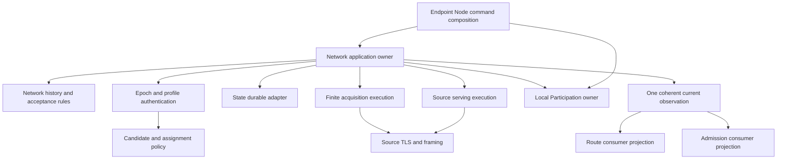

# Повторный анализ границ Network

Разбор для Product Owner от 5 октября 2026 года. Проверен текущий
`internal/successor/network` на `dev`, HEAD
`1098fefb1feec54f59ac38cbe921b1148dd89ba3`, его новые потребители и текущие
владельцы контрактов. Network на момент проверки не имел незакоммиченных
изменений; соседний Route и несколько документов менялись в рабочем дереве.
Это анализ и предложение внутреннего устройства, не изменение принятого
протокола, разрешений импорта или статуса исполнения.

**Вывод:** в Network уже есть настоящий доменный механизм принятия сетевых
фактов. Чужие Admission, Hosting и Service authority в нём не обнаружены.
Главная спорная ответственность внутри — отдельная installation-local история
участия, а не подписанная Network State. Главный найденный кандидат на
недостающую общую политику — совместимость действующих назначений по subrole
и известной family: старый Endpoint проверяет её, новое membership этого не
делает. Большинство остальных Network-проверок из старых Node/Endpoint/Route
уже выражены новой моделью; им требуется перенос потребителей, а не ещё одна
реализация правил. Подробная двусторонняя инвентаризация приведена ниже.
Сосуществование модели, application и технических адаптеров в одном контексте
само по себе не является нарушением границы домена.

## На что опирается анализ

Текущие владельцы требований: [scope](../product/scope.md),
[threat model](../security/threat-model.md),
[Network](../technical/successor-network-state.md),
[Network и Node](../technical/network-route-node.md),
[domain map](domain-map.md), [package map](package-map.md),
[agent execution](agent-execution.md) и
[Route migration contract](route-migration-contract.md).
Проверены исходники модели, принятия/восстановления/наблюдения State,
Source acquisition и serving, локальных ограничений, форматов и реальные
новые потребители. Инвентаризация файлов и поиски импортов охватывают
платформенные файлы и тесты; это не полный security audit всех реализаций.

[Предыдущий разбор](network-domain-boundary-analysis.md) относится к другому
исходнику. Его defect с отбрасыванием подписанного конфликта до reconciliation
уже исправлен: новый intake использует `Authenticate`, затем
`EpochHistory.Reconcile`. Его выводы и старые failing receipts нельзя выдавать
за сегодняшнее поведение. В Git история нового Network начинается с
`4d56c37a7`; следующая поправка `c3f568809` исправляет тестовый oracle backoff.

Прочитаны [issue 493](https://github.com/dianabuilds/ardents-network/issues/493)
и комментарии, включая
[уточнение границы принятия](https://github.com/dianabuilds/ardents-network/issues/493#issuecomment-5974888292),
[receipt коммита](https://github.com/dianabuilds/ardents-network/issues/493#issuecomment-5977818747)
и [cleanup](https://github.com/dianabuilds/ardents-network/issues/493#issuecomment-5978196727).
Широкие исходные требования issue и позднейшее ограничение нового Network
различаются: старые Node/Endpoint/Route consumers исключены из той границы
приёмки. Их отсутствие в новом пути не следует объявлять нарушением
скорректированного задания. Но оно ограничивает утверждение о полном переносе
сценариев. GitHub CLI вернул 401; чтение через подключённый GitHub удалось.
Tracker не изменялся.

## Что находится в каталоге

| Go package | Implementation files | Test files | Фактическая обязанность |
|---|---:|---:|---|
| `network` | 14 | 9 | Epoch/profile history, Candidate View, membership/time/observations, acquisition, local participation |
| `network/state` | 33 | 41 | Сериализация операций, восстановление, публикация, наблюдение, Source execution и shutdown |
| `network/epoch` | 21 | 9 | Подписанная грамматика, commitments/proofs, проекции и unsigned preparation |
| `network/closedprofile` | 5 | 4 | Подписанный профиль, роли, публичный token inventory и unsigned preparation |
| `network/source` | 6 | 8 | Source plan, trust/key separation, mTLS, framing, Fetch/Serve |
| `network/state/durable` | 8 | 7 | Физический State root и его файловые транзакции |
| `network/duty` | 16 | 11 | Отдельный installation-local root ограничений и его транзакции |

Всего 103 implementation files и 89 test files. Размеры не являются диагнозом.
Значение имеют владельцы состояния, причины изменения, Interface и реальные
потребители. Семь пакетов не означают семь доменов или aggregate roots.

## Какой вопрос должен решать Network

**Какие аутентифицированные сетевые факты эта локальная установка вправе
считать принятыми и использовать в данный момент?**

Идентичность контекста — pinned Network и его доверительная история.
Exclusive State root реализует локальное владение этой историей. Root path,
Source address, номер refresh и delivery milestone не являются сетевой
идентичностью. Не следует создавать новый universal identity или runtime
Control Plane, чтобы придать структуре вид DDD.

Network владеет следующими правилами:

- допустимость Candidate View, исключение всех участников коллизии,
  порядок отказов, family summaries и детерминированное назначение Role Domain;
- current/pending Epoch, exact successor, rollback floors и sticky conflict;
- допустимость нового intake относительно выбранного профиля и схемы, с
  отдельной интерпретацией аутентифицированных исторических predecessor bytes;
- единственный принятый профиль поколения и его конфликт;
- точная связь подписанных назначений с Node Records, неоднозначность ключей,
  сроки каждого member и retained assignment;
- Time Confidence и retained floor, необходимые для текущего использования;
- coherence наблюдения: Epoch, профиль, membership и время взяты из одного
  принятого состояния;
- конечная история получения State: consumed attempts, original deadline,
  exposure cap, exact selector и durable backoff.

Это supporting domain с существенными правилами безопасности. Он не обязан
иметь сущность «Network», mutable object graph или отдельный процесс.
Immutable aggregate values и pure proposals подходят этой задаче.

Network не владеет выбором пути/recipient для операции, Purpose/HELLO,
физическим каналом, Admission rights или debit, Hosting reservations,
Service Target/Descriptor/Publication/Connection, Local Grant/Job,
проверкой Release или private signing. Подписанная возможность выполнять
назначенную роль не означает, что локальный процесс уже имеет все права и
ресурсы для её исполнения.

## Что уже сделано правильно

[EpochHistory](../../internal/successor/network/epoch_history.go) рассматривает
все authenticated observations до выбора кандидата. Более высокий номер не
скрывает конфликт retained номера. Future genesis отличается от pending
successor. [ProfileHistory](../../internal/successor/network/profile_history.go)
не очищает конфликт повторной подачей старого или нового digest.

[Membership](../../internal/successor/network/membership.go) связывает
назначение с exact record digest/generation и Epoch-assigned Role Domain.
Истёкшие members остаются в inventory, поэтому фильтрация по времени не
превращает неоднозначный ключ в однозначный.
[AcceptedState](../../internal/successor/network/accepted_state.go) и
[RetainedDuty](../../internal/successor/network/retained_duty.go) обеспечивают
coherent copied observations и запрещают незаметное переназначение retained
duty на successor. [TrustedTime](../../internal/successor/network/time_confidence.go)
не опускается ниже retained floor.

В [CurrentRuntime](../../internal/successor/network/state/runtime_observation.go)
публичное наблюдение строится под одним read lock; время проверяется после
durable profile read. Receipt и diagnostic Snapshot не заменяют это наблюдение.
В [closed-profile conflict commit](../../internal/successor/network/state/closed_profile_accept.go)
и [control commit](../../internal/successor/network/state/control_state.go)
невозможность надёжно сохранить обнаруженный конфликт прекращает live owner.
Это доменное поведение и существенное улучшение относительно простого source move.

Корневая модель использует standard library и не вызывает State, Route,
Admission или Hosting. Новый application owner не скрывает old backend.
Эти свойства следует сохранить, а не переписать только ради других имён.

## Где модель и границы ещё не завершены

### Решения о State распределены между моделью и application owner

`EpochHistory` представляет current/pending/conflict, но не полный retained
State transition. Epoch/time floors и Source history находятся в
[distributionState](../../internal/successor/network/state/control_state.go).
Pending promotion/cleanup реализованы в
[pending.go](../../internal/successor/network/state/pending.go) и
[source_wave.go](../../internal/successor/network/state/source_wave.go).
Выбор live схемы расположен в
[epoch_intake.go](../../internal/successor/network/state/epoch_intake.go).
Проверки unavailable/closed/conflict/current profile распределены между
observation, intake, refresh и Source serving.

Application вправе владеть locks, authentication calls, journal writes,
retirement и публикацией. Но решение, что именно разрешено принять и какие
retained факты должны измениться вместе, не должно выводиться из порядка
присваивания полей `distributionState` в нескольких application methods.
Сейчас pure model не исчерпывает доменную политику. Это подтверждённый
архитектурный пробел, не доказательство неверной текущей транзакции.

Рекомендация: восстановить доменные transition proposals для offline intake,
wave completion и recovery relation. Вход — verified facts и retained semantic
history; выход — retain/activate/stage/refuse/conflict с изменениями истории.
Эффекты и uncertainty retirement остаются application. Не нужен гигантский
публичный DTO всех внутренних полей и не нужны три независимо принимающих
State владельца.

### Отдельная локальная власть помещена внутрь Network

[LocalParticipation](../../internal/successor/network/local_participation.go)
решает другой вопрос: **совместимы ли известные роли и exposures на этой
установке с новым локальным участием?** Его identity — installation root и
producer, а не Epoch. Его lifetime — live/time-held guard, в том числе за
пределами timestamp. Его факты задают Source и Node producers.
[Duty](../../internal/successor/network/duty/contract.go) имеет собственные
root lease, generations, watermark и recovery.

Текущий технический owner явно разрешает этим правилам находиться в Network
context при отдельной consistency boundary. Поэтому это не нарушение
существующего разрешённого импорта. Однако на практике корневой package
публикует сразу accepted-state authority и installation restrictions; их
разные principals и lifetimes слабо видны в tree и Interface.

Рекомендация: обозначить Local Participation самостоятельным supporting
owner, который может только ограничивать локальное исполнение. Он не меняет
подписанное membership и не даёт право на Route или Admission. Для начала
достаточно явного semantic/application Interface и исключений. Отдельный Go
package появится только с реальными producers/consumers, поведением и точной
регистрацией. Не переносить это в Route: ограничения совместного размещения
и Direct Source exposure шире одной Route operation. Не переносить в Hosting:
физическая ёмкость не определяет privacy compatibility.

### Часть policy продолжает жить в format и transport adapters

| Место | Найденное правило | Предлагаемый владелец |
|---|---|---|
| `state/local_roles.go:sourceCollides`, `epochDecisionCollides` | Source identity/key/family/endpoint не совмещается с Candidate View | Чистая Network/participation policy; application собирает проверенные факты и выполняет отказ |
| `source/credentials.go:configureClients` | Ровно два distinct Sources; separation от Epoch authority и client keys | Политика finite acquisition/trust separation; X.509, адреса и certificate copies остаются adapter |
| `closedprofile/profile.go:validDuty`, `decodeNodes` | Допустимые Role Domain/subrole и единственный selected issuer | Семантика подписанного profile inventory в Network; canonical decoding остаётся format owner |
| `epoch/chain.go:verifyEpochChain` | Genesis/exact successor и retained chain bound | History admissibility и recovery policy с одним явным владельцем; adapter обходит и проверяет bytes |

Это не команда механически переместить каждую проверку. Byte length,
canonical ordering, signature verification и форматный bounds check остаются
в адаптерах. Проблема появляется, когда semantic rule считается собственностью
адаптера и становится вторым источником решения. Например, recovery chain и
live reconciliation имеют разные допустимые операции: общей должна быть
семантика genesis/successor, а не одинаковая accepting функция для обоих путей.

`validDuty` уже разделяется verifier и unsigned preparer внутри одного
форматного package; дублирования там не обнаружено. Это незавершённость
semantic ownership, а не подтверждённый drift или принимающая уязвимость.

### State связывает authority с execution нескольких Source lifetimes

[networkState](../../internal/successor/network/state/runtime_state.go)
содержит accepted decisions вместе с `activeSource`, `servingPredecessors`,
server/automatic completion, refresh work и terminal errors. В
[active_publication.go](../../internal/successor/network/state/active_publication.go)
публикация successor координируется с другим root, а handler counters
определяют сохранение predecessor guards.

Эта связь не случайная: принятый контракт требует guard до contact/publication
и retention до joined dependent work. Нельзя убрать её посредством async event
или независимого «Source microservice». Но accepted facts, contact execution
и serving execution имеют разные resources и причины изменения. Их следует
выразить как внутренние Modules под одним application coordinator: они
возвращают конкретный held lifetime/terminal result, а не меняют общие поля
State произвольными callbacks.

Первое изменение не должно менять refusal semantics. В частности, текущий
owner отказывает при terminal automatic-refresh failure даже до Epoch expiry.
Отделение execution не разрешает продолжать принимать работу только потому,
что подписанный срок ещё не истёк. Такое изменение было бы отдельной policy
revision, а не рефакторингом.

### Публичная проекция слишком тесно привязана к одному composite profile

[ProfileFacts](../../internal/successor/network/profile_facts.go) переносит
публичные token cohorts, class и fixed SPKI width. Это обусловлено принятым
ARDCPR03 и само по себе не делает Network владельцем Admission.
[token_spki.go](../../internal/successor/network/closedprofile/token_spki.go)
правильно делегирует RSA grammar Admission leaf. Частные ключи, quota, stock
и spend в Network не обнаружены.

Тем не менее общий `RuntimeView` заставляет Route знать профиль, содержащий
Admission inventory. Предпочтительны consumer projections из одного coherent
observation: membership/profile identity для Route и public issuance inventory
для Admission composition. Они не должны порождать два independently observed
states. Не требуется новая abstraction или универсальный public-key interface
ради удаления числа 346; fixed width является нынешней форматной обязанностью.

### Pure values не являются аутентификационными capabilities

Публичные constructors принимают supplied facts. `AcceptedState` связывает
их, но не проверяет подписи или durable commit. `RuntimeView.Check` проверяет
границы сохранённого наблюдения, но не узнаёт о следующем конфликте или
successor. Членство из `Members()` также не является live lease.

Это оговорено в текущем контракте; воспроизведённая принимающая уязвимость
здесь не установлена. Реальная authority начинается у opened State owner.
Consumer должен брать новое наблюдение перед/после своих effects. Приватные
поля и zero-value refusal полезны, но не могут заменить этот trust seam.
Лучшее обозначение для внутреннего accepted value — committed interpretation;
реальная текущая authority требует нового обращения к application owner.

## Реальные потребители и недостающие сценарии

| Путь | Что реально подключено | Чего этот путь не доказывает |
|---|---|---|
| `cmd/ardents-next/network.go` | Offline Epoch intake, profile acceptance, current profile inspection через opened new State | Source contact/serve или background refresh |
| `cmd/ardents-next/network_authority.go` | Lossless перевод одного observation в Admission facts, live issuer/receiver/presentation/intent checks | Node startup, локальные participation restrictions или installed Endpoint |
| `route/selection` | Membership, retained duties, Entry/Interior/Rendezvous/recipient selection | Приём State, роль Source или authority над Local Participation |
| `route/role` и `route/operation` | Fresh reobservation, exact retained-duty/profile matching, Purpose/peer/channel checks у их владельцев | Принятие successor и восстановление State floors |

Существенный факт: все production constructions нового State найдены через
[networkStateConfig](../../cmd/ardents-next/network_authority.go).
Он задаёт pins, root и clock file, но не Source plan, local-role root или
automatic refresh. Поэтому `Fetch`, `Serve` и configured automatic refresh
нового Network не имеют подключённого executable command scenario.
Внутренний production код для них существует и вызывается State, но соответствующая
конфигурация сейчас до него не доходит из новых команд.

`duty.RetainNode`, `duty.ReadConflict`, `closedprofile.Prepare` и entry point
`epoch.PrepareInitialClosedEpoch` в новом дереве также не имеют найденного
реального вызывающего потребителя. `PrepareInitialClosedRecord` вызывается
новым preparer, чей entry point пока не подключён. Старые Node/Control
commands импортируют `internal/network/...`, а не эти новые implementations.
Это явно сохранённые будущие ports по текущему owner, не завершённые
новые use cases. Тестовая достижимость не меняет этого вывода.

Обратная инвентаризация также важна. Purpose rules в Route, own-node exclusions
в selection и signer/receiver comparisons в Admission composition не должны
автоматически переехать в Network только потому, что используют Network IDs.
Network доказывает факт assignment; сосед определяет пригодность этого факта
для конкретной операции. Новая Local Participation интеграция должна добавить
свои ограничения через explicit composition, а не заменить path exclusions.

## Предлагаемое устройство



Это схема semantic ownership, не разрешённые новые Go imports. Candidate,
history, profile и acquisition policies могут остаться в одном pure package.
Authentication и durable механизмы могут остаться нынешними пакетами.
Local Participation имеет отдельную consistency boundary. Acquisition history
остаётся внутри ordered State commit: разрывать её с Epoch/time floors нельзя.
Contact/serving execution — внутренние application Modules; им не нужны
independent accepting authority или новые хранилища.

Особенно важно различать три вещи: **подписанный факт**, **его принятие в
retained history**, **право consumer выполнять свою операцию сейчас**.
Network завершает вторую и снабжает третью coherent facts. Он не выдаёт
универсальное разрешение на исполнение.

## Двусторонняя инвентаризация ответственности

Дополнение по уточнённому заданию Product Owner: что убрать из ответственности
Network и что найти у старых maintained `internal` owners. Удалённая ветка
`old` не использовалась. Ниже различаются отсутствие правила, уже имеющаяся
модель без перенесённого потребителя и спорная граница. Старое поведение не
становится требованием только потому, что существует в исходниках.

### Что внутри нового Network требует иной границы

| Ответственность и исходник | Оценка | Предлагаемое действие |
|---|---|---|
| Installation-local restrictions, producer replacement и live guards: [local_participation.go](../../internal/successor/network/local_participation.go), [node_participation.go](../../internal/successor/network/node_participation.go), [duty](../../internal/successor/network/duty/doc.go) | Отдельная история локального участия, а не глобальная подписанная membership. Это главный кандидат на отдельного supporting owner; текущее размещение разрешено действующими owners, поэтому это предложение, а не доказанное нарушение imports | Разделить подписанный duty и локальную возможность совмещения. Сохранить producer identity, retained floors и release после join; не передать историю целиком Route или Hosting |
| Source/Node/family separation в [state/local_roles.go](../../internal/successor/network/state/local_roles.go), role/subrole correspondence в [closedprofile/profile.go](../../internal/successor/network/closedprofile/profile.go) | Network-семантика расположена в application/codec. Это недостаток внутреннего владельца правил, не чужой домен внутри Network | Выделять semantic verdict из проверенных facts; adapter оставляет canonical bytes и effects |
| Source Fetch/Serve, mTLS, durable storage, автоматическое обновление | Законные механизмы Network intake/distribution. Сам факт socket, файла или goroutine не делает их чужими Network | Не выносить ради чистоты дерева. Разделить policy и effects, сохранив ordered commit/recovery и termination |
| Публичные issuer/token keys и admission configuration в signed profile | Network удостоверяет состав подписанного профиля; Admission интерпретирует права, проверяет и тратит их. Приватного issuer/quota/spend owner здесь нет | Не переносить Admission обратно и не объявлять публичный inventory токенным доменом. Проверить узкий shared canonical SPKI контракт при изменении формата |
| Unsigned Node/Epoch/profile preparation | Подготовка Network grammar, не право подписания или публикации | Реальный provisioning consumer нужен в собственной композиции. Private signing/Custody не добавлять в Network |

Process-wide resource monitor, Route Purpose/path choice, Service Target,
Descriptor/Connection history, Local Grant/Job authority, физические Hosting
reservations и Admission debit должны оставаться вне Network. В новом дереве
их реализации не найдены. Старые `NodeDuty`, `ClosedRouteView` и ресурсный
governor нового общего владельца тоже не требуют: их отсутствие намеренное.

### Что найдено у старых owners и что уже есть в новом Network

| Старое место | Network-ответственность | Новое соответствие / результат |
|---|---|---|
| [node/authority/receiver.go](../../internal/node/authority/receiver.go), [peer.go](../../internal/node/authority/peer.go), [endpoint/source_state.go](../../internal/endpoint/source_state.go), [route/client/closed_bootstrap_plan.go](../../internal/route/client/closed_bootstrap_plan.go) | Согласовать Epoch, profile, generation, точный Node Record, assignment и сроки; однозначно найти участника по key | Уже есть `BindAcceptedState`, `BindMembership`, `RuntimeView.Member/MemberByKey`. Перенести consumers на одну observation; не добавлять повторную сборку двух снимков |
| [node/forwarding/recipient.go](../../internal/node/forwarding/recipient.go), [node/issuer/listener.go](../../internal/node/issuer/listener.go), [node/resolution/operation.go](../../internal/node/resolution/operation.go) | Проверить, что retained duty и текущие public facts относятся к той же authority | `RetainDuty`/`MatchDuty`, membership и Profile facts уже существуют. OPEN Purpose, issuer listener, Descriptor proof и TLS recipient принадлежат своим consumers |
| [node/local_roles.go](../../internal/node/local_roles.go) и старый [network/state/local_roles.go](../../internal/network/state/local_roles.go) | Вывести ограничения локального Node/Source участия из действующего duty | `NodeParticipationFacts.Restriction` и новый `duty` уже представляют правило. Не хватает нового Node consumer, а не вычисления. Start/drain/join решает владелец физического участия |
| [endpoint/source_separation.go](../../internal/endpoint/source_separation.go): `roleSeparated` | Исключить member, если другой live assignment иной Role Domain/subrole совпадает по Node/key/known family | Общего соответствия в новом Network не найдено. Это конкретный кандидат на недостающую policy с нерешённой границей Network/Route; разбор ниже |
| [endpoint/issuance.go](../../internal/endpoint/issuance.go), [permission.go](../../internal/endpoint/permission.go), [service_binding.go](../../internal/endpoint/service_binding.go) | Использовать те же текущие profile/member facts | Поставщик facts уже есть. Challenges, finite stock, exact Job permission и Service binding переносить в Network нельзя |
| [alphacontrol/inspection/inspect.go](../../internal/alphacontrol/inspection/inspect.go): `verifyNetwork` | Проверить публичное Network evidence через реального State verifier | Consumer verification/diagnostics, не ещё один принимающий Network aggregate. Disclosure catalog и Release compatibility остаются supporting composition |

### Конкретный пробел: cross-subrole known-family eligibility

[Protected Route owner](../technical/protected-route-protocol.md) требует
разделения subroles в течение assignment lifetime, применения known-family
exclusions и expiry/drain старых назначений при смене роли. Старый Endpoint
применяет `roleSeparated` ко всем действующим assignments перед выбором и
повторно при проверке retained selection. Это правило шире сравнения двух
уже выбранных соседей пути.

Новый `closedprofile.decodeNodes` исключает повторение NodeID и проверяет
допустимую пару Role Domain/subrole. `EvaluateCandidates` исключает коллизии
Node/key/endpoint, но общая family разрешена. Family assignment назначает
Role Domain, а не subrole. `BindMembership` связывает точные records и domain;
`Member` проверяет liveness, но не сравнивает member с иными subroles.
Следовательно, два разных Node одной family в одном Role Domain, один с
adjacent subrole, другой с interior subrole, не исключаются этими проверками.
Старый `roleSeparated` исключил бы такого кандидата, пока оба назначения live.

В текущем новом [route/selection/entry_set.go](../../internal/successor/route/selection/entry_set.go)
`selectionCandidates` фильтрует subrole, Purpose, currentness и переданные
known peers. Проверки против всех остальных live assignments там нет.
Это установлено по чтению исходников; реальный подписанный end-to-end negative
scenario в этом анализе не запускался. Route меняется параллельно; вывод
относится к прочитанному рабочему исходнику, а не к будущему финальному commit.

**Предложение границы:** Network вычисляет совместимость public assignments
в пределах одной coherent observation, включая reasons и сроки. Route
выбирает нужный Purpose и применяет compatibility verdict вместе с частными
исключениями своего пути. Локальное участие отдельно проверяет installation
restrictions. Не изменять молча acceptance всего profile: старое правило
отказывает eligibility кандидату, а не обязательно отвергает весь подписанный
inventory. Не создавать универсальное `Allowed` для всех consumer operations.

Текущие owners не фиксируют такой новый Network interface; это конкретное
предложение semantic ownership, а не принятое изменение протокола. Допустим
и вариант общего Route eligibility owner, если требование относится только
к защищённому Route. В обоих вариантах нужен один явный владелец проверки
всех live assignments; pairwise private path exclusions её не заменяют.
Отдельно необходимо сохранить predecessor duty retention до expiry/join:
проверка одной новой profile не доказывает завершение старого физического duty.

### Приоритет по уточнённому заданию

1. Закрепить владельца cross-subrole family eligibility и сделать независимый
   signed negative scenario: same-family Nodes, разные subroles, оба live;
   затем expiry одного assignment и сохранение original retained selection.
2. Обозначить отдельную consistency boundary Local Participation, сохранив
   ограничения producers и физический порядок join/release.
3. Завершать миграции соседних consumers с `RuntimeView`/`MatchDuty`, убирая
   реконструкцию Network authority из Endpoint/Node/Route. Большая часть
   найденных старых checks уже реализована новой моделью.
4. Упорядочивать semantic policy внутри Network application/codec только
   по конкретным правилам, а не переносить инфраструктуру по признаку файлов
   или сетевого I/O. Следующий раздел описывает такой внутренний рефакторинг,
   но сам по себе он не закрывает найденный eligibility пробел.

## Уточнение совместимости в среде новых доменов

Product Owner уточнил направление: взаимодействия проектируются только между
новыми владельцами `internal/successor`; отсутствие будущей реализации не
разрешает зависимость от legacy. Это ограничение проектирования и интеграции.
Следующие semantic правила — уточнённое предложение, не заявление, что они
уже реализованы или что изменены accepted wire/root contracts.

### Два разных смысла совместимости

Программные контексты Network, Admission, Hosting и Route сотрудничают в одной
операции. Они не являются числовыми Network Role Domains и не образуют матрицу
взаимоисключения по именам Go-пакетов. Ограничения Node/key/family относятся
к назначениям и сохраняемому локальному участию, не к существованию доменов.

| Новый владелец | Предоставляет / решает | Предел основания |
|---|---|---|
| Network | Одну current authenticated observation; exact membership; предлагаемую совместимость public duty assignments | Не выдаёт разрешение на Purpose, token spend, физическую работу или Service operation |
| Route | Purpose, выбор/retention участников, known-peer exclusions и ролевой transport lifecycle | Использует fresh Network verdict; не реконструирует State authority и не решает Admission/Hosting policy |
| Admission | Получение, предъявление, verification и необратимый spend конечных прав | Наличие права не доказывает current membership, допустимость пути или физическую ёмкость |
| Hosting | Physical allowance и reservation с exact release | Reservation не подтверждает duty, token или Job authority |
| Local Participation, отдельный предложенный supporting owner | Совмещение локальных producers и retained restrictions; durable acquisition/release | Не принимает глобальную State, не выбирает путь; release требует подтверждённого завершения удерживающего владельца |
| Execution, Publication, Reachability, Connection | Их собственные Job/publication/proof/logical-stream transitions при появлении реализации | Не получают общую authority от Network; потребляют только необходимые факты через свои конкретные use cases |
| Enrollment, Release, Installation, Custody | Purpose-specific pinning, software acceptance, installation и signing/storage | Не становятся runtime membership или универсальным разрешением на исполнение |

README-only будущие владельцы существуют в новом дереве; Local Participation
ещё не имеет отдельного каталога. Этот разбор не создаёт новый Go package,
пустые interfaces, заглушки или разрешения imports. Зависимая операция без
реального нового owner остаётся недоступной. Запрещены legacy fallback,
callback bridge, shared live root и supplied-success boolean вместо owner.
Исторические wire/persisted identities остаются существующими compatibility
обязательствами: изоляция исполнения не разрешает стирать их floors.

### Предлагаемые правила public duty compatibility

1. Вход — только bound assignments из одной аутентифицированной Network
   observation и её trusted time. Непроверенный Node Record, caller timestamp,
   имя домена или caller-declared `fresh` не являются основанием.
2. Проверка действительности assignment включает Epoch/profile/record и
   assignment intervals. В момент `NotAfter` право новых effects заканчивается.
   Исторические records сохраняются для binding, ambiguity и floors, но
   истёкший assignment не считается ещё одним current duty.
3. Exact identity связывает Network, Epoch/generation, profile, Node,
   record digest, duty generation и Role Domain/subrole. Совпадение одного
   NodeID или ключа не разрешает rebound к новому назначению. Неоднозначный
   membership отказывает до consumer filtering.
4. Различные одновременно current Role Domain/subrole несовместимы, если
   совпадают Node identity, transport key или known family. В пределах одного
   Role Domain разные subroles также проверяются. Новая key/generation не
   устраняет известную family связь.
5. Общая family у разных Nodes с одинаковыми Role Domain/subrole сама по себе
   не является глобальным запретом membership. Route отдельно исключает такую
   пару там, где его конкретный путь требует различных families. Это сохраняет
   различие global assignment compatibility и private path compatibility.
6. Несовместимость сообщает eligibility конкретного assignment и причину;
   автоматически отвергать весь signed profile или изменять его digest/interval
   не предлагается. Недостаточные facts не превращаются в положительный verdict.
7. Verdict действует в пределах observation, не является lease. Route и другие
   effects owners получают fresh observation в уже принадлежащих им точках
   admission/recheck. Смена State не продлевает original deadline и не разрешает
   resampling retained selection, возврат spend или ранний release reservation.

Видимые публичные назначения и локальная физическая работа — разные входы.
Network может установить expiry публичного assignment, но не подтвердить
завершение remote handler. Local Participation сохраняет относящийся к прежнему
локальному duty guard до истечения обязательного ограничения и joined physical
work, где эти основания требуются контрактом. Clock expiry не заменяет join;
join сам по себе не стирает retained exposure floor. Смена публичного assignment
не предоставляет producer право очистить restriction другого producer.

### Проверочные примеры и предел следующего изменения

| Сценарий | Предлагаемый результат / владелец |
|---|---|
| Два live Node одной family: Initiator adjacent и Initiator interior | Public duty incompatibility; Network verdict, Route исключает кандидатов |
| Два live Node одной family: оба Initiator adjacent | Network compatibility не запрещает оба; Route отказывает паре, требующей разных families |
| Предыдущее назначение expired; его локальный handler ещё работает | Public eligibility оценивает current State; Local Participation запрещает конфликтующий локальный start до join и сохраняемых ограничений |
| Network current и Route подходит, но token отсутствует | Отказ Admission; Network не компенсирует отсутствие права |
| Token принят, но Hosting capacity отсутствует | Отказ до необратимого spend в порядке owning operation; после уже совершённого spend возврата права нет |
| Future Publication/Connection owner ещё не реализован | Соответствующая операция недоступна; старый Service/Endpoint не подставляется |

Следующий bounded дизайн проверяет public compatibility на genuine signed
Network input и exact retained observations. Для локального старта отдельно
нужен реальный новый producer, guard до эффектов и join/release oracle.
Не расширять это в универсальный coordinator всей системы. Числовые subroles,
форматы, quota и recovery не меняются этим предложением. До реализации
закрепить правило в Network/Route owners, а Local Participation boundary — в
domain/package map вместе с реальным consumer; execution ledger остаётся GitHub.

## Возможный первый внутренний рефакторинг Network

Первый bounded результат — **единый semantic владелец переходов принятой
Network State**. До перемещения файлов составить и реализовать relation
retained history → transition proposal для offline intake, Source completion
и recovery. Перенести туда оставшуюся eligibility/transition policy, сохранив
точный journal, byte identities и порядок физических effects в application.
Это улучшает существующий принимающий путь и не зависит от готовности
будущих Node или Control consumers.

Наблюдаемая граница первого изменения: одинаковые verified facts и retained
history дают одинаковый verdict независимо от пути получения. Это включает
current/pending conflict перед winner selection, future genesis, exact pending
promotion, retirement при неперсистируемом конфликте, retained floors и
completion-time expiry. Внешний Interface consumers не должен требовать
самостоятельно собирать эти правила.

Затем явным отдельным изменением обозначить Local Participation owner,
отделить его semantic facts от canonical journal classes и сохранить
producer ownership/live guard retention. Реальные Source и Node producers
подключаются в их разрешённых миграционных сценариях. Domain map и package
map обновляются с реализованным переносом, не заранее объявляют его состоявшимся.

После этого разделить contact/serving execution внутри application, сохранив
один ordered coordinator, и подключать missing real scenarios. Unsigned
preparation получает Control composition consumer; это не основание помещать
private signing в Network. Consumer projections уточнять по фактической
необходимости, не создавать обязательную новую package иерархию для диаграммы.

Не следует начинать с переименования `network`, создания шести aggregate roots,
generic repository/event bus, переноса `duty` в Route или переписывания TLS и
fsync механизмов. Такие действия сами по себе не устраняют найденные причины
смешения и могут нарушить сохранённые safety ordering.

## Критерии проверки изменения

| Инвариант | Проверка на реальном Interface |
|---|---|
| Одно принятие State | Signed intake и Source results в обоих порядках; same-number conflict не скрывается successor; wrong Network/signature не создаёт conflict |
| Одна coherent authority | Concurrent publication/profile conflict; copied observations; expired member не оживает через старое caller time; retained duty не rebind на successor |
| Разные локальная и глобальная власти | Local conflict отказывает placement, не меняя signed membership; другой producer не удаляет live Source; identity-only/family-only collisions и bounded caps |
| Ordered commit | Guard → immutable bytes → control floor → published decision/pointer; pre-pointer отказ, sync uncertainty, повторное открытие и retained failure |
| Finite acquisition | Commit consumed selector/exposure перед contact, exact object/index, original deadline/backoff после crash, terminal recording и join до guard release |
| Source lifecycle | Реальный blocked handler и blocked contact, A→B→C predecessor retention, cancellation, concurrent Close, release только после join |
| Соседние authority | Genuine Network плюс Admission/Hosting/Route; pre-effect refusal, необратимый spend и retained reservation до physical join; без fake успешного соседа |
| Реальная композиция | Исполняемый new-domain scenario с configured Source и Node participation; preparer с реальным Control caller; тестовый caller не считается delivery |

При реализации действуют обычные quick/full gates и требуемые profiles.
Ранее принятые narrower receipts остаются историческими результатами своих
исходников. Они не доказывают готовность этого нового предложенного устройства.

## Выполненная проверка и пределы результата

Независимо запущено на Windows amd64, Go 1.27.1:

```text
go test ./internal/successor/network/... -count=1
```

Все семь пакетов прошли; State — 39.219s. Это Windows Network package behavior,
не Linux/race, полный repository gate или installed/privacy qualification.

Дополнительно выполнен текущий structural check:

```text
go test ./internal/architecture -run '^(TestNetworkIntegrationImportIsolation|TestSuccessor.*|TestRouteMigrationImportIsolation|TestRouteMigrationIsolationPolicy)$' -count=1
```

Он завершился с failure в `TestSuccessorImportIsolation` и
`TestNetworkIntegrationImportIsolation`: рабочие
`route/operation/prefix.go` и `receiver_linux.go` импортируют
`route/transport/quic`, который отсутствует в разрешениях этого owner.
Эти соседние исходники и architecture policy уже менялись до анализа.
Отказ относится к текущей Route import registration; он не устанавливает
Network defect и не должен исчезать за утверждением «все gates зелёные».
Проверка не была ослаблена, чужой Route не исправлялся.

Runtime code, старые документы, domain map, package map, index и branch не
менялись. Добавлен только этот разбор. Предлагаемые границы требуют реализации
и проверенных consumer scenarios; никакая самостоятельная security validation
или full domain acceptance этим анализом не заявляется.
