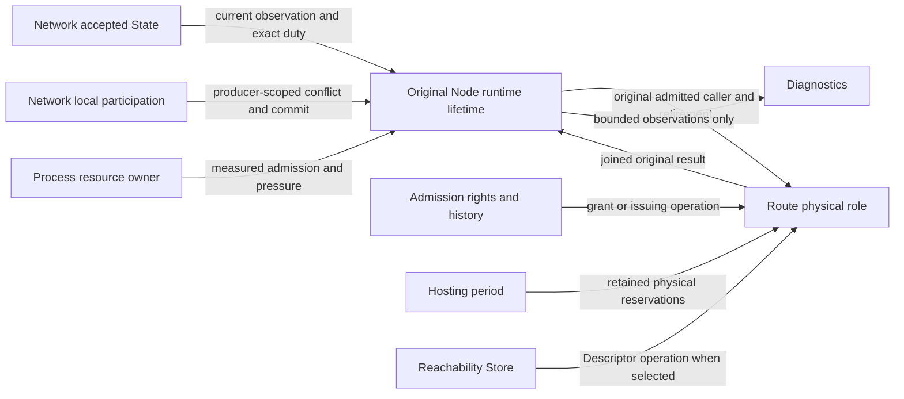

# Domain ownership map

The nearest closed release selects TCP/TLS alone under
[ADR-0122](../adr/0122-select-tcp-only-closed-release.md). Descriptions below of
realized dual-Carrier components retain historical source scope; current product
execution and positive qualification require TCP/TLS plus explicit deferred-QUIC
refusal, not successful QUIC use. The unresolved QUIC dependency finding remains
with its owner and future selection. This changes no domain authority or old/new
isolation boundary; actual implementation and evidence must establish exclusion.

This is the maintained semantic map for the DDD transition. The Product Owner
assigned its upkeep to the orchestrator on 2026-10-04. It records responsibilities,
exclusions, interaction mechanisms and realized architectural results. It does not
select work, accept a protocol change or replace the GitHub execution ledger.

Accepted ADRs and current product/security/technical owners remain authoritative.
[CONTEXT.md](../../CONTEXT.md) owns product language;
[package-map.md](package-map.md) owns the Go package inventory and permitted
imports. It includes domain implementation, shared mechanisms, platform
adapters, composition and engineering checks. This map describes those
supporting responsibilities where they affect domain ownership or collaboration.
Earlier strategic proposals and source receipts are retained in Git history,
recoverable via the [pinned archive index](https://github.com/dianabuilds/ardents-network/blob/c58268d72f1eaeae173144e76d32d50986de2a77/docs/archive/README.md).
This map records current ownership; proposed future boundaries remain proposals.

## Reading and planning route

Use this document to prepare a domain change:

1. Find the domain's question, rules and exclusions in
   [Domains and boundaries](#domains-and-boundaries).
2. Identify its state, physical borrowers and terminal owner in the
   [completion inventory](#consistency-resources-and-completion-inventory).
3. Select the permitted interaction from the
   [inter-domain contract](#inter-domain-interaction-contract) and
   [collaboration matrix](#collaborations-to-review).
4. Describe each affected operation using the
   [interface checklist](#interface-checklist-for-development-plans), then
   check its actual source and current technical owner.
5. Verify task selection and acceptance in GitHub before implementation.

| Planning question | One current owner |
|---|---|
| Product outcomes, non-goals and threat conditions | [Scope](../product/scope.md), [threat model](../security/threat-model.md) and their linked contracts |
| Domain boundaries, responsibility and inter-domain interaction | This map; the affected technical owner supplies exact rules and formats |
| Actual package/import direction and dependency admission | [Package map](package-map.md), [dependency register](dependencies.md) |
| Component prerequisites and whole-journey coverage | [Privacy integration map](privacy-anonymity-map.md), [Route integration](route-delivery-join-boundary.md) |
| Work selection, domain order, transition conditions and full issue acceptance | [GitHub #497](https://github.com/dianabuilds/ardents-network/issues/497), its selected child issues and the C0 milestone |
| Execution, handoff and verification method | [Agent execution](agent-execution.md), [testing](testing.md), [privacy qualification](privacy-qualification.md) |

An interaction described here is a contract to preserve, not evidence that its
complete consumer is implemented. The [realized boundaries](#realized-boundaries-and-their-limits)
record integrated component behavior and limits. A draft, prepared interface or
successful narrower test cannot upgrade that result or select the next domain.

## How to preserve the map

Read this map before delegating a domain slice and after every orchestration
compaction/handoff. Compare it with the actual source and current owners before
updating it. A source path, successful import or directory rename cannot prove
that a responsibility moved to the correct domain.

Keep every identified domain in the inventory, including domains not yet
implemented. Do not delete a responsibility when its old source is removed.
Give each maintained rule one semantic owner and name its actual consumer and
evidence. If ownership changes, update both the receiving owner and the former
owner's exclusions, their collaboration, package registry and affected oracles
in the owning change. A shared technical mechanism does not merge authorities,
databases, principals or lifecycle owners.

Newly found responsibilities must be classified: existing domain rule,
application composition, technical adapter, or a proposed new boundary. Do not
silently put them in a generic shared package or invent a domain to hold a test.
Escalate consequential unresolved ownership with exact evidence and a concrete
proposal, while continuing unaffected authorized work.

The entries below describe DDD contexts and supporting owners. Network's numeric
Role Domains are a different protocol concept. Temporary `successor` paths,
delivery labels and issue numbers are not product domain identities.

## Domains and boundaries

This inventory describes ten semantic families, not ten packages, processes,
databases or global aggregates. Each family may contain several consistency
owners at different principals. In particular, Software acceptance groups
Enrollment and Release verification; platform delivery and transitional
installation/replacement do not form another product domain or shared authority. Local Application execution
is the execution boundary, not all Application functionality. Future boundaries
remain proposed until their current contracts and real consumers are verified.

| Domain / question | Owned rules and distinct consistency owners | Explicitly outside | Current new owner or future source map |
|---|---|---|---|
| **Network:** which authenticated facts may be used now? | Candidate eligibility/assignment, Epoch/profile history and conflicts, bound membership, trusted time/floors, coherent accepted observations and same-observation retained duty; local participation is a separate lifetime | Route purpose/path choice, tokens/spend, physical Hosting budget, process-wide resource monitor, private profile signing, Job/Service authority | [new Network](../technical/successor-network-state.md), `internal/domain/network`; State application and authentication/Source/durable/duty adapters have separate responsibilities |
| **Admission:** which finite rights can be obtained and spent? | Allocation; issuance quota; private material and retained results; holder permission/pending batch/stock; presentation history; receiving verification, allowance and durable spend are separate owners; opaque one-use fresh receiving-root creation fact belongs to storage lifecycle | Network authenticity, transport scheduling, Introduction slots and their independent history, provider budget, Local Grants, Custody keys and file delivery; a creation fact grants no token or transport authority | [new Admission boundary](../technical/successor-admission-boundary.md), [implemented owner map](../../internal/domain/admission/README.md) |
| **Hosting:** which physical allowance can this owner reserve? | One provider-period Tx/Rx accounting policy, coherent measurements, durable budget, work/termination reservations and their exact release | Token authority/debit, Node assignment, role envelope calculation, transport stop/join, CPU/RAM/cgroups or global process monitor | [new Hosting](../technical/successor-hosting-budget.md), `internal/domain/hosting` |
| **Route:** which protected leg and role channel may this operation use? | Entry/Interior selection and retention; role-purpose rules; prefix/lanes and credit; forwarding parents/children and permitted parent refill transport; receiving Introduction slots/delivery/floors; JOIN pairing and physical termination | State acceptance, Admission quotas/verification/spend, Hosting budget, publication readiness, Descriptor authority/history, Instance authentication and logical recovery | [Route protocol](../technical/protected-route-protocol.md), [migration contract](route-migration-contract.md), [implemented retained prefix](../technical/successor-route-prefix.md), [registration owner](../technical/successor-route-introduction.md) and [JOIN owner](../technical/successor-route-join.md); `internal/domain/route`, `selection`, `ardp`, `channel`, `role`, `issuer`, `prefix`, `join`, `join/pairing`, `receiver`, `transport/tls` and `introduction` with real `ardents-next` consumers. `join/pairing` owns the receiving JOIN Rendezvous matching/relay/retirement that Receiver consumes directly; the holder JOIN aggregate stays in `join`. Lower `transport` owns no operation or adapter selection; former `carrier` and `operation` are removed. Genuine forwarding-parent refill and issuer Control use real Admission/Hosting owners. Descriptor Control composes separately owned Reachability Store/history. Opaque delivery composes the genuine Publication recipient and Connection/Execution consumers under the [integration contract](route-delivery-join-boundary.md). Five original Node compositions consume receiving roles. Deferred QUIC is refused before Route effects; its unresolved dependency finding blocks future QUIC admission; operator cutover, old-runtime retirement and qualification retain separate boundaries |
| **Local Application execution:** may this process invocation perform this operation? | Volatile Local Grant generation; local session with exact current/last Job and one-use handoff; separate supervisor cleanup capacity and terminal admission latch; qualified launch and joined original worker descendants. Job is a lifetime entity within the session consistency boundary, not an independent network Context | Token allowance, Service authority, Target/path choice, private routing history, remote publication, Connection recovery, software acceptance, global resource pressure, Application data interpretation and qualification Run | [Execution contract](../technical/application-execution.md); [confinement owner](../technical/application-confinement.md). New `internal/domain/execution` implements local authority/session/Job and independent cleanup supervision; `execution/worker` implements fixed native mechanisms; `execution/runtime` has genuine permission-preparation and bounded live Route-holder consumers. One exact operation retains qualified original cleanup through Route and authenticated Service Connection borrower join. Bounded installed Reader/Publisher composition consumes genuine independently admitted startup and permission preparation; full installed qualification remains separate |
| **Service Publication:** which authorized Instance is accepting work? | Publication generation/revision, current/pending/predecessor registration pair, private recipient lifetime, ACK/readiness, refresh and withdrawal; Instance authority/material remain purpose-scoped | Credential root signing, raw Route transport, Descriptor Store conflict floors, logical Connection recovery, Local Grant/Job mutation and worker cleanup; retain an exact live Execution operation instead | `internal/domain/publication` public proof rules, `publication/durable` exclusive floors, `publication/instance` purpose-scoped private lifetime and `publication/runtime` live qualified Publisher have real `ardents-next` consumers; [Service owner](../technical/endpoint-service-runtime.md), [private reachability](../technical/private-reachability.md), [Execution seam](../technical/application-execution.md#required-lifecycle-and-linearization) |
| **Reachability:** what current proof is valid for this Target? | Receiving Descriptor Store and durable conflicts; local lookup verification/history is a separate owner at another principal | Publication readiness, admission spend, path choice, Service Instance authentication and logical Connection | `internal/domain/reachability` implements portable proof/conflict/history rules and native receiving Store mechanisms; real Route Prefix/Receiver and `ardents-next` consume them. [Reachability contract](../technical/private-reachability.md) records signed-input acceptance and its limits. Predecessor `service/reachability`, Endpoint history and Node resolution remain independent; their complete Service consumers are not transferred by this boundary |
| **Service Connection:** how does one authenticated logical stream retain its identity? | Immutable destination/provenance, exact Instance TLS authentication, ordered byte state, Attachment generation, continuity/recovery deadline and retained Service terminal outcome; checks the exact retained Execution operation at effects and final handoffs | New Target/Application operation, new Grant, Job mutation/worker cleanup, publication authority, path policy and independent physical reservations | `internal/domain/connection` owns immutable logical binding, exact-role authentication, ordered byte/Terminal ledgers and finite Attachment proposals; `connection/wire` owns only canonical records and transcripts. The installed participant's Reader Source and Publication accepted-stream composition consume these owners; complete acceptance remains separate. Predecessor evidence: `service/connection`, Endpoint Service/binding/recovery; [Service owner](../technical/endpoint-service-runtime.md), [Execution seam](../technical/application-execution.md#required-lifecycle-and-linearization) |
| **Software acceptance:** which exact generation may be installed or run? | Separate Enrollment initial-pin/inventory and Release exact-target authorization/monotonic floors | Network membership, Admission permissions, Service authority, generic signing, platform delivery and automatic rollback | [Enrollment](../technical/enrollment-verification.md), [Release/Custody](../technical/release-update-custody.md); current installation consumers are transitional mechanisms under [ADR-0125](../adr/0125-separate-software-delivery-and-infrastructure-deployment.md) |
| **Authority Custody** (supporting boundary) | Purpose-specific encrypted authority storage, approved signing commitments and recovery floors; authority kinds never become one signing right | Generic `Sign`, exported private authority, Network/Service/Admission decisions assigned to their own domains; runtime Instance/Node keys | New `internal/domain/custody` owns encrypted records and purpose-specific Admission through new Allocation and real `ardents-custody`; Service Authority issuance consumes the one pure Publication request/response contract; predecessor records remain evidence, never signing adoption; [Custody contract](../technical/release-update-custody.md) |

Forwarding retains distinct supervision responsibilities within one original
Node invocation: the independent Node timer checks Guard and participation;
Route's joined authority watcher calls Node's full State/duty observation.
Canonical installed composition separately supervises Startup. Every effect
still requires fresh original observations; none of these timers caches authority
or substitutes another owner's physical completion.
Concurrent requests to the same original Startup may share a complete physical
round only if each request was admitted before that round began. An in-progress
or completed round cannot admit a later request; checks on opposite sides of a
domain effect still require separate fresh rounds. Startup retains and joins
both physical observation and waiter uses without changing any supervisor timer.
Before sealing the next batch, the one-processor observer yields to resumed
consumers; this permits their fresh post-I/O requests to be admitted before
that next physical round, never during or after it.

## Software delivery and infrastructure deployment

[ADR-0125](../adr/0125-separate-software-delivery-and-infrastructure-deployment.md)
removes Installation as a standalone domain. The current native implementation
inventory below describes mechanisms that still have real consumers; it does
not make them target domain boundaries or require another role installer.

| Responsibility | Owner and required result |
| --- | --- |
| Initial pin, complete inventory | Enrollment; verified bytes do not authorize runtime work |
| Exact software authorization, rollback/security floors | Release; neither root creation nor stored binding facts can mint a fresh proof |
| Application installation/update | Platform delivery; exact authorized artifacts, configuration binding and retained user data |
| Infrastructure deployment | Portable fixed-role declaration and resource projection; native original Enrollment, Release, account and manager checks. Source State supplies its retained read-only inspection. Operators and the manager deliver and start the admitted unit |
| Work admission, interruption and physical completion | Runtime composition and its actual Node/Network/Execution/Service owners; process exit or timeout cannot stand in for required joined completion |
| Spend/quota/results, slot/history/time floors, keys | Their existing Admission/Route/Network/Custody owners; program replacement does not reset their state |

Alpha-bundle packaging obtains platform executable identities and static
protected-generation validation from new Enrollment through its two thin Go
script consumers. The same constructor binds the bundle verifier's companion
names. ADR-0131 assigns the v6 Endpoint bundle the Endpoint executable,
Release metadata and the optional complete protected group. Authority Custody
has a separate authenticated offline delivery. This packaging mechanism
supplies no initial-pin provenance, Release permission, execution or
domain-state ownership.

The separate ADR-0120 Endpoint Release producer consumes new Enrollment's static
protected-generation validator and new Release's ordinary two-target verification.
`scripts/sign-qualification-release.go` owns the bounded offline signing operation;
neither domain signs, selects bootstrap trust, installs or starts the result.
Its fresh diagnostic verification roots are not participant trust or runtime
history. The producer creates no general signer or lifecycle manager.

The target contains no general Ardents installer, separate lifecycle manager or
new role-specific install/restart/replacement/recovery domain.
The replacement composes the existing direct new-domain runtime consumers under
the platform service manager with verified artifacts and role configuration;
it does not implement each Node role a second time in an installed runtime.
That direct platform composition requires its own artifact/configuration and
completion evidence before it replaces the current native launch contract. Technical checks
must preserve exact artifact/configuration binding, predecessor completion and
unsafe-interruption refusal at the actual effect boundary. Platform mechanisms
may replace a custom journal or exchange only when they provide the required
guarantee; a directory move is not that transfer. Existing roots are preserved,
with no automatic migration, reset or uncertain-process adoption. The detailed
current transition remains with its technical owner until that transfer.

## Supporting mechanisms and composition

Public infrastructure descriptor and inventory preparation belongs to
`internal/domain/release/infrastructure`. Platform Artifacts supplies the retained
root-controlled input, ext4 check and exclusive durable output.

The owner-only generation stores share filesystem operations and generation
encodings in `internal/durablefile` (R1, #764). The package implements bounded
reads, exclusive creation, staged replacement, generation pruning, the
watermark floor codec, owned-root inspection, directory sync and Unix root
lease acquisition with a regular-file and single-link identity check. Each
caller owns its root, lease lifetime, schema and authorization policy.
Generation store consumers include `internal/domain/route/selection`,
`internal/domain/network/duty` and `internal/domain/network/state/durable`.
`internal/domain/release` uses the generation-name grammar. `internal/domain/publication/instance` keeps its separate
joined-error, TOCTOU-hardened private custody. A shared technical mechanism does
not merge authorities, roots, leases or lifecycle owners.

The canonical Network byte grammars share one pure bounded cursor leaf,
`internal/domain/network/canonicalcursor` (R5, #804): bounded reads over one
caller-supplied canonical byte slice, big-endian unsigned readers and the exact
consumed-offset observation, with the single "truncated canonical bytes" bounds
refusal formerly repeated byte-identically by every consumer. It is a
Network-domain mechanism, not a grammar or authority owner: every consumer is a
network package, so the cursor lives inside the Network domain rather than as a
top-level leaf (Phase 4, #834); it holds no root, marker, schema, authority or
lifecycle, reads alias the caller's bytes, and each consumer keeps its distinct
magic, field order, validation bounds and refusal prose. `internal/domain/network/epoch`,
`internal/domain/network/closedprofile`, `internal/domain/network/state/internal/distribution` (distribution
journal) and `internal/domain/network/source` (bundle framing) consume it; Epoch's
canonical text grammar stays in Epoch over the shared cursor. A shared technical
mechanism does not merge grammars, authorities or lifecycle owners.

The maintained owners share one pure path-validation grammar leaf,
`internal/pathcheck` (G7, #772): a single strict predicate admitting only
absolute, already-clean host paths, with no conversion and no filesystem
observation. It is a mechanism, not an owner: it holds no root, marker, schema,
authority or lifecycle, and each consumer keeps its distinct refusal prose and
any additional root/NUL-rune/length bounds it genuinely needs. Admission,
Endpoint, Enrollment, Execution worker, Hosting, Network State/duty, Node,
Platform Artifacts/cgroup/process, Reachability, Release and Route Introduction
consume it; the POSIX declaration wire grammar in `internal/domain/endpoint/plan`, the
pure Application zone and configured-root resolution operations stay separate.
Network State configuration validation refuses relative and non-clean paths
instead of silently absolutizing them (the one deliberate tightening; every
production caller already supplies absolute clean paths). A shared grammar does
not merge roots, custody or authority owners.

The maintained owners share one pure canonical hex-32 validation atom,
`internal/canonicaldigest` (Phase 4, #835): a decode predicate admitting exactly
64 lowercase hexadecimal characters whose decoded 32 bytes re-encode to the
identical string, plus its validation-only projection, with no hashing and no
filesystem observation. It is a mechanism, not an owner: it holds no root,
marker, schema, authority or lifecycle, and each consumer keeps its distinct
refusal prose and any additional zero-value, presence or length bounds it
genuinely needs. Endpoint (declaration, unit, launch, generation, installed
identity), Enrollment, Execution worker, Hosting, Network State, Node
provisioning, Platform process, Publication Instance and Release (target
identity, infrastructure artifact/launch) consume it, as does the
`ardents-next source inspect-latest` adapter. Deliberate boundaries stay
separate: variable-length canonical hex (Issuance and command admission inputs,
closed network preparation text), the weaker no-round-trip Release floor and
fixed-hex decoders, the 16-byte systemd InvocationID shape, and Custody
authority validation. Release builder-attestation validation joins the canonical
atom because the same package's verification already requires exact equality
with `hex.EncodeToString` of the authenticated digest (the one deliberate
tightening; no reachable acceptance is lost). A shared validation atom does not
merge roots, custody or authority owners.

Source artifact authentication in `internal/domain/release/infrastructure` joins the
Release verifier before returning inspection facts. Enrollment owns original
distribution provenance and the initial pin. Release owns retained trust and
floors. The independent inspection history is distinct from platform startup
history. Every role's candidate admission applies the same full platform/
target/architecture/reference-time outer guard before trust observation, at one
consistent depth (G5, #772); per-role authorization types remain distinct.
`ardents-next infrastructure` parses inputs and renders outcomes.

Admission's pure issuer-profile leaf supplies public-only Control inspection.
The command verifies independent Network/issuer/Node-key pins, canonical signed
bytes and complete hourly cohorts, then reports the signed interval. The strict
profile verifier additionally requires the caller's selected exact interval.
Neither inspection path supplies live State, quota, private issuer material or
clock authority. Raw new-Issuer profiles and existing public exports have the
same report; no old runtime or root is borrowed by this leaf consumer.

Descriptor-role public preparation is fixed offline command composition.
Infrastructure binds only its exact descriptor/program/template bytes; Enrollment
owns the distinct seven-file inventory. `ardents-next infrastructure` retains
original public input and exclusive output custody through physical joins. These bytes confer
neither native policy acceptance nor Release, Startup, Store ACK or runtime duty.
Reachability remains the sole Store/proof/history owner. No live owner or role
permission crosses from Source, Forwarding or JOIN through shared physical I/O.
The #604 FJD stage D signing cutover binds the static `ardents-next` program and
the canonical platform unit template; the former initial admission entry point
and detached inventory accessors retired with the transitional orchestration.

The transitional Descriptor orchestration (read-only original-input preflight,
initial stopped Installation, allowance preparation, root first Start and
independent Startup, explicit Stop/same-generation Restart, stopped replacement
and original-prefix recovery) and the `installation/descriptor` declaration owner
retired (#604 FJD stage D, ADR-0125) after the merged real-platform installed
evidence. The platform-led Descriptor lifecycle owns installation and runtime
admission through the canonical platform unit, `ardents-next node descriptor
--retained-config` and `descriptor repair-retained`; `ardents-node descriptor ...`
is refusal-by-absence (the binary is removed). The former canonical installed Descriptor
composition (`cmd/ardents-node/descriptor_installed_linux.go`) and its R01
five-import exception are removed; Descriptor was the last canonical installed
role, so R01 now has zero installed exceptions and no old-command role consumer
remains. The retained repair mechanisms (`systemd.DescriptorRuntime`,
`cgroup.CheckDescriptorRecoveryQuiescent`, the `network/state` producer repair and
`reachability.RepairRetainedStoreStage`) keep their independent read-only custody
and grant no Start, Stop, domain initialization or installed qualification. The
Store lease is flock and dies with the process, so the bounded repair validates
every committed publication floor and removes only an uncertain `.record-stage`
under the exclusive Store lease, never initializing a missing root or resetting a
floor; slot claims, spend obligations and publication floors are never repairable.
Platform-led operator preparation is realized by the node domain's pure
runtime-plan declaration codec and `ardents-next node prepare-plan` (#673,
ADR-0125); the shared byte grammar supplies no universal role policy.

JOIN public artifact preparation uses the fixed-role offline `ardents-next
infrastructure` consumer. Infrastructure owns exact descriptor/program/template
byte binding and Enrollment owns the seven-file inventory. The command retains
original native public inputs and exclusive output until physical Close.
These detached bytes supply neither initial trust nor coherent Release authority,
native unit-policy acceptance, Installation startup or a Node duty. Existing
Source and Forwarding proofs remain purpose-bound; no live owner or permission
crosses between invocations through this shared byte-preparation mechanism.

Forwarding, JOIN and Descriptor use a common offline Release mechanism for
their fixed initial and forward operations. The role selects its closed plan
schema, exact program/generation targets and genuine predecessor verifier.
Each operation admits its own original key directory and retains original
protected inputs and exclusive output. Source Timestamp signing is a separate
purpose and path.
Release verifies signatures/floors and
Infrastructure retains a distinct opaque JOIN candidate pair for original
predecessor verification. Forward public metadata cannot supply native
replacement, first-pin provenance, domain retirement or runtime duty. Enrollment
and each eventual native Installation lifetime retain their independent gates.
The #604 FJD stage D signing cutover binds the static `ardents-next` program and
the canonical platform unit template; the former initial admission entry point
retired with the transitional orchestration.

The transitional JOIN orchestration (read-only original-input preflight,
initial stopped Installation, allowance preparation, root first Start and
independent Startup, explicit Stop/same-generation Restart, stopped replacement
and original-prefix recovery) and the `installation/join` declaration owner
retired (#604 FJD stage D, ADR-0125) after the merged real-platform installed
evidence. The platform-led JOIN lifecycle owns installation and runtime
admission through the canonical platform unit, `ardents-next node join
--retained-config` and `join repair-retained`; `ardents-node join ...` is refusal-by-absence (the binary is removed). The former canonical installed JOIN composition
(`cmd/ardents-node/join_installed_linux.go`) and its R01 five-import exception
are removed; no old-command JOIN consumer remains. The retained repair
mechanisms (`systemd.JoinRuntime`, `cgroup.CheckJoinRecoveryQuiescent` and the
`network/state` producer repair) keep their independent read-only custody and
grant no Start, Stop, domain initialization or installed qualification. Each
JOIN pair participant owns a separate participation root and sole node-duty
fence, so repair is per-invocation, never a shared pair effect. Platform-led
operator preparation is realized by the node domain's pure runtime-plan
declaration codec and `ardents-next node prepare-plan` (#673, ADR-0125); it
supplies no universal role policy.

Local Node certificate provisioning is one offline supporting composition,
`ardents-next network prepare-node-certificate` and the separate canonical
`ardents infrastructure provision forwarding prepare-node-certificate`. Canonical Control's fixed
Node-key birth and public Record preparation/signing supply that latter path
without JSON editing, fixture-key extraction or delegation. Network/epoch owns canonical
initial Record bytes, ordinary signature verification and detached public facts.
Composition owns the closed reviewed purpose, original protected matching Node
key, standard-library X.509 leaf creation/verification and finite public output.
The original signing input/time/custody and joined failure/secret lifetime remain
with composition. No private material enters Network/Route; no Identity/Custody/
PKI domain or generic signer is created. Self-signature supplies no membership:
State owns signed acceptance/currentness, Node exact member/process/producer
credential custody, and Route exact-key TLS/ALPN and physical join.

Endpoint owns the offline Direct-Origin Source public preparation exposed by
`ardents-next source prepare-trust`. It retains original externally supplied
public chains/roots and independently reviewed commitments, and writes the
existing two Source serve and one client acquisition/local headless declarations.
The existing Source owner supplies `ObservePublicTrust`, sharing exact
declaration/collision and leaf-key transcript rules with runtime TLS; no public
observation grants a live Plan or clock. Private runtime paths remain opaque and
are never opened by the preparer. The existing installed Network projection is
pure declaration adaptation; State still owns signed acceptance/time/exposures/
floors, Installation startup admission, processguard original protection and
Source command physical completion remain separate. Platform Artifacts supplies retained public input custody and exclusive finite
output. The command renders the joined receipt. External credential
issuance, operational trust delivery, effective family independence and installed
qualification are not supplied by this operation. No universal Identity/PKI
authority, private signer, new package or runtime format is introduced.

Canonical Control's former `source prepare-install-inputs` single-Source public
input preparation and `source.ObservePublicContact` were removed under ADR-0125. The platform-led lifecycle
(`source prepare-state`, `ardents-next platform initialize-trust`/`unit`,
`systemctl start ardents-source`) owns installed Source delivery; State still
owns acceptance/currentness. This supplies no installed or bootstrap acceptance.

Initial Network provisioning has one finite offline key producer,
`network prepare-initial-keys`, and three fixed-purpose offline signing consumers:
`network sign-initial-node-record` and `network sign-initial-epoch` in
`ardents-next`, plus `network sign-closed-profile`. Network's public preparation/verification owners retain grammar,
assignment, signatures and materializations; composition retains the exact
reviewed prepared artifact, original root-protected private key and public-file
descriptors, original time/purpose and finite output custody. Node and initial
State keys remain separate. Closedprofile owns the validated public fixed-purpose
transcript shared by producer and verifier. Its in-body Admission permission
authority is distinct from the independently pinned State signing key. State
alone authenticates currentness and joins signed Records/roles/issuer references.
No private authority crosses into Network, Node
runtime or Custody, and no generic signer, encrypted Vault, signing-history or
bootstrap acceptance is supplied. Provisioning also admits the exact public Record, Epoch and profile declarations
and returns the same typed public facts used for their canonical unsigned bytes.
Within Node Provisioning, `networkdraft` owns the pure public declaration
grammar and unsigned bytes; `networkpreparation` admits the original public
file and publishes the exclusive unsigned artifact. `networksigning` owns the
original protected inputs, fixed-purpose signing and exclusive signed output
through join.
Provisioning's command adapter retains dispatch and the public receipt.
The separate `provisioning/infrastructure` owner runs fixed-role offline
Node generation and delegates the one-Record Source cohort to `sourcegenesis`.
Each role retains its own signing purpose and custody. These operations do not
open State; actual acceptance stays in Network State.
Provisioning owns fresh standard-library generation of one State and 1..64
distinct Node keys, with Platform Artifacts supplying canonical Ed25519 PKCS#8
encoding and exact admission. Provisioning retains original root-protected native
output, joined secret erasure and public-only receipt. It creates no NodeID,
Network identity, assignment, State floor or other authority. Public facts pass
to preparation; each signer independently admits its own purpose/key/pin/time.
Receipt presence never repairs failed generation. Operational key ceremony,
installed use and operator cutover remain distinct boundaries.

Enrollment retains inventory and initial-pin provenance. Release authenticates
each exact program and generation pair. Endpoint owns the conditions for its
staging, replacement and startup. Native adapters retain physical observations
through their original lifetimes. The [Endpoint launch owner](../../internal/domain/endpoint/launch/README.md)
and [Release/Custody](../technical/release-update-custody.md) describe these contracts.
The transitional Source orchestration (initial stopped installation, first
start, stop/restart, stopped replacement and original-cut recovery) is retired
(#604 stage 1.6, ADR-0125). The platform-led Source lifecycle owns Source
delivery: `source prepare-state`, `ardents-next platform initialize-trust`/`unit`,
`systemctl start ardents-source` with the mandatory `platform check`
ExecStartPre gate and `source serve-retained`, stop/relaunch/forward program
change, and `source repair-retained` for a dead retained producer. The existing
`internal/platform/systemd` owner renders the canonical infrastructure unit and
compares the loaded policy with the admitted command and actual ControlPID. Release
retains trust/floors; State alone supplies opaque signed/time/participation
inspection. Native manager matching and zero-execution observations grant no
semantic authority. The [Source lifecycle owner](../technical/network-route-node.md#source-lifecycle-and-forward-program-change)
and the [operator procedure](../operations/source-platform-lifecycle.md) define
these boundaries; installed causal acceptance remains in the selected issue
ledger.
Private installed Startup reads fresh fixed manager facts on one bounded native
connection per observation, retaining the unique manager across its original
lifetime. Both complete property rounds, original file/process reobservations
and physical cancellation remain distinct checks. Typed facts preserve original
wire signatures and grant neither a cache nor startup authority; only the
Installation consumer compares its original generation and invocation.
Original interruption preserves its caller's exclusive cancellation cause;
independent physical failures remain failures. Finishing an already verified
decoder frame after socket Close grants no manager or startup authority.
After original inode and executable matching, private Startup retains sealed
generation files only in its own Snapshot, which fully reobserves them before
and after manager observations. Its separate installed-file reader retains
selection, fixed resources and original ancestors. Root inspection and recovery
keep their independent custody; no accepting cache crosses these lifetimes.

| Owner | Scope | Boundary to preserve |
|---|---|---|
| `admission/issuerprofile/signing` | Independently pinned imported Ed25519 material, original lease/failure/Close and validated issuer-profile signing within Admission | It grants no duty and is not Person/Device/Persona, Network membership or a generic runtime Node identity service |
| Endpoint / Node composition | Construct genuine domain owners, perform live operation ordering and supervise their lifetimes | Composition must not accumulate domain policy or become the new version of the old monolithic owner; old composers cannot consume new Route — [R01](route-migration-contract.md#r01-isolate-both-directions) now admits zero canonical installed exceptions after the Descriptor retirement |
| State/Hosting/Route physical adapters | Byte verification, durable transactions, counters, sockets and Carrier mechanisms under their declared owners | Mechanisms cannot mint authority, reset floors or copy a second domain decision implementation |
| Endpoint launch | Owns platform initial trust and pre-start composition, stages checked generations, validates the stopped original predecessor before replacement and retains installed observations through runtime use | The platform owns account, root and unit setup and service management. Application history stays with its runtime owner. |
| Endpoint declarations and writable roots | `endpoint/plan` checks canonical portable declarations, literal launch paths, writable roots and read-only Source credentials. Linux file custody retains original input provenance | Both staging and pre-start consume the same rule. Checked plans supply configuration data, while Enrollment/Release and the runtime separately establish authority. |
| Native observations | `platform/cgroup` observes actual kernel inventory. `platform/artifacts` retains original configuration files and executable identity. `platform/systemd` retains typed units, socket state and manager identity. `platform/process` retains native execution and principal facts. | Callers own the admitted policy, effect order and joined completion. |
| Endpoint unit policy | `endpoint/unit` checks exact loaded Endpoint and activation-socket configuration and renders the enrolled template with the same pre-start arguments | Typed observations supply facts for Endpoint and Execution decisions. |
| Endpoint immutable generation | `endpoint/generation` exclusively stages and seals the exact inventory and independently retains original bytes and identity | Staging consumes fresh Release proofs and original request provenance. Startup independently observes the selected generation. |
| Process resource protection | `processguard` owns the original process and cgroup observations and the fail-closed resource profile check. | `node` and `network/source/serving` own the runtime reaction and joined completion. Network State and Hosting retain their own acceptance and provider-period budget policies. |
| Provisioning composition and signing owner | `ardents-next network prepare-initial-keys` owns a strict finite public count, fresh distinct State/Node keys, original protected files, secret erasure and a public-only receipt, without creating identities or accepting authority. `ardents-next network prepare-initial-node-record`, `prepare-initial-epoch` and `prepare-closed-profile` adapt bounded public declarations directly to Network's canonical unsigned preparation, retaining fresh native output custody. Its separate `sign-initial-node-record`, `sign-initial-epoch` and `sign-closed-profile` consumers retain exact reviewed preparations, independent purpose-specific public pins, original protected private custody/time and exclusive durable output | Private keys stay in offline command composition, outside Network; State acceptance, assignment redraw and runtime launch are not admitted. Unsigned grammar and durable output grant neither signature nor current authority; private issuer-profile signing belongs to Admission; no new Control domain or generic signing service is introduced |
| Integration/regression harness | Registered test composition across genuine new public/application contracts | It is not a product domain, production coordinator or new test-only command; domain-local tests remain with domain rules |
| Document Application | Fixed bounded document exchange, selected snapshot import, UTF-8/document rules, multiplexing/credit and safe presentation; current `internal/application/document` | Application semantics remain outside Execution and Service Connection. The confined worker receives the selected snapshot and bounded bytes, never destination, publication or Endpoint authority. This product-specific owner is not another network authority |
| Local Application IPC | AAI3 document and AAI4 byte-stream Connection requests, ordered local streams and separately authorized Administration publication/withdrawal and fixed byte-stream upgrade; current `internal/application/connection` and `administration` | Interface admission and local transport cleanup remain explicit; an IPC request, peer socket or READY message cannot attest a qualified Job. The Administration upgrade admits a local attachment. The authenticated Service Connection supplies the remote profile and terminal result |
| Disclosure and diagnostics | Receipt-bound heap-dump verification in `tests/diagnostics/heapdump`, shared finite local/OTLP observation catalogue, retained-event decoding and canonical command-report formatting in `diagnostics/runtimeevent`; the SDK exporter remains in `diagnostics/telemetry`. The explicit `diagnostics/measurement` leaf records finite internal stage and resource aggregates without I/O or authority. Original owners retain queue/stock/credit and physical release semantics; capture owns only detached numeric observations and bounded history. Genuine command/runtime composition supplies owner results and joins cleanup before terminal reporting. The [diagnostic owner](local-diagnostics.md#domain-observation-boundaries) distinguishes observed command boundaries from unmeasured internal activity. The ACA1 disclosure-catalog reader and its unified inspection report retired with ADR-0127 (#647); authority facts are verified and reported by their own successor domain owners, and acceptance outcomes come only from the qualification harness | Observations never decide admission, authorize State, Release or runtime work, or create a global cross-role trace. These are supporting mechanisms, not a generic Control authority |
| Qualification | Selected Run/workload composition, observers, measurements, completion barriers and retained reports; current `application/streamqualification` and its fixed stream worker | Qualification is a proof producer with its own selected environment, not an ordinary Job, a permission issuer or a runtime domain substitute. A passing module test cannot qualify an installed product |

Route's shared TLS listener owns original socket admission, finite concurrent
authentication, queued authenticated carriers and their actual joined Close.
Cancellation before admission cannot dispatch work or latch the original bound;
queued transfer rechecks its original waiter and owner. No new authority or
capacity follows. Composition joins returned carriers before semantic roots;
listener Close retains and joins all untransferred users and physical errors.

Route channel owns both opening and receiving child-capacity decisions: 256
ordinary slots plus two reserved for Issuer, Reachability, Introduction and
Submission, with ordinary capacity used first. The original claim returns only
after joined child Finish or parent Close; the reserve remains inside the shared
physical principal's 1024-child and memory bounds. Admission rights and Hosting
reservations remain separate and grant no bypass of these Route limits.

Within `route/channel`, child opening, physical output and Session retirement
use the same original Session. Both OPEN directions share the capacity owner.
The lane owns consumption and the frame writer credits only physical emission.
Retirement retains each source's native failure through reader, writer and
child joins. Prefix, receiving roles and the paired JOIN use these same
operations and retain their own role authority and completion.

## Node composition: original lifetime boundary

Existing Node and Source runtime composition remains distinct from software
acceptance and native deployment. [ADR-0125](../adr/0125-separate-software-delivery-and-infrastructure-deployment.md)
retires Installation as a target domain; it does not turn process exit, copied
journal bytes or a platform unit into domain completion. The
[Node owner](../technical/network-route-node.md#platform-managed-infrastructure-launch)
owns the platform launch contract and its evidence limits. Exact native
transaction formats and historical receipts are implementation provenance,
not additional product meanings or another execution ledger in this map.

### Transitional native consumers

All four canonical installed role consumers have cut over to the platform-led
lifecycle; no transitional installed role consumer remains. Source delivery cut
over to the platform-led lifecycle (#604 stage 1.6, ADR-0125); its transitional
orchestration is retired and the platform-led lifecycle owns Source delivery.
Forwarding delivery cut over in turn (#604 FJD stage D, ADR-0125) after the
merged real-platform installed evidence; its transitional orchestration,
OLD-path installed QA test and `forwarding-installed-linux` profile are retired,
and `ardents-node forwarding ...` is refusal-by-absence (the binary is removed).
Forwarding Release signing is preserved and bound to `cmd/ardents-next` plus the
canonical platform unit template. JOIN delivery cut over in turn (#604 FJD stage
D, ADR-0125) after the merged real-platform installed evidence; its transitional
orchestration, OLD-path installed QA test and `join-installed-linux` profile are
retired, and `ardents-node join ...` is refusal-by-absence (the binary is removed). JOIN
Release signing is preserved and bound to `cmd/ardents-next` plus the canonical
platform unit template. Descriptor delivery cut over last (#604 FJD stage D,
ADR-0125) after the merged real-platform installed evidence; its transitional
orchestration and OLD-path installed QA tests/profiles are retired, and
`ardents-node descriptor ...` is refusal-by-absence (the binary is removed). Descriptor
Release signing is preserved and bound to `cmd/ardents-next` plus the canonical
platform unit template.
Retained mechanisms live with Endpoint launch, Release artifact acceptance
and the native platform adapters. Existing installed roots and durable role
histories stay with their current owners.

The node-role runtime invocation declaration grammar is owned by
`internal/domain/node` (`plan_declaration.go`): a pure closed byte codec
mirroring `network/source.ServingDeclaration`, shared by the five node-role
runtime commands, the four retained repair commands (Forwarding/JOIN/Descriptor/
Introduction) and the `ardents-next node prepare-plan` operator command (#673,
ADR-0125 decision 6 keeps configuration validation with the runtime owner). It
returns declaration facts only; it performs no State acceptance, root creation,
hosting initialization or signing, and supplies no universal role policy. The runtime commands convert their declaration into `state.Config`.
Node validates the role and independent roots for recovery.
`internal/domain/release/infrastructure/launch` retains the original public plan and
actual manager while Network State decides whether to repair. The Node role composition borrows `network/state` for the original State
acquisition; State retains its own authority and joined lifetime. The five
runtime commands share that composition and bounded outcome projection in
`internal/domain/node/command/role_command.go`. Each invocation retains its own genuine typed
constructor and role roots. Introduction retained repair now consumes the
same full Introduction declaration grammar as its runtime (the former six-field
repair subset is normalized). `node prepare-plan` delegates exclusive production of the role plan JSON to
`internal/domain/node/provisioning/runtimeplan` with before-effect typed refusals.
The command writes the new declaration exclusively; the runtime owner retains
the codec and all live authority checks.
Source's separate serving declaration grammar is unchanged. The operator
procedure is recorded in `docs/operations/node-role-platform-lifecycle.md`.

[R01](route-migration-contract.md#r01-isolate-both-directions) now admits ZERO
canonical installed exceptions. The former `forwarding_installed_linux.go`,
`join_installed_linux.go` and `descriptor_installed_linux.go` exceptions retired
with the transitional Forwarding/JOIN/Descriptor orchestration (#604 FJD stage D,
ADR-0125); Descriptor was the last canonical installed role. New Route belongs only in `internal/domain/route`; the `cmd/ardents-next`
development consumer dispatches to the existing new Node and Endpoint owners,
which compose genuine new-domain operations.
No old-runtime wrapper, shared live root, role selector or additional canonical
consumer is admitted by the platform path in `cmd/ardents-next`.

| Responsibility still realized by native deployment | Owner / preserved boundary |
|---|---|
| Initial pin and immutable role inventory | Enrollment retains independent pin and actual mapped-program provenance; a candidate or copied inventory cannot establish initial trust |
| Exact coherent program/generation permission | Release retains trust, monotonic floors and original opaque proofs; native composition matches exact role/resources and current verifier. RuntimeAuthorization is a separate platform pre-start result and cannot enter native effects |
| Read-only request/native preflight | Role-specific bounded input custody plus independently opened fixed-purpose systemd observations. Absence/preflight grants no creation, Start, domain initialization or recovery permission |
| Initial stopped native deployment | Source, Forwarding, JOIN and Descriptor first installation are all platform-led (`source prepare-state` / `platform initialize-trust`/`unit` / `systemctl start ardents-source`; canonical platform unit / `platform check` / `node forwarding --retained-config` / `node join --retained-config` / `node descriptor --retained-config`), not native stopped creators. The transitional Descriptor stopped creator retired (#604 FJD stage D, ADR-0125). Semantic roots remain with their domain owners; pending publication follows actual joins |
| Existing native first Start and independent Startup | Root control retains its original manager/process/scope and archival-before-ACK ordering. Non-root Startup independently checks original files, actual invocation/protection and root completion. It grants no State, duty, spend, Store ACK or Service readiness |
| Original runtime retirement and native stop | Runtime joins its actual Node/Route/Store/State/credential/Guard borrowers before its original challenge-bound report. Root independently joins actual process/scope/manager observers and retains failed/uncertain retirement. A timeout, missing path, ACK or process exit cannot supply domain completion |
| Existing native restart | Fresh Release and new independent invocation after complete original retirement; all original principals, keys, allowance and semantic floors persist. No late original result binds a successor |
| Existing stopped replacement | The transitional role replacement orchestration retired (#604 FJD stage D, ADR-0125); the platform-led lifecycle and systemd own replacement through the canonical platform unit. State, Receiving, Hosting and Descriptor Store retain their own independently leased existing-only read-only inspections as reviewed mechanism code with genuine native coverage; no foreign mutable root or successful ACK is borrowed, and the inspections grant no replacement, repair or runtime authority |
| Existing bounded recovery | Distinct original-cut custody, fresh Release/native admission, independent original prefix/completion and physical join. No adoption, earlier-effect/report replay, invented birth, semantic completion, reset or generic recovery controller is authorized |
| Canonical offline preparation/signing | Command composition retains original protected inputs, reviewed commitments and finite output custody. Network authenticates Records/Epoch/profile/State; Admission owns token keys/quota/results; Release authenticates signed software. Unsigned preparation, fixture keys or signatures alone grant no current runtime or installed qualification |

Each fixed-purpose manager adapter opens its own original connection and closed
vocabulary. Read-only clients cannot load, reload, start or stop; mutation
mechanisms retain their original finite attempts and joins. Shared source code
is not shared connection, lease, authority or live runtime custody. Source is not
a Node role, and Source input/State preparation grants no receiving duty.
Hosting alone initializes provider allowance under its genuine policy; Receiving
alone initializes spend; Route alone owns Introduction slots; Reachability alone
initializes and owns Store. Native deployment may supply paths/access but cannot
write their contents or interpret detached observations as runtime rights.

Source's actual original plan/TLS/input lifetime and State Current/Wait/Close
remain with its command/runtime owners. `internal/platform/artifacts` shares the
Linux directory traversal and original-descriptor reobservation used by Source,
platform pre-start, and offline Network commands. It also owns the bounded
regular-file read shared by Source and platform pre-start. Each invocation retains its
own descriptors and its required access checks. This mechanism confers no
State, signing, startup or Route authority. Node retains original duty, credential,
participation producer and process protection. Unresolved live producers survive
expiry/lost cleanup; retained openings do not initialize erased histories.
These obligations apply independently of a custom native transaction or a
platform-managed invocation. Exact bootstrap acceptance under ADR-0123 and
whole installed/operator qualification remain separate from component readiness.

The process-resource owner applies the finite development CPU/I/O trend budget
in the [native profile contract](../technical/network-route-node.md#forwarding-development-process-profile),
with unchanged hard/event/evidence limits. Its retained failure facts contain
only local observation/deadline/resource context. Node adds original phase and
first logical cause, preserving separate physical cleanup outcomes. These copied
diagnostics confer neither accepting authority nor a new monitoring domain.
The registered native development runner orders all five complete profiles with
real preflight and a shared own-job lock; it does not own runtime admission,
foreign host workloads, Network authority or platform/capacity qualification.

This is a design refinement of the supporting composition owner above, not an
eleventh network authority or an execution assignment. The new `node` owner
composes one original Forwarding, Issuer, Descriptor, Introduction or JOIN invocation; complete role and installed
acceptance remain separately required.
Node is a product infrastructure actor; a process, a signed Node identity and
one accepted duty generation are distinct things. The current
[Node contract](../technical/network-route-node.md#node-and-resource-lifecycle)
and [glossary](../../CONTEXT.md) remain authoritative. Work selection, source
receipts and candidate slice acceptance belong in GitHub.

### Assessment and responsibility inventory

The maintained predecessor is a brownfield Go composition with explicit
lifecycle behavior, broad configuration and adapters that mix several owners.
Light DDD is appropriate for its supporting lifetime: model original identity,
admission, retirement and completion precisely. Do not create a universal Node
aggregate, repository, event bus or microservice around the old directory.
Network and Route retain their own substantive domain models.

| Inspected predecessor responsibility | Target semantic owner | Current new seam / remaining boundary |
|---|---|---|
| `node/admission.go`, `state_authority.go`, `authority/receiver.go`: membership, duty/profile projections and purpose checks | Network authenticates and binds membership; Route admits its exact purpose; composition matches local credentials | `state.CurrentRuntime`, `RuntimeView.RetainDuty/MatchDuty`, `route/role.Authority`; copied diagnostics cannot replace them |
| `node/local_roles.go`: producer-owned local conflict retention | Network's separate local-participation policy and native `network/duty` owner; Node lifetime owns its producer's physical completion | Source uses `duty.OpenOperation/Replace/Remove`; the Node lifetime consumes `duty.OpenNodeProducer/Check/Live/Close` with private producer and original-caller fencing |
| `node/lifecycle.go`, `machine.go`, `duty_cleanup.go`: startup, retirement and process result | Proposed Node runtime lifetime, orchestrated by command composition | No new general Node supervisor is inferred from `route receive`; transport already has its own currentness watcher and joined Close |
| `node/forwarding`, `outer`, `introduction`, `join`: queues, channels, slots, pairing and physical work | Route | New `receiver`, `channel`, `introduction`, `join` and concrete Carriers own these mechanisms; Node must not copy them |
| `node/issuer` and `node/hosting`: issuance and reserve-before-spend adapters | Admission owns issuance/spend; Hosting owns the period; Route owns the physical exchange | New `admission/issuer`, `receiving`, `hosting`, `route/issuer` and the real `route receive` composition already collaborate |
| `node/resolution`: receiving Descriptor rules and physical listener | Reachability owns proof/conflict/history; Route owns receiving transport | New `reachability.Store` and `receiver` have a real command consumer; Node grants no Store ACK or publication readiness |
| `node/resource_pressure.go`, `resource`: OS observations, pressure classification and reaction | Separate process-resource owner measures/classifies; Node lifetime reacts; Hosting retains provider-period accounting | New `processguard` owns actual original Linux placement, counters and pressure; `node` composes its synchronous work checks. Predecessor native source remains evidence, with no runtime import or historical profile revival |
| `cmd/ardents-node/source_runtime.go`: Source serving/background termination | Network State and Source, with their own command composition | New State owns Source exposure, Wait and Close; `ardents-next source serve` composes that original owner with its distinct processguard Source guard. State joins transport/handlers before guard release, retains its own root lease through producer cleanup, and composition releases process pins last. A Source is not another Route role selected by Node dispatch |
| `node/identity.go`, command key loading and signing preparation | Purpose-specific credential mechanisms and provisioning; accepted Node identity stays with Network facts | Admission `issuerprofile/signing` grants only imported offline issuer-profile signing, not generic TLS/Node authority or State signing |
| Lifecycle/resource event output and qualification fixtures | Bounded diagnostic projection and independent test composition | Neither output success nor a measured/unknown field grants readiness; old tests are inspected evidence, not the new oracle |

### Original lifetime and state

The candidate consistency boundary is one original runtime invocation and one
retained role generation. It owns its admission/terminal latch, original caller,
startup work, cancellation callbacks, physical borrow inventory and immutable
first failure. It references external owners through their narrow contracts;
it does not own their journals, budgets, private roots or policies.

Its retained binding comes from one coherent authenticated observation: Network,
Epoch/profile, Node/key/family, record generation, assignment, endpoint, Carrier
and finite bounds. A retained binding is copied evidence, not an independent
live permit. Network rechecks it; the runtime additionally checks its original
invocation and process admission. Node may not pick the first locally available
role or silently rebind that lifetime to a successor.

| Local transition / observation | Owner and required ordering |
|---|---|
| Prepare original invocation | Validate declared roots/credentials/resource profile; obtain genuine current Network binding and producer-scoped participation admission before accepting role work |
| Acquire role | Retain the original startup caller; open genuine collaborating owners; recheck after native I/O and before publishing the accepting lifetime; creator joins rejected partial acquisitions |
| Serve | Route rechecks authority at its effects. Process protection controls new work through the original runtime; measurements require declared scope, freshness and availability |
| Protect or retire | Local denial is synchronous. A pressure observation, diagnostic event or polling tick cannot substitute for denial; interrupt original dependents before waiting |
| Join and finish | Route joins physical users first; then composition closes purpose roots/Hosting borrows, updates only its own participation producer and releases remaining owners. Preserve first failure and all cleanup causes |

For the selected Forwarding, Issuer, Descriptor, Introduction and JOIN compositions, Network retains `node-duty/live`
identity/family conflicts until the original producer releases them after join.
The earlier Epoch/Record bound still denies work; it does not prove physical
completion. Prepared/quarantined Node facts remain time-held. An unresolved
live producer, including after lost cleanup, cannot be pruned or adopted as a
restart shortcut. This refines local restriction retention, not membership,
Source exposure, another Node role or a persisted-format migration.

An early failed outcome and known physical completion are different results.
If a bounded attempt cannot prove join, it must preserve the failed result and
retain still-needed resources/conflicts; it cannot publish successful withdrawal
or invent free capacity. A new lifetime cannot inherit the old one's failure,
authority or borrowers, nor begin as an automatic recovery/restart policy.
Exact compatibility of outward states remains with their current owning formats.

### Narrow collaborations and effect checks

These arrows describe owner calls, facts and physical borrows, not cyclic Go
imports. A runtime supervisor must not import its command composer; Route,
Admission, Hosting, Network and process-resource mechanisms do not import the
supervisor. Exact future package admission must establish an acyclic graph.
No foreign I/O/join or policy callback occurs under a runtime state lock.

Network retains accepted-state and local-participation consistency separately.
Shared local participation history has one policy/storage owner and short
producer-scoped operations; it is not a shared live State/Node root, lease or
mutex. Node release follows actual role join. Source exposure cannot be removed
by Node or expired merely because a caller is stopping.

Process placement/CPU/RAM/availability are separate from Hosting bytes. The new
Receiver exposes `Listen`, `Done` and retained `Close`, not the predecessor's
`Protect/Usage` surface. Before accepting a complete new Node runtime, specify
genuine protection/measurement seams and the applicable current native profile.
Unknown timers/queue/admission values are not zero. Missing required protection
does not authorize an unprotected accepting path or an optional stronger mode.
Profile changes need their current owner's admission; historical stage labels
do not become new domain or runtime identities.

Runtime TLS credentials must match the accepted member at the owned effect;
offline issuer-profile signing is a different purpose. Credential loading is a
physical mechanism, not a universal Identity/Custody domain. Enrollment, Release
and installed-process validation retain their own authority; a development role
consumer cannot establish a supported Node installation or qualified host.

### Realized prerequisites and design limits

`internal/domain/node/route_receive_linux.go` composes genuine State, retained duty,
receiving Admission, Hosting and `receiver.Listen`, with additional issuer or
Descriptor owners only when that exact duty requires them. Receiver supports
TCP/TLS, refuses deferred QUIC before listening, reobserves authority and joins its work.
Platform Artifacts reads the effective user's bounded TLS files for this
development command, while installed Node retains its separate credential
policy. Issuer owns the canonical result after current-authority issuance;
composition supplies the exact signer observation and Bootstrap or ordinary
issuance selection. This command is an existing component consumer. Its
Forwarding refill uses the same reserve-before-spend operation as the original
Node Forwarding role. Each consumer retains its own reservation map and lifetime.

`internal/domain/node` composes original Forwarding, Issuer, Descriptor, Introduction and
JOIN lifetimes through the typed CLI adapters in
`internal/domain/node/command/role_command.go`. JOIN surrounds the existing Receiver/Pairing with exact original process,
producer and fixed TLS custody, full class-2 reserve-before-spend and retained
joined completion. Matching, both RESULT writes, credit, EOF and CLOSE remain
Route rules. It grants no refill, Service authority or automatic replacement.
Introduction retains one genuine prepared Route Registry/History
before listening, short-denies admission and joins Receiver before closing native
History/Receiving/Hosting; Route alone retains slot and delivery policy.
Descriptor retains a separately owned Reachability Store and reads its original
operational cause after joined Store closure. Its private denial fences dependent
work without attributing a foreign operational failure to Route physical cleanup.
Store proof/conflict/durability policy remains with Reachability; full Control
coverage and irreversible spend remain with Hosting and Admission respectively.
Issuer retains Admission's prepared quota/key/result application
until Route and issuing users join; it grants no private RSA or signing right
to Node. Ordinary Control and separate Bootstrap physical reservations remain
with Hosting, without Forward refill. Network's
`duty.OpenNodeProducer` retains a private producer and original caller through
short journal transactions, checking retained generation/digest floors without
holding a live shared lease. `processguard` independently observes the
original Linux proc/cgroup and selected limits. Node retains purpose-specific
TLS custody, original admission/retirement and cleanup result; diagnostics
projects observations without authority. These implementations grant no Source,
provisioning, unselected-role or installed qualification. Their exact behavior and
remaining scenario limits belong to the [Node owner](../technical/network-route-node.md#original-forwarding-composition).

Source, provisioning/signing, all-role coverage and installed/operator acceptance
remain distinct responsibilities. An initial single-role consumer does not close
them. Old Node/Endpoint qualification failures stay evidence at their recorded
source; they neither select repair of old runtime nor prove the new owners fail.
Required checks of an actually selected change remain mandatory.

## Consistency, resources and completion inventory

Network State owns the offline `ardents-next source prepare-state`
transaction. It composes `state.OpenFresh`/Accept and `duty.Initialize` in that order over two original
vacant runtime-owned directories. State owns authenticated acceptance/floors;
participation owns its empty first generation and exclusive new lease. A
preparation failure preserves completed and partial native history, with no
automatic continuation or cleanup. Platform Artifacts retains and reobserves the public files and prepared
directories. Both owners and inputs join before the command renders its receipt;
no Source transport, producer, process Guard or Installation Startup is opened.

Source serving admission claims only an absent State-root-bound participation
producer. Participation checks absence and commits under the same exclusive
operation; it does not prune an expired original producer to admit a successor.
State maps the retained-producer refusal to recovery-required and opens no
listener. Source command retains one opaque State-owned completion before
supervision: State.Close joins its own work and storage while the live producer
continues fencing new claims and inspections. Only original successful State
join plus completed command observation/input/process/output cleanup permits
one final removal. Failure preserves the producer; copied completion cannot
remove a successor's guard. Program authorization remains separate in Release; neither a fresh
software proof nor lease availability certifies predecessor completion.

Platform infrastructure launch is supporting command composition in
`internal/platform/launch/native_linux.go`, not a restored Installation domain.
Enrollment/Release bind the exact signed program/template; root-controlled
operator configuration binds the immutable runtime copy and configuration
digest. A mandatory privileged systemd pre-start checks the actual loaded
fixed-role unit and its own original control PID before success. The unit
directly runs the existing Source/Node composition, with no root supervisor,
ACK exchange, transition journal or recovery controller on that path.
`RuntimeAuthorization` cannot enter transitional native Installation effects.
For Source, pre-start opens existing State's read-only SourceInspection before
Release candidate acceptance, verifies the exact runtime principal/plan and
holds both original semantic inspections through Release and loaded-policy
reobservation. It refuses live producers, damaged history and unknown completion
without clearing or adopting anything. Original inspection joins precede success.
Source's `serve-retained` and Node's `--retained-config` require existing
semantic histories; Introduction uses Receiving's existing-only opening and
Route's `OpenRetainedReceivingRegistry`, while Issuer keeps quota/keys/results
with Admission. Those components do not establish first initialization,
predecessor completion or installed qualification. The canonical installed role
consumers are all retired (#604 FJD stage D, ADR-0125); Endpoint Startup alone
remains transitional until its equivalent platform ownership and evidence are
established under ADR-0125.

The semantic owner below decides transitions. Storage, crypto and operating
system adapters enforce its declared mechanism; they cannot acquire the rule.
Separate roots are separate histories, not arbitrary new root names that may
erase installed floors. Every live operation retains its original identity,
bounds and terminal result; no late completion can act on a replacement.

| Family | Distinct state/authority owners | Resources and completion responsibility |
|---|---|---|
| Network | Authenticated State/history/conflict/time floors; retained runtime duty; separate local participation | State owns its root/lease and intake work; participation stops its own effects. Observations grant no indefinite right to callers and cannot replace their final currentness checks |
| Admission | Allocation; issuer quota/debit; private key/results; holder stock/pending/presentation; receiving verification/spend | Each principal owns its own private durable history. Issuer stores debit before response; holder stores presentation before sending; receiver reserves before spending. Receiving serializes original observations/spends outside its state mutex; Close seals admission before joining original callbacks and refusal release, then returns the spend lease. Work owns transferred physical reservation until join; no later failure refunds a token |
| Hosting | Provider-period counters, durable budget, current measurements and finite work/termination reservations | Hosting owns budget and actual once-only return. Physical borrowers keep the reservation until joined; close of another domain cannot invent capacity or reset usage |
| Route | Entry selection/floors retained for the Endpoint installation; local retained Interior/Rendezvous; role channel/parent/children; Introduction registry and slot history; JOIN pair and queues | Route owns Carrier/TLS/readers/writers/timers, wire accounting and physical stop/join. Its channel-local identifiers and private selection stay local; no full-path object or shared private history at a Node |
| Local Application execution | Volatile authority generation; execution session with current/last Job and one-use handoff; supervisor capacity and first terminal failure | Exact verified invocation/attachment/pinned original descendants. Revoke synchronously denies new effects, interrupts all dependents, joins the original worker tree, then returns cleanup capacity. Job is an entity within the session, not an independent network context |
| Service Publication | Purpose-scoped Instance generation/material; publication lifecycle with current/pending/predecessor pair, revision, recipient/replay and readiness | Publication stops new acquisitions before joining registrations and retiring/erasing private recipients. Descriptor Store ACK and REGISTER ACK remain different prerequisites; a late ACK cannot renew a retired generation |
| Reachability | Receiving Descriptor Store/conflict floors; local exact-Target lookup/history at another principal | Receiving Store owns original native root/records/marker/lock/record custody, permanent operational denial, serialized durable effects and ACK; joins original operations before retained physical release. Foreign observations run outside its state mutex. Lookup owns its bounded attempt/history. Refusal cannot expose an older proof or substitute another destination; proof validity is neither readiness nor Instance authentication |
| Service Connection | Immutable destination/provenance, authenticated Instance, logical ordered bytes, Attachment generation, original recovery bound and terminal result | Connection stops/joins its current Attachments and retains the logical outcome. Route joins each physical stream; Execution joins its worker. Recovery changes an Attachment, never Target, Job, Grant or original recovery time |
| Software acceptance | Separate Enrollment first-pin/inventory and Release authorization/floors; transitional delivery retains its own journal/generation until required guarantees transfer | Enrollment cannot sign or install; Release cannot activate. Platform delivery and runtime composition retain artifact/configuration binding and predecessor completion. Existing installation transactions are transitional mechanisms under ADR-0125; ordinary Job cleanup does not own program replacement |
| Authority Custody | Purpose-specific encrypted vault/recovery record, approved signing commitment and retained authority floors; separate authority kinds | Custody owns unlock, secret erasure and durable successor-before-response. Service Credential issuance retains its own purpose-specific approval/generation policy; Admission supplies allocation rules. No generic Sign or shared right across Service, Admission, State, Name and Release. Runtime Instance/Node keys stay outside the vault authority owner |

### Endpoint application composition

`internal/domain/endpoint/funding` coordinates original Source Stock
preparation/issuance/presentation and retains shared Entry/Hosting parents.
`endpoint/reader` owns the qualified request's Source, lookup history, selected
roles, stream handoff and joined local result. Its one qualified Operation
is consumed by both installed IPC and the console Reader; root construction
retains its original ordering around that operation. `endpoint/publisher` owns snapshot
launch, pending/active handoff, Source/Introduction/Responder composition,
Instance/history borrows, serving and joined withdrawal. These are application
scenario boundaries, not new semantic domains. Their sole command consumer
remains `cmd/ardents-next`, including its installed participant invocation.

Admission retains finite allocation and irreversible presentation/debit; Network
retains live authority; Route retains selection and physical join; Execution
retains worker admission/results; Publication retains readiness/refresh/replay;
Connection retains logical bytes and recovery. The original participant joins
all requests/publications before closing shared parents, Stock and authority.
`endpoint` owns the original participant's use of Startup, State, local Execution
and shared parents. `endpoint/launch` retains the installed Startup observations.
`endpoint/internal/permission` retains the local file exchange under the
participant's original Startup check and the Stock owner's exact response
admission. Bound Installation declarations also serve offline Source preparation.
`endpoint/command` handles the installed start and offline preparation arguments
and public command results. Each command runs the existing preparation or
participant effect with its original owners.

Endpoint's explicit offline first preparation consumes declared trust/roots and
public signed Epoch/profile through fresh Network State, then initializes empty
participation, Entry/role Interior and Stock through their own owners, without
drawing any Route member. The original fresh State
claim remains held through subsequent effects and joins. A partial or completed
preparation cannot replay, adopt or clear history. Runtime uses retained State
and role Stock only, including when the role child itself disappeared. Shared
Entry and role Interior openings are retained-only as well; missing history
cannot redraw the original pair or reset its watermark/horizon. This
composition grants no permission, Job, Source transport, Service readiness or
installed acceptance; Hosting and Service preparation retain separate owners.
The authenticated plan constructor separately renders preparation plans from
an already accepted retained State's authenticated pins plus bounded operator
declarations and the distributed Source artifact; it opens no preparation root
and grants no runtime authority.

`endpoint/session` retains one serial holder conversation: original issuance
attempt and intent, Prefix/JOIN context, registration, Publication, stream and
lookup history. Its separate local, preparation and live-operation constructors
borrow genuine authority and transfer Stock only on success. Every typed method
checks the sealed Execution permission independently of CLI dispatch; joined
preparation still admits only permission/bootstrap operations. Explicit Finish
joins children and Stock before its final permission check, while deferred Close
retains the same terminal result. Network and Execution remain outer owners.
Native Prefix/Bootstrap/JOIN construction lives with this application scenario;
Route retains selection, role and physical transport policy. The session owns
the bounded local operation grammar and result/error-stage projection; the
command adapts configuration and process streams. Test adapters lend real new handles
only and do not reintroduce production command callbacks.

## Responsibilities outside the selected transition

**Naming is an explicit future separate model:** Service Name to authenticated
Target binding. The current maintained journey uses Target Links; Namespace and
Name signing routes are retired. Keeping this future boundary visible does not
restore their code, wire, signing rights or select implementation. Person,
Device, Persona, transport identity, Service Target, Credential and Capability
also remain distinct glossary concepts; this map does not create an Identity
domain or a universal authorization model by conflating them.

Public storage, consensus, blockchain, governance and long-term public transport
are unselected product/technology decisions. They are not silently inferred
domains or tasks for this DDD transition. Current accepted bounded transport and
software compatibility obligations remain with their named owners. A new
boundary needs a concrete domain question, rules, state/termination owner and
real consumer before package or implementation admission.

## Realized boundaries and their limits

| Owner | Maintained new behavior | Separate remaining boundary |
|---|---|---|
| Network, Admission, Hosting | Authenticated State/current observations, separately owned rights/history and durable physical budgets; genuine new command and Route consumers | Complete old-runtime cutover and installed/public qualification are not inferred |
| Route | Retained prefix/channel and TCP/TLS; explicit deferred-QUIC refusal; REGISTER/WITHDRAW and durable floors; opaque relay delivery and paired JOIN; parent refill, issuer and Descriptor Control; genuine qualified Reader/Publisher Service consumers and five original native Node compositions | [Future QUIC admission](dependencies.md#existing-quic-finding-return-path-reply-budget) remains blocked by its unresolved finding; supported operator cutover, old-runtime retirement, installed Node, whole-host and privacy qualification stay separate |
| Execution | Volatile local authority/session/Job, fixed native worker, original operation and joined cleanup; permission, holder and installed bootstrap consumers | Logical Service recovery and complete installed journey remain separate |
| Publication and Reachability | Public proof, consumed private Instance, live qualified Publisher, accepting registration/Store-ACK pairs, refresh/withdrawal, private recipient/replay; independent Store and local lookup history | Full Service TLS, logical Connection and installed product qualification are not implied by accepting Link or capsule transport |
| Connection | Immutable original binding, exact-Instance TLS/Continuity, bounded ordered stream and Terminal controls; genuine Reader/Publisher document and byte-stream transfer, finite recovery and Route-backed Attachments retain original Execution/Publication; independently admitted installed participants consume these same owners | Service authentication and recovery grant no new Target, Job, Grant, publication authority or physical Route allowance; complete operator and privacy qualification remain separate |
| Enrollment, Release, Installation | Pinned immutable inventory; offline exact-byte authorization/floors; separate generation authentication and native initial/replacement/recovery/startup consumers | Full interruption matrix, private Service journey and installed acceptance remain separate |
| Custody | Encrypted Vault/Bundle, purpose-specific Admission through new Allocation and Service through the pure public request/response contract, original exclusive lifetime, authenticated successor/floors and separate quarantine; genuine terminal command consumer | Full operator/installed integration and platform/crash qualification remain separate |

Connection borrows one original Execution operation and one immutable Instance
Service lease through transport gaps. Publication retains accepting generation,
recipient cutoff and delivery replay history; Instance owns non-exporting TLS
and proof signing. Connection owns continuity, directional workload counters,
Attachment proposals/replay and the logical Terminal outcome. Route owns the
exact physical JOIN and its reservation return. Joined cleanup receipts report
physical retirement only; neither clean cleanup nor a completed Application
result supplies accepting authority. Execution retains the original worker's
protocol reader and cleanup capacity until those borrowers finish. These seams
do not merge state locks, private roots or domain policy.
The Connection Reader reuses one TLS profile for the original and replacement
Attachment. Its private certificate verifier compares only the exact public
Instance key. Publisher retains its own Instance proof and live lease, and Route
retains its original transport and physical join.
Connection stages received bytes privately while its original owners validate
the final handoff. Bounded caller-memory delivery and clean-outcome publication
then run under the same local locks, with no foreign I/O or owner observation.
Failure exposes neither a positive read count nor the staged plaintext.
An early original-owner refusal retains the Stream's first logical failure;
later cancellation cannot replace it. Failed Source/Responder acquisition also
retains the joined original generation outcome before any replacement handoff.
Initial Reader authentication retains its original setup deadline after joined
proof/Continuity input, separately from the Attachment's interruption and actual
physical error. Expired setup cannot transfer buffered complete bytes.
An unsuccessful Attachment retires its exact Route child with the existing
refusal terminal; its cleanup cannot mint a clean child witness and retire the
peer's still-needed Terminal-control tail. The original logical owner and
authority remain separate from that failed physical child.
Route's nested framing separately retains successful lower output counts and
the lower owner's actual physical failures. An incomplete upper frame followed
by lower retirement remains failed work; successful lower bytes alone cannot
poison Execution cleanup. Actual native write, close and join failures remain
retained through their original owners.
Instance's original Binding observation borrow retains native custody and its
separately owned Publication reservation while full logical/physical Service
checks run outside Instance state. Local effect gates compare the same original
lease/Attachment; retirement joins those observers before key erasure and
reservation return. This borrow supplies no accepting observation or new right.
Acquisition and first consumption retain the same original custody across
separate durable reconciliation/burn without holding Instance state. Root and
Binding retirement deny late transfer/private effects and join those operations;
neither a pending opening nor a completed floor burn grants readiness.
Recipient and capsule users observe original native custody before taking their
state locks, then compare the exact local recipient/opening and cutoff. Their
copied candidate/Descriptor facts remain distinct from accepting Publication,
Connection authentication and replay commitment.
Holder Stock retains one original operation/journal use through external current
authority observation, native presentation marking and final verification/deposit.
These foreign observations and marks do not hold Stock state; local transitions
still compare the original attempt/preparation/permission and monotonic floor.
Revocation erases secrets and denies new uses before joining existing uses and
returning the owned journal. Spent token/quota and actual late failures remain
with their original owners; a use borrow supplies no Admission authority.

Canonical installed command continuation composes its private Reader and
snapshot Administration consumers after the original retained Startup checks.
The participant owns one shared Entry history and initialized Hosting budget;
each operation owns its role selection, physical borrows and qualified worker.
Fresh Link/Withdraw admission belongs to the original Execution generation and
creates no worker or Service authority. Local listeners join before pending and
active Publication retirement, which precedes shared-root closure. This realized
composition is distinct from two-manager installed acceptance and final gates.

Reader Source retains the full logical Stream and original Prefix outcome while
passing only joined physical cleanup into Execution's failure accounting. A
Route-owned opaque Source scope retains the original caller, selected leg and
absolute bound; its logical checks reobserve genuine authority independently
of an ended physical Prefix. Every lookup, submission and JOIN still needs its
exact physical acquisition. Connection consumes its finite proposal before
Route joins an ended generation and opens another with original selected bindings
and genuine new reservations/Stock. One opaque handle binds lookup, submission,
JOIN and final replacement handoff; an old handle never follows a successor.
Scope retirement seals logical effects before joining all physical generations
and retaining actual cleanup failures.
The scope itself grants no fresh opening, token, Job or successful Connection.
A replaced Attachment retains its own attempt outcome; that recoverable attempt
does not overwrite successful logical recovery. Its actual physical cleanup
failures remain retained through the original cleanup owners.
Prefix's separate cleanup receipt requires actual original users, callbacks,
framing and resource returns to finish; retired readiness alone cannot supply
it. JOIN returns its own exact physical result to the Prefix borrower callback,
keeping the complete exchange outcome with its original caller. Cancellation
does not become a physical failure by projection, and an actual late write,
close, borrower or resource-return error remains retained.

Publisher likewise keeps its full Publication/Registration outcome while
passing only original joined physical results to Execution. Registration owns
its complete withdrawal/delivery result; its exact Introduction terminal owns
lower output/deadline failures and the parent/control return. Publisher retains
one original Source scope through private and Connection users. Route's Source
scope and Responder scope own their original selected legs and exact physical
generations; each transferred JOIN retains its own generation borrow. Physical
loss seals only that generation, which joins before fresh reservation/opening.
Responder generations retain one exact Source handle, and JOIN handoffs check
both original scopes. Physical Source loss retires its dependent Responder
generation without withdrawing the original accepting Publication or changing
the Job. Current-source issuing borrows an existing opaque handle only; it
cannot recursively replace a Source during dependent presentation. Descriptor
publication acquires one exact handle and commits its Store ACK under that
handle. Scope retirement joins all generations before Instance binding retirement. Ordinary
cancellation does not seal the Execution generation as failed physical cleanup;
actual output, close, missing join or resource-return failure still does.

Actual source and imports are in the [package map](package-map.md) and
[implementation entry point](../../internal/README.md). Component
readiness, full issue acceptance, repository integration and qualification are
different results. [GitHub #497](https://github.com/dianabuilds/ardents-network/issues/497)
owns their dependency order and live criteria. Exact earlier source hashes,
failed attempts, inspected/reproduced distinctions and fixture limits remain
in the [archived map](https://github.com/dianabuilds/ardents-network/blob/c58268d72f1eaeae173144e76d32d50986de2a77/docs/archive/development/domain-map-before-consolidation.md)
and issue receipts. Consolidation does not upgrade their evidence level.

## Collaborations to review

Explicit dead-Source recovery belongs to Network State and participation,
not software acceptance or deployment orchestration. State authenticates the
retained signed chain/time/security journal under its no-write existing lease;
participation retains its own existing lease, exact sole serving obligation,
generation and watermark. The Linux adapter consumes an actual original
read-only fixed systemd connection and independent kernel cgroup observation,
binds the fixed account and exact roots, and only then requests that producer's
removal. SourceCompletion remains a volatile original-command result and grants
no post-crash authority. `source repair-retained` retains only the public plan
and joins its own observations; normal platform Release admission and a new
Source Claim remain independent. Pending/wave/partial/foreign duties still
refuse. The [Source owner](../technical/network-route-node.md#source-lifecycle-and-forward-program-change)
defines the bounded abandonment contract; component tests supply no installed
crash/relaunch qualification. The transitional Source orchestration is retired
(#604 stage 1.6, ADR-0125); installed crash/relaunch evidence is the
`source_installed_native` gate.

Apply the interaction contract below to these collaborations. The matrix names
semantic dependencies; the package map separately permits each implemented
import. The technical owner defines the exact callable or wire Interface.

| Collaboration | Mechanism and evidence or right passed | Consumer check / prohibited expansion |
|---|---|---|
| Network State to Direct-Origin Source serving | State configuration, PermitWork, Current/Wait/Close and retained SourceCompletion; Platform Artifacts Check/Close and Source processguard Check/Close | `internal/domain/network/source/serving` supplies original input/process/caller admission outside State locks. Original file loss is latched without reload or rebinding. Caller cancellation starts the same State.Close during a held observation. State owns live clock, serving policy and transport join. Serving joins original State and observations before releasing files and process pins and records the causal terminal result. The command projects the bounded listening, refusal, unavailable and joined reports. Source has its own State duty, independent of Node and Route roles. |
| Network to Admission/Route application | `CurrentRuntime` with coherent authenticated profile/member/time; `RetainDuty` from that same observation and `MatchDuty` against a fresh one | Reobserve at effect/commit points; no diagnostic Snapshot/receipt authority, successor rebinding, cached approval or callback into an already locked owner; exact role/Purpose and actual peer authentication remain consumer rules |
| Admission to Route | Purpose/receiver-bound finite accepted allowance and exactly transferred reservation lifetime | Admission owns the Control, Forward and Registration class bounds in the [private admission contract](../technical/private-admission.md); this map does not maintain another numeric register. No token refund, new deadline, second claim or transport authorization based only on Node identity. Receiving Admission may request reservation rollback; Route's `Channel.HoldReservation` retains its physical return until joined retirement, including refusal without a Grant |
| Admission root creation to Route slot-history initialization | `receiving.Owner.TakeFreshRoot` passes an opaque one-use fact of genuinely durable fresh receiving-root creation for an exact public duty binding, before admission attempts; Route consumes it through its own history initialization | This is storage lifecycle evidence, not token/Network/Service authority. Retained reopen or pruned-empty spends cannot recreate a missing Route floor; attempts, Close, stale binding and late completion invalidate the fact. No shared lease/mutex or private spend parsing. The [implemented owner](../technical/successor-route-introduction.md) retains the failure/adoption boundary |
| Route Introduction lifetime to receiving composition | `OpenReceivingRegistry` prepares one original Registry/native History before listener; `ReceiverConfig.Introduction` borrows it and `Registry.Check` supplies exact-binding native/short-state reobservation without a foreign observer | Composition denies, interrupts and joins Receiver before Registry physical Close, then Receiving/Hosting. Route retains slot/floor policy, original root/lease/snapshot pins and first native failure; short Stop cannot wait behind physical history I/O. Request refusal grants no original failure or refund |
| Hosting to actual work owner | Finite work and termination reservation | Work owner joins physical borrowers before release; no duplicated budget or hidden cleanup reserve. Hosting still owns the budget and actual return; Route delays the composed return callback until physical join rather than changing Hosting or Admission policy |
| Execution to operation composition / Publication / Connection / Route | Exact live Job/operation permit and local generation; joined result checked against exact last Job | Revoke is synchronous; neighbors check before effects and final handoff, stop/join their own resources and never mutate Job state. Late completion cannot enter replacement generation; no eventually delivered event substitute |
| Execution to permission preparation composition | Private retained provenance of a successfully joined verified preparation launch under its still-live local session | It is not a live worker permit or network authority; Network/Admission still verify current facts and permission. Do not retain a dead worker's rights through this proof |
| Software acceptance to Execution launch | Exact authorized installed artifact/binding; distinct runtime byte/invocation checks | Execution cannot mint Release authorization, reset floors, choose arbitrary executables or install privilege; worker compatibility is not product platform qualification |
| Publication through Route and Reachability | Authorized registration/revision and signed bounded Descriptor | Receiving slot transport, publication readiness and Store ACK remain different facts |
| Publication/Instance to Connection | Owner methods lend purpose-specific non-exporting Instance TLS/proof use under the original accepting generation and exact live Execution operation | Connection verifies Service authentication and owns continuity; Publication retains readiness/replay/withdrawal and Instance erasure. Join all key users before returning the borrow; no raw private key, generic signer or supplied established flag. Full authenticated consumers remain a separate acceptance boundary |
| Reachability to Connection | Verified exact-Target proof with its bounds and provenance | Descriptor verification is not Instance authentication, readiness or an accepting stream |
| Connection to Route | Already authorized fresh Attachment attempt within original logical bounds | Route cannot change destination, restart an Application operation or own the recovery decision |
| Allocation to Custody | Custody invokes `allocation.Prepare` and original `Request.Decide` over authenticated retained journal and exact independently approved holder request; no caller-supplied Decision | Allocation owns finite rights/hour/retry; Custody owns private signing, encrypted successor/readback/floor before response. Domains receive no private root. Service approval and generation policy remain purpose-specific Custody rules; the pure Publication codec grants no issuance authority |
| Enrollment to Release authorization | Independently pinned, verified immutable inventory and retained initial-pin provenance passed through the owning public contract | Pin/inventory verification cannot sign, authorize a successor Release or install. Consumers use the same verified bytes; copied identifiers cannot recreate initial-pin provenance |
| Release to Endpoint launch | Fresh coherent exact program/generation proofs and original Enrollment inventory | Release retains trust floors. Endpoint checks generation and transition conditions before native effects. |
| Endpoint launch to installed runtime composition | `launch.OpenStartup`, retained `Startup.Check` and detached `Plans` after exact original installed generation, process and platform manager observation | Recheck before participant effects. Each operation retains its own live Execution permit. |
| Application profiles and local IPC to Execution/Connection composition | Closed AAI3 document, AAI4 byte-stream and Administration requests with bounded worker handoffs through their registered Interfaces | Document owns document semantics; Execution owns local admission/worker cleanup; Connection owns authenticated logical bytes. No destination, Service key or Route authority crosses into the worker. IPC/READY alone cannot attest a qualified Job |

## Inter-domain interaction contract

The project uses narrow owner Interfaces inside one modular Go codebase.
Command/runtime composition constructs genuine owners, orders their calls and
supervises transfers; the receiving owner still decides its own policy. Remote
roles use the accepted protected wire contracts, and local Applications use
the accepted IPC/worker contracts. A domain collaboration selects no new
service, message bus, generic repository or protocol.

### Forms of interaction

| Form | What crosses the boundary | Required behavior |
|---|---|---|
| Detached data or verified observation | Canonical bytes, copied facts, public proof or declarations; examples include Network observations and Installation plans | State what was verified and when. Reverify original signed bytes where mutable projections could be substituted; reobserve current authority at required effects. A copied value is neither a live permit nor resource ownership |
| Owner-specific right or borrow | An opaque handle tied to the original owner, purpose, caller/generation and finite bounds; examples include an Execution operation or Hosting reservation | Check it through its owner; preserve revocation and original identity. It grants only its stated purpose. Borrowing another domain's resource does not transfer that domain's policy, mutable state or private key |
| Request to perform an owned effect | A typed owner operation over admitted inputs; examples include Admission presentation/spend, Reachability Store publication and Installation transition | The owner validates, orders and records its own effect. The caller cannot write its journal, mutate its aggregate or replace validation with an accepting boolean/callback |
| Physical ownership transfer | The exact original stream/acquisition, reservation or launch lifetime and its completion obligation | Define the handoff point and who owns a partial result. After transfer the recipient joins it; before transfer the creator joins rejected work. An error after a real transfer does not silently return ownership or permit double release |
| Result or notification | A bounded outcome, original completion or notification after an owned transition | Preserve the result's scope and original failure. A notification, ACK, cancellation or timeout cannot substitute for synchronous revoke, current authority or physical join |

These forms may be combined in one use case, but their meanings stay distinct.
No universal authority token or common mutable context combines Network,
Admission, Execution, Publication and Installation rights.

### Checks, handoff and termination

Every affected operation preserves this ordering at its owning boundaries:

1. Bind the exact caller, principal, purpose, destination where applicable,
   original generation and bounds. Obtain genuine authority and reservations
   before the admitted effect, in the order required by the technical owner.
2. Recheck the relevant live owners before effects, after asynchronous I/O and
   at the final commit/handoff. An observation or earlier successful check is
   not indefinite permission. A late result cannot bind to a replacement owner.
3. Publish a successful handoff only under the original owner's admission
   barrier. Disarm and join a setup-only cancellation callback that could close
   the transferred resource; retain the admitted operation's own cancellation
   and authority checks. Join rejected/partial resources through their original
   owner and retain their actual cleanup failures.
4. On revoke or close, deny new dependent effects synchronously and interrupt
   affected work before waiting. Each domain joins its own borrowers; composition
   orders the dependencies. Wait for actual readers, writers, callbacks and
   descendants before returning their reservations or erasing needed material.
5. Return the original retained terminal result. A later success cannot erase
   a definite failure; timeout or path absence is not joined completion. Spent
   rights and durable conflict/replay/time floors keep their owning semantics.

Application completion and physical resource retirement may differ where the
accepted owner explicitly requires it, including a Connection Terminal-control
tail. Such a result retains every still-needed authority/resource borrow until
the tail joins; it cannot release Execution cleanup or Instance material early.
Exact ordering remains with [Execution](../technical/application-execution.md#required-lifecycle-and-linearization),
[Service](../technical/endpoint-service-runtime.md#publication-and-connection-lifecycle)
and the [Route migration contract](route-migration-contract.md#r05-preserve-authority-bytes-and-failure-ordering).

Across an owner boundary, do not hold a state lock while waiting for another
owner's physical I/O/join or call back into an already locked owner. A narrow
synchronous commit check may compare original local state only under its
documented lock ordering; it cannot perform foreign network/filesystem work or
become a foreign policy callback. Each owner still serializes its own durable
effects as its technical contract requires. Asynchronous notifications may
follow a synchronous transition, never implement its revoke.

The retained Connection Source/Responder consumes Network State's opaque
`RuntimeWitness` as a synchronous local refusal projection. Its exact original
owner/profile and invalidation generation remain fixed across physical Route
replacement. Full signed/durable/time observations remain mandatory outside
consumer locks; the local witness supplies no accepting authority or root
borrow. Network invalidates it on its own retirement or authority transition;
Route and Connection retain their own stop, join and outcome responsibilities.

### Dependency and information boundaries

Keep production and test imports acyclic and exactly registered. A shared
codec/transcript/typed-observation leaf grants no permission for its live parent
owner and must retain its own declared imports. For example, fixed-unit/systemd
facts used by Execution do not grant Installation transaction/startup authority.
Route's Entry selection retained per installation is Route state, not software
installation/replacement policy.

Use only the fields and identities permitted to that role by the current
product/threat/wire owner. Do not pass raw private authority, a whole private
Context/path, shared cross-role history or a new tracing identity through a
convenient request structure. Diagnostics never supply authority. New Route
remains isolated from old runtime in both directions, including tests, wrappers,
callbacks, process bridges and mutable roots.

## Interface checklist for development plans

For each changed cross-domain operation, record these fields in its selected
issue/brief and link the current owners. Do not create a parallel contract file
or export a speculative API merely to fill the checklist.

| Field | What the plan must make reviewable |
|---|---|
| Rule and owners | One semantic decision owner; separate authority, state, physical resource and terminal owners; explicit exclusions |
| Producer and consumer | Genuine non-test caller, exact incoming/outgoing Interface and composition responsibility |
| Input and proof | What is copied, verified, borrowed or transferred; original provenance, principal/purpose/generation/bounds; fields hidden from the recipient |
| Effects and linearization | Checks before/after I/O, durable effect/commit order and the exact successful ownership handoff |
| Failure and completion | Refusal, cancellation, expiry, late/foreign result, partial transfer, stop/interrupt/join/release and retained error behavior |
| Dependencies | Specific ready component and source/Interface/evidence identity; distinguish component readiness, full domain acceptance, integration and installed qualification |
| Verification | Positive and causal refusal cases for both neighbors, applicable race/reopen/Carrier/native profiles, actual candidate identity and honest limits |
| Owning updates | Changes to both neighbors' exclusions/collaboration, technical owner, exact package/import registration and affected oracles |

Missing authority or a missing real producer is a named prerequisite, never a
successful fixture. Required rules stay with their owner when implementation is
incomplete. The selected issue owns unresolved evidence and acceptance; preparing
this contract does not start another domain under the current implementation hold.

## Updating after a completed slice

The orchestrator checks and updates this map with the owning result:

1. Reconcile every affected responsibility against final implementation, real
   caller and accepted contract. Record excluded/retired old ownership rather
   than dropping the responsibility from the inventory.
2. Update inbound/outbound collaboration and state/resource/termination owner.
   Verify both the receiving domain and the neighbor losing that responsibility.
3. Link the realized architectural result to its precise source and evidence,
   distinguishing inspected, reported and independently reproduced results.
4. Record unresolved consequential boundaries as proposals with named owner;
   do not convert a recommendation into an accepted product rule.
5. Update current technical documentation and factual imports with the owning
   implementation. Delivery status and acceptance remain in the selected issue.
6. Preserve all future domains and the map/contract paths in the orchestrator's
   external handoff. After compaction reread the actual map, then verify source.

Do not start new work merely because this inventory contains a future owner.
Under the delegated project transition, the orchestrator designs and verifies
the next dependency-ready domain, records its selection and WIP admission in
GitHub, and assigns a real acceptance boundary only within current selection under the
[execution workflow](agent-execution.md#delegated-project-wide-domain-transition).
Completion of one slice does not complete a domain; completion of one domain
continues the program until every maintained scenario has transferred.
