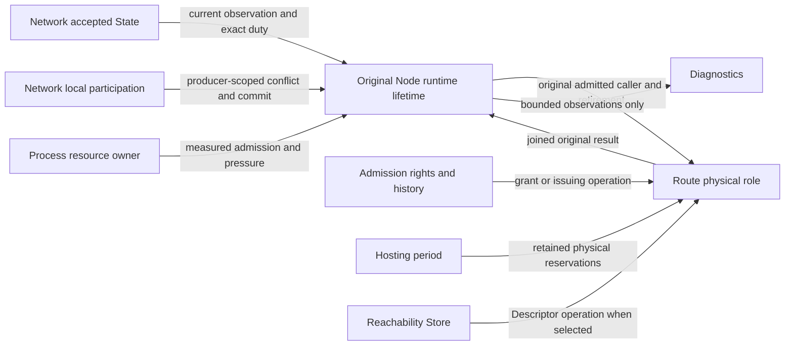

# Domain ownership map

The nearest closed release selects TCP/TLS alone under
[ADR-0122](../adr/0122-select-tcp-only-closed-release.md). Descriptions below of
realized dual-Carrier components retain historical source scope; current product
execution and positive qualification require TCP/TLS plus explicit deferred-QUIC
refusal, not successful QUIC use. The unresolved QUIC dependency finding remains
with its owner and future selection. This changes no domain authority or old/new
isolation boundary; actual implementation and evidence must establish exclusion.

This is the maintained semantic map for the DDD transition. The Product Owner
assigned its upkeep to the orchestrator on 2026-10-04. It records responsibilities,
exclusions, interaction mechanisms and realized architectural results. It does not
select work, accept a protocol change or replace the GitHub execution ledger.

Accepted ADRs and current product/security/technical owners remain authoritative.
[CONTEXT.md](../../CONTEXT.md) owns product language;
[package-map.md](package-map.md) owns actual Go packages and permitted imports.
Earlier strategic proposals and source receipts are in the [archive](../archive/README.md).
This map records current ownership; proposed future boundaries remain proposals.

## Reading and planning route

Use this document to prepare a domain change:

1. Find the domain's question, rules and exclusions in
   [Domains and boundaries](#domains-and-boundaries).
2. Identify its state, physical borrowers and terminal owner in the
   [completion inventory](#consistency-resources-and-completion-inventory).
3. Select the permitted interaction from the
   [inter-domain contract](#inter-domain-interaction-contract) and
   [collaboration matrix](#collaborations-to-review).
4. Describe each affected operation using the
   [interface checklist](#interface-checklist-for-development-plans), then
   check its actual source and current technical owner.
5. Verify task selection and acceptance in GitHub before implementation.

| Planning question | One current owner |
|---|---|
| Product outcomes, non-goals and threat conditions | [Scope](../product/scope.md), [threat model](../security/threat-model.md) and their linked contracts |
| Domain boundaries, responsibility and inter-domain interaction | This map; the affected technical owner supplies exact rules and formats |
| Actual package/import direction and dependency admission | [Package map](package-map.md), [dependency register](dependencies.md) |
| Component prerequisites and whole-journey coverage | [Privacy integration map](privacy-anonymity-map.md), [Route integration](route-delivery-join-boundary.md) |
| Work selection, domain order, transition conditions and full issue acceptance | [GitHub #497](https://github.com/dianabuilds/ardents-network/issues/497), its selected child issues and the C0 milestone |
| Execution, handoff and verification method | [Agent execution](agent-execution.md), [testing](testing.md), [privacy qualification](privacy-qualification.md) |

An interaction described here is a contract to preserve, not evidence that its
complete consumer is implemented. The [realized boundaries](#realized-boundaries-and-their-limits)
record integrated component behavior and limits. A draft, prepared interface or
successful narrower test cannot upgrade that result or select the next domain.

## How to preserve the map

Read this map before delegating a domain slice and after every orchestration
compaction/handoff. Compare it with the actual source and current owners before
updating it. A source path, successful import or directory rename cannot prove
that a responsibility moved to the correct domain.

Keep every identified domain in the inventory, including domains not yet
implemented. Do not delete a responsibility when its old source is removed.
Give each maintained rule one semantic owner and name its actual consumer and
evidence. If ownership changes, update both the receiving owner and the former
owner's exclusions, their collaboration, package registry and affected oracles
in the owning change. A shared technical mechanism does not merge authorities,
databases, principals or lifecycle owners.

Newly found responsibilities must be classified: existing domain rule,
application composition, technical adapter, or a proposed new boundary. Do not
silently put them in a generic shared package or invent a domain to hold a test.
Escalate consequential unresolved ownership with exact evidence and a concrete
proposal, while continuing unaffected authorized work.

The entries below describe DDD contexts and supporting owners. Network's numeric
Role Domains are a different protocol concept. Temporary `successor` paths,
delivery labels and issue numbers are not product domain identities.

## Domains and boundaries

This inventory describes ten semantic families, not ten packages, processes,
databases or global aggregates. Each family may contain several consistency
owners at different principals. In particular, Software acceptance groups
Enrollment, Release verification and installation/replacement; it must not be
implemented as one authority or shared transaction. Local Application execution
is the execution boundary, not all Application functionality. Future boundaries
remain proposed until their current contracts and real consumers are verified.

| Domain / question | Owned rules and distinct consistency owners | Explicitly outside | Current new owner or future source map |
|---|---|---|---|
| **Network:** which authenticated facts may be used now? | Candidate eligibility/assignment, Epoch/profile history and conflicts, bound membership, trusted time/floors, coherent accepted observations and same-observation retained duty; local participation is a separate lifetime | Route purpose/path choice, tokens/spend, physical Hosting budget, process-wide resource monitor, private profile signing, Job/Service authority | [new Network](../technical/successor-network-state.md), `internal/successor/network`; State application and authentication/Source/durable/duty adapters have separate responsibilities |
| **Admission:** which finite rights can be obtained and spent? | Allocation; issuance quota; private material and retained results; holder permission/pending batch/stock; presentation history; receiving verification, allowance and durable spend are separate owners; opaque one-use fresh receiving-root creation fact belongs to storage lifecycle | Network authenticity, transport scheduling, Introduction slots and their independent history, provider budget, Local Grants, Custody keys and file delivery; a creation fact grants no token or transport authority | [new Admission boundary](../technical/successor-admission-boundary.md), [implemented owner map](../../internal/successor/admission/README.md) |
| **Hosting:** which physical allowance can this owner reserve? | One provider-period Tx/Rx accounting policy, coherent measurements, durable budget, work/termination reservations and their exact release | Token authority/debit, Node assignment, role envelope calculation, transport stop/join, CPU/RAM/cgroups or global process monitor | [new Hosting](../technical/successor-hosting-budget.md), `internal/successor/hosting` |
| **Route:** which protected leg and role channel may this operation use? | Entry/Interior selection and retention; role-purpose rules; prefix/lanes and credit; forwarding parents/children and permitted parent refill transport; receiving Introduction slots/delivery/floors; JOIN pairing and physical termination | State acceptance, Admission quotas/verification/spend, Hosting budget, publication readiness, Descriptor authority/history, Instance authentication and logical recovery | [Route protocol](../technical/protected-route-protocol.md), [migration contract](route-migration-contract.md), [implemented retained prefix](../technical/successor-route-prefix.md), [registration owner](../technical/successor-route-introduction.md) and [JOIN owner](../technical/successor-route-join.md); `internal/successor/route`, `selection`, `ardp`, `channel`, `role`, `issuer`, `prefix`, `join`, `receiver`, `transport/tls` and `introduction` with real `ardents-next` consumers. Lower `transport` owns no operation or adapter selection; former `carrier` and `operation` are removed. Genuine forwarding-parent refill and issuer Control use real Admission/Hosting owners. Descriptor Control composes separately owned Reachability Store/history. Opaque delivery composes the genuine Publication recipient and Connection/Execution consumers under the [integration contract](route-delivery-join-boundary.md). Five original Node compositions consume receiving roles. Deferred QUIC is refused before Route effects; its unresolved dependency finding blocks future QUIC admission; operator cutover, old-runtime retirement and qualification retain separate boundaries |
| **Local Application execution:** may this process invocation perform this operation? | Volatile Local Grant generation; local session with exact current/last Job and one-use handoff; separate supervisor cleanup capacity and terminal admission latch; qualified launch and joined original worker descendants. Job is a lifetime entity within the session consistency boundary, not an independent network Context | Token allowance, Service authority, Target/path choice, private routing history, remote publication, Connection recovery, software acceptance, global resource pressure, text semantics and qualification Run | [Execution contract](../technical/application-execution.md), current evidence `application/broker`, Endpoint Job/worker and scattered Service effect/handoff checks; [confinement owner](../technical/application-confinement.md). New `internal/successor/execution` implements local authority/session/Job and independent cleanup supervision; `execution/worker` implements fixed native mechanisms; `execution/runtime` has genuine permission-preparation and bounded live Route-holder consumers. One exact operation retains qualified original cleanup through Route and authenticated Service Connection borrower join. Bounded installed Reader/Publisher composition consumes genuine independently admitted startup and permission preparation; full installed qualification remains separate |
| **Service Publication:** which authorized Instance is accepting work? | Publication generation/revision, current/pending/predecessor registration pair, private recipient lifetime, ACK/readiness, refresh and withdrawal; Instance authority/material remain purpose-scoped | Credential root signing, raw Route transport, Descriptor Store conflict floors, logical Connection recovery, Local Grant/Job mutation and worker cleanup; retain an exact live Execution operation instead | `internal/successor/publication` public proof rules, `publication/durable` exclusive floors, `publication/instance` purpose-scoped private lifetime and `publication/runtime` live qualified Publisher have real `ardents-next` consumers; [Service owner](../technical/endpoint-service-runtime.md), [private reachability](../technical/private-reachability.md), [Execution seam](../technical/application-execution.md#required-lifecycle-and-linearization) |
| **Reachability:** what current proof is valid for this Target? | Receiving Descriptor Store and durable conflicts; local lookup verification/history is a separate owner at another principal | Publication readiness, admission spend, path choice, Service Instance authentication and logical Connection | `internal/successor/reachability` implements portable proof/conflict/history rules and native receiving Store mechanisms; real Route Prefix/Receiver and `ardents-next` consume them. [Reachability contract](../technical/private-reachability.md) records signed-input acceptance and its limits. Predecessor `service/reachability`, Endpoint history and Node resolution remain independent; their complete Service consumers are not transferred by this boundary |
| **Service Connection:** how does one authenticated logical stream retain its identity? | Immutable destination/provenance, exact Instance TLS authentication, ordered byte state, Attachment generation, continuity/recovery deadline and retained Service terminal outcome; checks the exact retained Execution operation at effects and final handoffs | New Target/Application operation, new Grant, Job mutation/worker cleanup, publication authority, path policy and independent physical reservations | `internal/successor/connection` owns immutable logical binding, exact-role authentication, ordered byte/Terminal ledgers and finite Attachment proposals; `connection/wire` owns only canonical records and transcripts. Genuine Reader Source and Publication accepted-stream composition consume these owners; complete acceptance remains separate. Predecessor evidence: `service/connection`, Endpoint Service/binding/recovery; [Service owner](../technical/endpoint-service-runtime.md), [Execution seam](../technical/application-execution.md#required-lifecycle-and-linearization) |
| **Software acceptance:** which exact generation may be installed or run? | Enrollment pin, Release authorization/monotonic floors, installation/replacement/recovery transaction are separate authority and state owners | Network membership, admission permissions, Service authority, generic signing and automatic rollback | New `enrollment`, `release` and `installation` have genuine new command consumers. Portable byte authentication, native transactions/recovery and bounded Source/permission startup have separate boundaries. Two independently admitted installed participants consume those startup owners for a bounded authenticated text exchange; the full Installation interruption/replacement matrix remains separate. [Enrollment](../technical/enrollment-verification.md), [Release/Custody](../technical/release-update-custody.md), [Installation](../../internal/successor/installation/README.md) |
| **Authority Custody** (supporting boundary) | Purpose-specific encrypted authority storage, approved signing commitments and recovery floors; authority kinds never become one signing right | Generic `Sign`, exported private authority, Network/Service/Admission decisions assigned to their own domains; runtime Instance/Node keys | New `internal/successor/custody` owns encrypted records and purpose-specific Admission through new Allocation and real `ardents-custody`; Service Authority issuance consumes the one pure Publication request/response contract; predecessor records remain evidence, never signing adoption; [Custody contract](../technical/release-update-custody.md) |

## Supporting mechanisms and composition

Local Node certificate provisioning is one offline supporting composition,
`ardents-next network prepare-node-certificate`. Network/epoch owns canonical
initial Record bytes, ordinary signature verification and detached public facts.
Composition owns the closed reviewed purpose, original protected matching Node
key, standard-library X.509 leaf creation/verification and finite public output.
The original signing input/time/custody and joined failure/secret lifetime remain
with composition. No private material enters Network/Route; no Identity/Custody/
PKI domain or generic signer is created. Self-signature supplies no membership:
State owns signed acceptance/currentness, Node exact member/process/producer
credential custody, and Route exact-key TLS/ALPN and physical join.

Direct-Origin Source public preparation is one offline supporting composition,
`ardents-next source prepare-trust`. It retains original externally supplied
public chains/roots and independently reviewed commitments, and writes the
existing two Source serve and one client acquisition/local headless declarations.
The existing Source owner supplies `ObservePublicTrust`, sharing exact
declaration/collision and leaf-key transcript rules with runtime TLS; no public
observation grants a live Plan or clock. Private runtime paths remain opaque and
are never opened by the preparer. The existing installed Network projection is
pure declaration adaptation; State still owns signed acceptance/time/exposures/
floors, Installation startup admission, processresource original protection and
Source command physical completion remain separate. Public native custody and
exclusive finite output/receipt stay with composition. External credential
issuance, operational trust delivery, effective family independence and installed
qualification are not supplied by this operation. No universal Identity/PKI
authority, private signer, new package or runtime format is introduced.

Canonical Control's separate `source prepare-install-inputs` composes a single
honest Source/client public observation through `source.ObservePublicContact`
and emits fixed public credential copies plus the existing serving/request
declarations. It retains independent public file commitments and original native
custody. Runtime private-key paths, mutable roots and clock remain unopened
declarations. Installation independently admits delivery and native effects;
State owns acceptance/currentness. This creates no second family or acquisition
Plan and supplies no installed or bootstrap acceptance.

Initial Network provisioning has one finite offline key producer,
`network prepare-initial-keys`, and three fixed-purpose offline signing consumers:
`network sign-initial-node-record` and `network sign-initial-epoch` in
`ardents-next`, plus `network sign-closed-profile`. Network's public preparation/verification owners retain grammar,
assignment, signatures and materializations; composition retains the exact
reviewed prepared artifact, original root-protected private key and public-file
descriptors, original time/purpose and finite output custody. Node and initial
State keys remain separate. Closedprofile owns the validated public fixed-purpose
transcript shared by producer and verifier. Its in-body Admission permission
authority is distinct from the independently pinned State signing key. State
alone authenticates currentness and joins signed Records/roles/issuer references.
No private authority crosses into Network, Node
runtime or Custody, and no generic signer, encrypted Vault, signing-history or
bootstrap acceptance is supplied. The key producer owns fresh standard-library generation of one State and 1..64
distinct Node keys, canonical private encoding, original root-protected native
output, joined secret erasure and public-only receipt. It creates no NodeID,
Network identity, assignment, State floor or other authority. Public facts pass
to preparation; each signer independently admits its own purpose/key/pin/time.
Receipt presence never repairs failed generation. Operational key ceremony,
installed use and operator cutover remain distinct boundaries.

Installation's portable owner authenticates the program/generation pair. Its
Endpoint owner admits native effects and owns initial, replacement, recovery
and startup lifetimes. Command composition consumes these owners directly,
without a delegating facade. Native Modules retain physical custody; neither
detached observations nor durable phase presence grant Release, mutation,
Start, ACK replay or runtime rights. [Installation's current owner](../../internal/successor/installation/README.md)
and [Release/Custody](../technical/release-update-custody.md) hold exact admission,
record, recovery and fixed-resource rules.
Private installed Startup reads fresh fixed manager facts on one bounded native
connection per observation, retaining the unique manager across its original
lifetime. Both complete property rounds, original file/process reobservations
and physical cancellation remain distinct checks. Typed facts preserve original
wire signatures and grant neither a cache nor startup authority; only the
Installation consumer compares its original generation and invocation.
Original interruption preserves its caller's exclusive cancellation cause;
independent physical failures remain failures. Finishing an already verified
decoder frame after socket Close grants no manager or startup authority.
After original inode and executable matching, private Startup retains sealed
generation files only in its own Snapshot, which fully reobserves them before
and after manager observations. Its separate installed-file reader retains
selection, fixed resources and original ancestors. Root inspection and recovery
keep their independent custody; no accepting cache crosses these lifetimes.

| Owner | Scope | Boundary to preserve |
|---|---|---|
| `admission/issuerprofile/signing` | Independently pinned imported Ed25519 material, original lease/failure/Close and validated issuer-profile signing within Admission | It grants no duty and is not Person/Device/Persona, Network membership or a generic runtime Node identity service |
| Endpoint / Node composition | Construct genuine domain owners, perform live operation ordering and supervise their lifetimes | Composition must not accumulate domain policy or become the new version of the old monolithic owner; old composers cannot consume new Route |
| State/Hosting/Route physical adapters | Byte verification, durable transactions, counters, sockets and Carrier mechanisms under their declared owners | Mechanisms cannot mint authority, reset floors or copy a second domain decision implementation |
| Installation mutable-directory birth | `installation/directory` retains one original creation caller and private born inode state, exclusively creates caller-admitted paths and synchronizes same-inode account/mode promotion; checked Identity facts are detached, and Matches serves independent installed inspection | Root Installation selects paths/account, admits Release/journal/lease/effects and projects binding facts. Directory creation grants no adoption/recovery, selection, manager or startup authority; shared trusted-root predicates remain with Root lease/fixed/recovery lifetimes |
| Installation request declarations and original input | `installation/request` owns canonical bounded declarations, detached copies, native direct root-owned input and opaque original byte/inode/access reobservation; the root Request facade is consumed by actual command and transaction composition | No Release authorization, writer lease, journal, account/root creation, generation selection, manager or startup authority. General trusted-path observations remain with root Installation lease/staging/inspection, independently of request provenance |
| Installation native observations | `installation/cgroup` owns bounded actual kernel inventory and original event-descriptor observations; `installation/systemd` owns bounded typed facts, canonical manager version, fixed unit/instance inventory and joined subprocess mechanisms for daemon-reload, fixed Endpoint start and fixed sockets/Endpoint stop | The separate `installation/process` owns original proc-directory/start clock and exact executable/argv/credentials/supplementary groups/cgroup/InvocationID observations. Root-only predecessor opening and actual non-root self opening remain separate; private startup inspection retains its own read Snapshot and process observations, consumed by independently admitted bounded startup after actual root archival/ACK. Installation retains Release admission, expected generation/protection and process binding, original lease, stop decision and first failure. Native Modules have no parent import, shared lease or startup authority; Installation admits stop/reload and retains original physical join; its root manager_binding_linux.go collects request projection and actual manager/activation checks across initial, predecessor, candidate and recovery lifetimes; typed bus facts and kernel observations do not qualify an installed invocation |
| Installation fixed-unit contract | `installation/unit` owns closed Endpoint template validation, immutable original template/command-path retention and exact rendering of caller-admitted write paths, alongside pure expected Endpoint/activation protection, typed execution/invocation and distinct fresh-stopped/quiescent/running observations | Installation admits request write roots and transaction effects, systemd obtains actual typed manager facts, process/cgroup retain original physical custody. Detached configuration and property maps grant no Release or start/recovery authority |
| Installation journals | `installation/journal` owns closed preparation grammar/order and opaque original preparation/transition directory/file custody; transition owns finite creation/directory/replacement groups, exact record bytes/access, durable append/resync and partial/first-failure custody through physical close; independently reopened recovery may retain an exact original replacement group and synchronize its directory links, including an empty group | Installation retains transition record schemas/phases, original caller/lease, Release proofs, account/root/fixed-resource effects and barrier ordering. Recovery consumes preparation grammar through separate provenance/fresh-proof admission. Detached journal bytes and presence grant no adoption, mutation, generation selection or startup right |
| Installation local completion exchange | `installation/completion` owns the shared closed 160-byte frame encoding/validation consumed by root start-barrier production and independent startup inspection; it independently owns one original Unix connection, read-only directory/guard/socket-record metadata, actual root peer PID/UID/GID and exact finite frame/reply under its original deadline; cancellation physically joins its callback and Close | Private startup inspection consumes Connect/Wait between independent generation/process/manager observations. The exchange neither reads private intent nor borrows a writer lease or grants runtime/readiness authority. Root retains start observation, durable archival and ACK decision. A private producer now orders actual retained process/peer checks, a synced start record, archival and ACK; a private candidate-start lifetime now retains original process/scope custody and failed-attempt quiescence until join, with a positive actual-manager start/ACK/original-join scenario and bounded Source/permission consumer; complete installed Service acceptance remains separate |
| Installation fixed-file mutation | `installation/fixedfile` owns independent original parent/file descriptors, exclusive empty birth, bounded prefix repair on an original inode, access/ctime rechecks after journal I/O, physical writes/sync and retained original cancellation through Close | Installation keeps allowed paths/bytes/access, exact birth/replacement records and phase admission, original lease, Release proofs, predecessor join, selection and recovery. Neither a detached inode nor this physical mechanism grants mutation authorization or installed startup; no shared live root or parent import |
| Installation immutable generation files | `installation/generation` owns closed artifact names, exclusively created original directory/files, exact finite inventory, same-inode read-access promotion, detached bytes and retained partial/failure custody through physical close; independent read-only Snapshot owns sealed fifteen-file custody with its own descriptors, original file ctime/bytes and caller failure, without a writer lease or creation ownership | Installation records a mandatory closed file-inventory marker and each original per-file birth before artifact bytes; compatible complete recovery independently matches recorded native inodes and fresh-bound target facts. Installation retains fresh exact-byte proofs, original lease and caller, birth journal before writes, phase-appropriate container access, fixed-resource effects, selection, original predecessor join and startup. An independent physical Prefix retains recorded original incomplete leaves and directory, checks complete preimages, repairs only original inodes and seals complete inventory; Installation separately owns ordered writing-generation admission and fresh-proof continuation. Original successor recovery admission, continuation, terminal cleanup and close are collected with one retained owner in successor_recovery_linux.go; independent Prefix/Snapshot/process custody remains distinct. Filesystem/race admission and causal ordering controls do not prove actual-manager recovery or process-crash acceptance. Sealed files and copied physical facts grant no Release, adoption, selection or startup authority |
| Process resource/lifecycle owner | Process-wide observation, pressure availability, supervision and terminal process outcome | New `processresource` measures original native placement/pressure; new `node` owns reaction and completion. Network accepted-state policy and Hosting provider-period budget remain separate; complete role/installed qualification is not inferred |
| Provisioning composition and signing owner | `ardents-next network prepare-initial-keys` owns a strict finite public count, fresh distinct State/Node keys, original protected files, secret erasure and a public-only receipt, without creating identities or accepting authority. `ardents-next network prepare-initial-node-record`, `prepare-initial-epoch` and `prepare-closed-profile` adapt bounded public declarations directly to Network's canonical unsigned preparation, retaining fresh native output custody. Its separate `sign-initial-node-record`, `sign-initial-epoch` and `sign-closed-profile` consumers retain exact reviewed preparations, independent purpose-specific public pins, original protected private custody/time and exclusive durable output | Private keys stay in offline command composition, outside Network; State acceptance, assignment redraw and runtime launch are not admitted. Unsigned grammar and durable output grant neither signature nor current authority; private issuer-profile signing belongs to Admission; no new Control domain or generic signing service is introduced |
| Integration/regression harness | Registered test composition across genuine new public/application contracts | It is not a product domain, production coordinator or new test-only command; domain-local tests remain with domain rules |
| Text Application | Fixed bounded text exchange, selected snapshot import, UTF-8/document rules, multiplexing/credit and safe presentation; current `internal/application/textdocument` | Application semantics remain outside Execution and Service Connection. The confined worker receives the selected snapshot and bounded bytes, never destination, publication or Endpoint authority. This product-specific owner is not another network authority |
| Local Application IPC | AAI3 Connection requests/ordered local streams and separately authorized Administration Publish/Withdraw grammar; current `internal/application/connection` and `administration` | Interface admission and local transport cleanup remain explicit; an IPC request, peer socket or READY message cannot attest a qualified Job. Administration grants no byte-stream or Service authority |
| Disclosure and diagnostics | Bounded public catalog verification, process/timeline measurements, inspection and command projections; current `alphacontrol`, `diagnostics` | Catalog verification never authorizes State, Release or runtime work; observations never decide admission or create a global cross-role trace. These are supporting mechanisms, not a generic Control authority |
| Qualification | Selected Run/workload composition, observers, measurements, completion barriers and retained reports; current `qualification` and `application/streamqualification` | Qualification is a proof producer with its own selected environment, not an ordinary Job, a permission issuer or a runtime domain substitute. A passing module test cannot qualify an installed product |

## Node composition: original lifetime boundary

The [accepted installed infrastructure contract](../technical/network-route-node.md#proposed-installed-infrastructure)
separately inventories the actual Source and five Node consumers, provisioning,
external inputs, command/build/recovery callers and missing installed mechanisms.
It preserves the actual owners below. Endpoint Installation's fixed unit and
program/generation pair do not admit Node/Source. The separate Source component
implements initial stopped installation, an original root first-start transaction
and independent non-root Startup custody. Canonical `ardents-node`
Source/Installation directly compose these new owners; exact artifact/bootstrap
acceptance and actual installed qualification remain separate requirements. Source has
one command-owned original plan/certificate/key/CA file/ancestor lifetime; four Node roles retain
loaded TLS material, while JOIN additionally reobserves original credential files.
The separate artifact/persisted/bootstrap extension is **accepted**
([ADR-0123](../adr/0123-bind-installed-infrastructure-generations.md)); acceptance
alone records no implemented or qualified result. The separate
`internal/successor/installation/infrastructure` now implements Source
descriptor/public preparation, coherent artifact admission and separate Source
read-only native preflight and the bounded initial stopped transition. The temporary
`ardents-next infrastructure` component consumer remains separate from canonical
Source/Installation composition. Enrollment
owns initial-pin provenance, Release owns fresh exact-target authorization and
floors, and infrastructure admission owns pair/resource coherence. Native
Installation and the separately accepted exact bootstrap remain distinct gates.
Source preflight retains original request/input/ancestor custody, closed Source
template policy and one original read-only manager connection. Existing inputs
and absent future destinations are different declarations; absence grants no
creation/readiness fact. Root, account and unit namespace observations, original
caller/manager/Release checks and physical joins precede its bounded result.
Release floor effects stay separately owned; no State/Source runtime is opened.
The initial stopped transition owns fresh native admission, original account and
credential/directory births, its closed initial journal, twelve-file immutable
generation and selected fixed unit. Its private initial admission also commits
the exact binding to the original Release history declaration and native directory
identity/access. Installation's independent read-only pins do not borrow Release's
lease; Release matches its own original path, directory and lock-file identities
retained from opening, and retains all trust/floor policy.
An independent root-only initial-transcript reader checks the complete canonical
birth sequence and recorded Source-owned native resources; the stopped creator
consumes it before returning its writer lease after native join. Historical
account database effects are not immutable Source-owned host databases. Reading
the transcript supplies no current-principal, fresh Release or Start authority.
The systemd adapter owns original physical
manager custody, one explicit reload and complete typed loaded observations;
Installation alone compares stopped policy. State and participation directories
remain empty; their semantic owners receive no initialized contents or authority.
Failures retain partial prefixes and original joins, without adoption/reset,
continuation or rollback. First start independently reopens the full stopped
transcript and retains fresh proofs, current principal and original manager /
process / cgroup / barrier custody in its own exclusive journal lifetime. The
Root control connection acquires one fixed Source unit reference so a stopped
unit can be freshly observed after manager collection; physical connection
closure returns that reference. This loads no runtime or accepting authority.
Non-root Startup independently retains original selected inputs, actual invocation,
namespace and manager, then completes the original root-peer exchange before
State or Guard construction. No initial transcript, Start job, ACK or public
receipt grants runtime authority. These mechanisms supply neither bootstrap
acceptance nor installed runtime or operational qualification.

Explicit Source retirement has distinct original owners. Canonical
`ardents-node installation stop-source` retains the archived original proc/pidfd,
scope and manager, and interrupts only that invocation. The original non-root
Source command reports its joined State/input/Guard/key/output result only after
those users physically close. Infrastructure independently joins the original
kernel scope, verifies matching native exit/clocks and closes its own observers
before committing the independently readable retirement transcript. Its blocking
marker survives partial or uncertain sync/Close; complete-looking bytes alone
cannot admit restart. `restart-source` separately verifies the whole retained
chain under the original first journal lease, creates a distinct finite attempt
and obtains fresh Release/native/process/credential/startup admission. It lends
no old live owner to the successor. Network State's Linux `OpenRetained` and its
retained local participation opening refuse missing semantic history rather than
initializing it; only State owns signed acceptance and security/time floors.
These implemented boundaries remain distinct from source-matched installed
qualification and the exact bootstrap receipt's direct Product Owner acceptance.
No automatic restart, crash continuation, adoption, reset or replacement follows.

Explicit forward Source replacement has its own distinct selection grammar and
transition journal in Infrastructure. Canonical Node directly composes the
original retirement, fresh coherent Release pair and retained original public
inputs. Network State supplies an opaque read-only `SourceInspection` under its
own independently acquired existing State/participation leases. It validates
signed/security/time history and unresolved producer policy without initializing,
repairing, pruning or lending a mutable root or runtime right. Installation binds
that inspection to the exact serving declaration and numeric principal, retains
all predecessor evidence, and owns separate sealed-generation, same-inode
selection/unit, explicit manager reload and joined-completion effects. A separate
restart obtains a fresh invocation. These implemented component boundaries do
not establish installed replacement qualification or bootstrap acceptance.

`ardents-control source prepare-state` separately composes finite offline State
acceptance under the runtime system UID/GID, using original public declaration /
bundle custody and an initially empty runtime-owned root. It opens no Source
listener/acquisition, runtime TLS key, participation owner or Installation Startup.
State alone authenticates signed Epoch/materialization and owns durable floors;
no Route profile, current membership or independent-family claim is supplied.
State Close joins before public input/root descriptor release. This supporting
producer and the real installed serving/client journey have separate evidence.
Its distinct finite `source inspect-latest` consumer retains original local
client credential/public inputs and invokes Source's one-contact mTLS inspection.
Source owns declaration/key separation, bounded LATEST framing and original socket
join. Inspection returns private local unaccepted evidence, no Plan or State
authority. It creates no second Source, family independence or acquisition
fallback; ordinary State acquisition retains its two-source rule.
Canonical Control's separate `source prepare-descriptor` and `prepare-inventory`
consume Infrastructure/Enrollment public byte preparation. Composition retains
original root-controlled inputs and fresh output descriptors through actual
sync/readback/Close; no signing, initial-pin, Release or runtime right is produced.
The native offline profile's unsigned byte fixtures and actual pinned preparation
command verify that custody only, separately from the complete signed candidate
and installed Source journey.
The separate canonical `source prepare-release-keys` creates only its five fresh
distinct offline Release keys under original secret native output custody and
emits public facts outside that key directory. No Endpoint ceremony/receipt,
signature, independent custody or trust is supplied. Its consumer,
`source sign-initial-release`, owns the fixed
initial Source signing purpose, original protected five-key/input custody and
public metadata output. Release still decides validity: the producer obtains two
fresh same-verifier authorizations for the fixed Node/Source targets before
publication. Actual key/signature and native custody controls with fixture build
declarations grant no operational rebuild, independent custody or installed claim.
Neither the Endpoint signer nor its earlier bootstrap receipt expands to Source.
The fixed Source initial-key producer creates separate State/Node private files
and public-only facts, without an identity or accepted State. Its one-Record
genesis public-flag plan preparation/signing chain consumes Network's canonical initial Record /
Epoch codecs and verifiers, original separately reviewed prepared-byte commitments,
protected matching purpose keys and current time. Source owns bundle framing;
State alone accepts it. This supplies no full Node/Route profile or independent
families and no runtime TLS credential. One actual standalone numeric-UID State
producer is distinct from the installed Source principal and startup lifetime.

The process-resource owner applies the finite development CPU/I/O trend budget
in the [native profile contract](../technical/network-route-node.md#forwarding-development-process-profile),
with unchanged hard/event/evidence limits. Its retained failure facts contain
only local observation/deadline/resource context. Node adds original phase and
first logical cause, preserving separate physical cleanup outcomes. These copied
diagnostics confer neither accepting authority nor a new monitoring domain.
The registered native development runner orders all five complete profiles with
real preflight and a shared own-job lock; it does not own runtime admission,
foreign host workloads, Network authority or platform/capacity qualification.

This is a design refinement of the supporting composition owner above, not an
eleventh network authority or an execution assignment. The new `node` owner
composes one original Forwarding, Issuer, Descriptor, Introduction or JOIN invocation; complete role and installed
acceptance remain separately required.
Node is a product infrastructure actor; a process, a signed Node identity and
one accepted duty generation are distinct things. The current
[Node contract](../technical/network-route-node.md#node-and-resource-lifecycle)
and [glossary](../../CONTEXT.md) remain authoritative. Work selection, source
receipts and candidate slice acceptance belong in GitHub.

### Assessment and responsibility inventory

The maintained predecessor is a brownfield Go composition with explicit
lifecycle behavior, broad configuration and adapters that mix several owners.
Light DDD is appropriate for its supporting lifetime: model original identity,
admission, retirement and completion precisely. Do not create a universal Node
aggregate, repository, event bus or microservice around the old directory.
Network and Route retain their own substantive domain models.

| Inspected predecessor responsibility | Target semantic owner | Current new seam / remaining boundary |
|---|---|---|
| `node/admission.go`, `state_authority.go`, `authority/receiver.go`: membership, duty/profile projections and purpose checks | Network authenticates and binds membership; Route admits its exact purpose; composition matches local credentials | `state.CurrentRuntime`, `RuntimeView.RetainDuty/MatchDuty`, `route/role.Authority`; copied diagnostics cannot replace them |
| `node/local_roles.go`: producer-owned local conflict retention | Network's separate local-participation policy and native `network/duty` owner; Node lifetime owns its producer's physical completion | Source uses `duty.OpenOperation/Replace/Remove`; the Node lifetime consumes `duty.OpenNodeProducer/Check/Live/Close` with private producer and original-caller fencing |
| `node/lifecycle.go`, `machine.go`, `duty_cleanup.go`: startup, retirement and process result | Proposed Node runtime lifetime, orchestrated by command composition | No new general Node supervisor is inferred from `route receive`; transport already has its own currentness watcher and joined Close |
| `node/forwarding`, `outer`, `introduction`, `join`: queues, channels, slots, pairing and physical work | Route | New `receiver`, `channel`, `introduction`, `join` and concrete Carriers own these mechanisms; Node must not copy them |
| `node/issuer` and `node/hosting`: issuance and reserve-before-spend adapters | Admission owns issuance/spend; Hosting owns the period; Route owns the physical exchange | New `admission/issuer`, `receiving`, `hosting`, `route/issuer` and the real `route receive` composition already collaborate |
| `node/resolution`: receiving Descriptor rules and physical listener | Reachability owns proof/conflict/history; Route owns receiving transport | New `reachability.Store` and `receiver` have a real command consumer; Node grants no Store ACK or publication readiness |
| `node/resource_pressure.go`, `resource`: OS observations, pressure classification and reaction | Separate process-resource owner measures/classifies; Node lifetime reacts; Hosting retains provider-period accounting | New `processresource` owns actual original Linux placement, counters and pressure; `node` composes its synchronous work checks. Predecessor native source remains evidence, with no runtime import or historical profile revival |
| `cmd/ardents-node/source_runtime.go`: Source serving/background termination | Network State and Source, with their own command composition | New State owns Source exposure, Wait and Close; `ardents-next source serve` composes that original owner with its distinct processresource Source guard. State joins transport/handlers before guard release, retains its own root lease through producer cleanup, and composition releases process pins last. A Source is not another Route role selected by Node dispatch |
| `node/identity.go`, command key loading and signing preparation | Purpose-specific credential mechanisms and provisioning; accepted Node identity stays with Network facts | Admission `issuerprofile/signing` grants only imported offline issuer-profile signing, not generic TLS/Node authority or State signing |
| Lifecycle/resource event output and qualification fixtures | Bounded diagnostic projection and independent test composition | Neither output success nor a measured/unknown field grants readiness; old tests are inspected evidence, not the new oracle |

### Original lifetime and state

The candidate consistency boundary is one original runtime invocation and one
retained role generation. It owns its admission/terminal latch, original caller,
startup work, cancellation callbacks, physical borrow inventory and immutable
first failure. It references external owners through their narrow contracts;
it does not own their journals, budgets, private roots or policies.

Its retained binding comes from one coherent authenticated observation: Network,
Epoch/profile, Node/key/family, record generation, assignment, endpoint, Carrier
and finite bounds. A retained binding is copied evidence, not an independent
live permit. Network rechecks it; the runtime additionally checks its original
invocation and process admission. Node may not pick the first locally available
role or silently rebind that lifetime to a successor.

| Local transition / observation | Owner and required ordering |
|---|---|
| Prepare original invocation | Validate declared roots/credentials/resource profile; obtain genuine current Network binding and producer-scoped participation admission before accepting role work |
| Acquire role | Retain the original startup caller; open genuine collaborating owners; recheck after native I/O and before publishing the accepting lifetime; creator joins rejected partial acquisitions |
| Serve | Route rechecks authority at its effects. Process protection controls new work through the original runtime; measurements require declared scope, freshness and availability |
| Protect or retire | Local denial is synchronous. A pressure observation, diagnostic event or polling tick cannot substitute for denial; interrupt original dependents before waiting |
| Join and finish | Route joins physical users first; then composition closes purpose roots/Hosting borrows, updates only its own participation producer and releases remaining owners. Preserve first failure and all cleanup causes |

For the selected Forwarding, Issuer, Descriptor, Introduction and JOIN compositions, Network retains `node-duty/live`
identity/family conflicts until the original producer releases them after join.
The earlier Epoch/Record bound still denies work; it does not prove physical
completion. Prepared/quarantined Node facts remain time-held. An unresolved
live producer, including after lost cleanup, cannot be pruned or adopted as a
restart shortcut. This refines local restriction retention, not membership,
Source exposure, another Node role or a persisted-format migration.

An early failed outcome and known physical completion are different results.
If a bounded attempt cannot prove join, it must preserve the failed result and
retain still-needed resources/conflicts; it cannot publish successful withdrawal
or invent free capacity. A new lifetime cannot inherit the old one's failure,
authority or borrowers, nor begin as an automatic recovery/restart policy.
Exact compatibility of outward states remains with their current owning formats.

### Narrow collaborations and effect checks

These arrows describe owner calls, facts and physical borrows, not cyclic Go
imports. A runtime supervisor must not import its command composer; Route,
Admission, Hosting, Network and process-resource mechanisms do not import the
supervisor. Exact future package admission must establish an acyclic graph.
No foreign I/O/join or policy callback occurs under a runtime state lock.

Network retains accepted-state and local-participation consistency separately.
Shared local participation history has one policy/storage owner and short
producer-scoped operations; it is not a shared live State/Node root, lease or
mutex. Node release follows actual role join. Source exposure cannot be removed
by Node or expired merely because a caller is stopping.

Process placement/CPU/RAM/availability are separate from Hosting bytes. The new
Receiver exposes `Listen`, `Done` and retained `Close`, not the predecessor's
`Protect/Usage` surface. Before accepting a complete new Node runtime, specify
genuine protection/measurement seams and the applicable current native profile.
Unknown timers/queue/admission values are not zero. Missing required protection
does not authorize an unprotected accepting path or an optional stronger mode.
Profile changes need their current owner's admission; historical stage labels
do not become new domain or runtime identities.

Runtime TLS credentials must match the accepted member at the owned effect;
offline issuer-profile signing is a different purpose. Credential loading is a
physical mechanism, not a universal Identity/Custody domain. Enrollment, Release
and installed-process validation retain their own authority; a development role
consumer cannot establish a supported Node installation or qualified host.

### Realized prerequisites and design limits

`cmd/ardents-next/route_linux.go` already composes genuine State, retained duty,
receiving Admission, Hosting and `receiver.Listen`, with additional issuer or
Descriptor owners only when that exact duty requires them. Receiver supports
TCP/TLS, refuses deferred QUIC before listening, reobserves authority and joins its work.
That is an existing component consumer, not the complete Node runtime model.

`internal/successor/node` composes original Forwarding, Issuer, Descriptor, Introduction and
JOIN lifetimes through the real `cmd/ardents-next/node_forwarding_linux.go`,
`node_issuer_linux.go`, `node_descriptor_linux.go`, `node_introduction_linux.go`
and `node_join_linux.go`
consumers. JOIN surrounds the existing Receiver/Pairing with exact original process,
producer and fixed TLS custody, full class-2 reserve-before-spend and retained
joined completion. Matching, both RESULT writes, credit, EOF and CLOSE remain
Route rules. It grants no refill, Service authority or automatic replacement.
Introduction retains one genuine prepared Route Registry/History
before listening, short-denies admission and joins Receiver before closing native
History/Receiving/Hosting; Route alone retains slot and delivery policy.
Descriptor retains a separately owned Reachability Store and reads its original
operational cause after joined Store closure. Its private denial fences dependent
work without attributing a foreign operational failure to Route physical cleanup.
Store proof/conflict/durability policy remains with Reachability; full Control
coverage and irreversible spend remain with Hosting and Admission respectively.
Issuer retains Admission's prepared quota/key/result application
until Route and issuing users join; it grants no private RSA or signing right
to Node. Ordinary Control and separate Bootstrap physical reservations remain
with Hosting, without Forward refill. Network's
`duty.OpenNodeProducer` retains a private producer and original caller through
short journal transactions, checking retained generation/digest floors without
holding a live shared lease. `processresource` independently observes the
original Linux proc/cgroup and selected limits. Node retains purpose-specific
TLS custody, original admission/retirement and cleanup result; diagnostics
projects observations without authority. These implementations grant no Source,
provisioning, unselected-role or installed qualification. Their exact behavior and
remaining scenario limits belong to the [Node owner](../technical/network-route-node.md#original-forwarding-composition).

Source, provisioning/signing, all-role coverage and installed/operator acceptance
remain distinct responsibilities. An initial single-role consumer does not close
them. Old Node/Endpoint qualification failures stay evidence at their recorded
source; they neither select repair of old runtime nor prove the new owners fail.
Required checks of an actually selected change remain mandatory.

## Consistency, resources and completion inventory

The semantic owner below decides transitions. Storage, crypto and operating
system adapters enforce its declared mechanism; they cannot acquire the rule.
Separate roots are separate histories, not arbitrary new root names that may
erase installed floors. Every live operation retains its original identity,
bounds and terminal result; no late completion can act on a replacement.

| Family | Distinct state/authority owners | Resources and completion responsibility |
|---|---|---|
| Network | Authenticated State/history/conflict/time floors; retained runtime duty; separate local participation | State owns its root/lease and intake work; participation stops its own effects. Observations grant no indefinite right to callers and cannot replace their final currentness checks |
| Admission | Allocation; issuer quota/debit; private key/results; holder stock/pending/presentation; receiving verification/spend | Each principal owns its own private durable history. Issuer stores debit before response; holder stores presentation before sending; receiver reserves before spending. Work owns transferred physical reservation until join; no later failure refunds a token |
| Hosting | Provider-period counters, durable budget, current measurements and finite work/termination reservations | Hosting owns budget and actual once-only return. Physical borrowers keep the reservation until joined; close of another domain cannot invent capacity or reset usage |
| Route | Entry selection/floors retained for the Endpoint installation; local retained Interior/Rendezvous; role channel/parent/children; Introduction registry and slot history; JOIN pair and queues | Route owns Carrier/TLS/readers/writers/timers, wire accounting and physical stop/join. Its channel-local identifiers and private selection stay local; no full-path object or shared private history at a Node |
| Local Application execution | Volatile authority generation; execution session with current/last Job and one-use handoff; supervisor capacity and first terminal failure | Exact verified invocation/attachment/pinned original descendants. Revoke synchronously denies new effects, interrupts all dependents, joins the original worker tree, then returns cleanup capacity. Job is an entity within the session, not an independent network context |
| Service Publication | Purpose-scoped Instance generation/material; publication lifecycle with current/pending/predecessor pair, revision, recipient/replay and readiness | Publication stops new acquisitions before joining registrations and retiring/erasing private recipients. Descriptor Store ACK and REGISTER ACK remain different prerequisites; a late ACK cannot renew a retired generation |
| Reachability | Receiving Descriptor Store/conflict floors; local exact-Target lookup/history at another principal | Receiving Store owns original native root/records/marker/lock/record custody, permanent operational denial, serialized durable effects and ACK; joins original operations before retained physical release. Foreign observations run outside its state mutex. Lookup owns its bounded attempt/history. Refusal cannot expose an older proof or substitute another destination; proof validity is neither readiness nor Instance authentication |
| Service Connection | Immutable destination/provenance, authenticated Instance, logical ordered bytes, Attachment generation, original recovery bound and terminal result | Connection stops/joins its current Attachments and retains the logical outcome. Route joins each physical stream; Execution joins its worker. Recovery changes an Attachment, never Target, Job, Grant or original recovery time |
| Software acceptance | Enrollment first-pin/inventory; Release authentication and monotonic floors; installation/replacement journal and generation ownership | Enrollment cannot sign or install; Release authorizes exact bytes but cannot download/activate. Installation authenticates fixed resources, joins its predecessor and completes its own transaction before runtime admission; ordinary Job cleanup does not own replacement |
| Authority Custody | Purpose-specific encrypted vault/recovery record, approved signing commitment and retained authority floors; separate authority kinds | Custody owns unlock, secret erasure and durable successor-before-response. Service Credential issuance retains its own purpose-specific approval/generation policy; Admission supplies allocation rules. No generic Sign or shared right across Service, Admission, State, Name and Release. Runtime Instance/Node keys stay outside the vault authority owner |

## Responsibilities outside the selected transition

**Naming is an explicit future separate model:** Service Name to authenticated
Target binding. The current maintained journey uses Target Links; Namespace and
Name signing routes are retired. Keeping this future boundary visible does not
restore their code, wire, signing rights or select implementation. Person,
Device, Persona, transport identity, Service Target, Credential and Capability
also remain distinct glossary concepts; this map does not create an Identity
domain or a universal authorization model by conflating them.

Public storage, consensus, blockchain, governance and long-term public transport
are unselected product/technology decisions. They are not silently inferred
domains or tasks for this DDD transition. Current accepted bounded transport and
software compatibility obligations remain with their named owners. A new
boundary needs a concrete domain question, rules, state/termination owner and
real consumer before package or implementation admission.

## Realized boundaries and their limits

| Owner | Maintained new behavior | Separate remaining boundary |
|---|---|---|
| Network, Admission, Hosting | Authenticated State/current observations, separately owned rights/history and durable physical budgets; genuine new command and Route consumers | Complete old-runtime cutover and installed/public qualification are not inferred |
| Route | Retained prefix/channel and TCP/TLS; explicit deferred-QUIC refusal; REGISTER/WITHDRAW and durable floors; opaque relay delivery and paired JOIN; parent refill, issuer and Descriptor Control; genuine qualified Reader/Publisher Service consumers and five original native Node compositions | [Future QUIC admission](dependencies.md#existing-quic-finding-return-path-reply-budget) remains blocked by its unresolved finding; supported operator cutover, old-runtime retirement, installed Node, whole-host and privacy qualification stay separate |
| Execution | Volatile local authority/session/Job, fixed native worker, original operation and joined cleanup; permission, holder and installed bootstrap consumers | Logical Service recovery and complete installed journey remain separate |
| Publication and Reachability | Public proof, consumed private Instance, live qualified Publisher, accepting registration/Store-ACK pairs, refresh/withdrawal, private recipient/replay; independent Store and local lookup history | Full Service TLS, logical Connection and installed product qualification are not implied by accepting Link or capsule transport |
| Connection | Immutable original binding, exact-Instance TLS/Continuity, bounded ordered stream and Terminal controls; genuine Reader/Publisher Text transfer, finite recovery and Route-backed Attachments retain original Execution/Publication; independently admitted installed participants consume these same owners | Service authentication and recovery grant no new Target, Job, Grant, publication authority or physical Route allowance; complete operator and privacy qualification remain separate |
| Enrollment, Release, Installation | Pinned immutable inventory; offline exact-byte authorization/floors; separate generation authentication and native initial/replacement/recovery/startup consumers | Full interruption matrix, private Service journey and installed acceptance remain separate |
| Custody | Encrypted Vault/Bundle, purpose-specific Admission through new Allocation and Service through the pure public request/response contract, original exclusive lifetime, authenticated successor/floors and separate quarantine; genuine terminal command consumer | Full operator/installed integration and platform/crash qualification remain separate |

Connection borrows one original Execution operation and one immutable Instance
Service lease through transport gaps. Publication retains accepting generation,
recipient cutoff and delivery replay history; Instance owns non-exporting TLS
and proof signing. Connection owns continuity, directional workload counters,
Attachment proposals/replay and the logical Terminal outcome. Route owns the
exact physical JOIN and its reservation return. Joined cleanup receipts report
physical retirement only; neither clean cleanup nor a completed Application
result supplies accepting authority. Execution retains the original worker's
protocol reader and cleanup capacity until those borrowers finish. These seams
do not merge state locks, private roots or domain policy.
Connection stages received bytes privately while its original owners validate
the final handoff. Bounded caller-memory delivery and clean-outcome publication
then run under the same local locks, with no foreign I/O or owner observation.
Failure exposes neither a positive read count nor the staged plaintext.
An early original-owner refusal retains the Stream's first logical failure;
later cancellation cannot replace it. Failed Source/Responder acquisition also
retains the joined original generation outcome before any replacement handoff.
Initial Reader authentication retains its original setup deadline after joined
proof/Continuity input, separately from the Attachment's interruption and actual
physical error. Expired setup cannot transfer buffered complete bytes.
An unsuccessful Attachment retires its exact Route child with the existing
refusal terminal; its cleanup cannot mint a clean child witness and retire the
peer's still-needed Terminal-control tail. The original logical owner and
authority remain separate from that failed physical child.
Route's nested framing separately retains successful lower output counts and
the lower owner's actual physical failures. An incomplete upper frame followed
by lower retirement remains failed work; successful lower bytes alone cannot
poison Execution cleanup. Actual native write, close and join failures remain
retained through their original owners.
Instance's original Binding observation borrow retains native custody and its
separately owned Publication reservation while full logical/physical Service
checks run outside Instance state. Local effect gates compare the same original
lease/Attachment; retirement joins those observers before key erasure and
reservation return. This borrow supplies no accepting observation or new right.
Acquisition and first consumption retain the same original custody across
separate durable reconciliation/burn without holding Instance state. Root and
Binding retirement deny late transfer/private effects and join those operations;
neither a pending opening nor a completed floor burn grants readiness.
Recipient and capsule users observe original native custody before taking their
state locks, then compare the exact local recipient/opening and cutoff. Their
copied candidate/Descriptor facts remain distinct from accepting Publication,
Connection authentication and replay commitment.
Holder Stock retains one original operation/journal use through external current
authority observation, native presentation marking and final verification/deposit.
These foreign observations and marks do not hold Stock state; local transitions
still compare the original attempt/preparation/permission and monotonic floor.
Revocation erases secrets and denies new uses before joining existing uses and
returning the owned journal. Spent token/quota and actual late failures remain
with their original owners; a use borrow supplies no Admission authority.

Canonical installed command continuation composes its private Reader and
snapshot Administration consumers after the original retained Startup checks.
The participant owns one shared Entry history and initialized Hosting budget;
each operation owns its role selection, physical borrows and qualified worker.
Fresh Link/Withdraw admission belongs to the original Execution generation and
creates no worker or Service authority. Local listeners join before pending and
active Publication retirement, which precedes shared-root closure. This realized
composition is distinct from two-manager installed acceptance and final gates.

Reader Source retains the full logical Stream and original Prefix outcome while
passing only joined physical cleanup into Execution's failure accounting. A
Route-owned opaque Source scope retains the original caller, selected leg and
absolute bound; its logical checks reobserve genuine authority independently
of an ended physical Prefix. Every lookup, submission and JOIN still needs its
exact physical acquisition. Connection consumes its finite proposal before
Route joins an ended generation and opens another with original selected bindings
and genuine new reservations/Stock. One opaque handle binds lookup, submission,
JOIN and final replacement handoff; an old handle never follows a successor.
Scope retirement seals logical effects before joining all physical generations
and retaining actual cleanup failures.
The scope itself grants no fresh opening, token, Job or successful Connection.
A replaced Attachment retains its own attempt outcome; that recoverable attempt
does not overwrite successful logical recovery. Its actual physical cleanup
failures remain retained through the original cleanup owners.
Prefix's separate cleanup receipt requires actual original users, callbacks,
framing and resource returns to finish; retired readiness alone cannot supply
it. JOIN returns its own exact physical result to the Prefix borrower callback,
keeping the complete exchange outcome with its original caller. Cancellation
does not become a physical failure by projection, and an actual late write,
close, borrower or resource-return error remains retained.

Publisher likewise keeps its full Publication/Registration outcome while
passing only original joined physical results to Execution. Registration owns
its complete withdrawal/delivery result; its exact Introduction terminal owns
lower output/deadline failures and the parent/control return. Publisher retains
one original Source scope through private and Connection users. Route's Source
scope and Responder scope own their original selected legs and exact physical
generations; each transferred JOIN retains its own generation borrow. Physical
loss seals only that generation, which joins before fresh reservation/opening.
Responder generations retain one exact Source handle, and JOIN handoffs check
both original scopes. Physical Source loss retires its dependent Responder
generation without withdrawing the original accepting Publication or changing
the Job. Current-source issuing borrows an existing opaque handle only; it
cannot recursively replace a Source during dependent presentation. Descriptor
publication acquires one exact handle and commits its Store ACK under that
handle. Scope retirement joins all generations before Instance binding retirement. Ordinary
cancellation does not seal the Execution generation as failed physical cleanup;
actual output, close, missing join or resource-return failure still does.

Actual source and imports are in the [package map](package-map.md) and
[implementation entry point](../../internal/successor/README.md). Component
readiness, full issue acceptance, repository integration and qualification are
different results. [GitHub #497](https://github.com/dianabuilds/ardents-network/issues/497)
owns their dependency order and live criteria. Exact earlier source hashes,
failed attempts, inspected/reproduced distinctions and fixture limits remain
in the [archived map](https://github.com/dianabuilds/ardents-network/blob/c58268d72f1eaeae173144e76d32d50986de2a77/docs/archive/development/domain-map-before-consolidation.md)
and issue receipts. Consolidation does not upgrade their evidence level.

## Collaborations to review

Apply the interaction contract below to these collaborations. The matrix names
semantic dependencies; the package map separately permits each implemented
import. The technical owner defines the exact callable or wire Interface.

| Collaboration | Mechanism and evidence or right passed | Consumer check / prohibited expansion |
|---|---|---|
| Network State to Direct-Origin Source command | Original State configuration, PermitWork, Current/Wait/Close; command's original fixed-input Check/Close and processresource's Source Check/Close | Composition supplies synchronous original input/process/caller admission outside State locks and background supervision. Input loss is latched without reload/rebinding; caller cancellation starts the same State.Close even during a held native Check. State owns serving decisions, live clock/time, guards and original transport join. State Close/Wait and command observations join before input Close releases its observers/files/bytes; loaded command key and process pins release last. A bounded completion-unavailable notice retains failure and continues waiting through input Close too, never substitutes timeout for join. Source is neither Node receiving duty nor Route Source/Responder; development custody supplies no installed binding |
| Network to Admission/Route application | `CurrentRuntime` with coherent authenticated profile/member/time; `RetainDuty` from that same observation and `MatchDuty` against a fresh one | Reobserve at effect/commit points; no diagnostic Snapshot/receipt authority, successor rebinding, cached approval or callback into an already locked owner; exact role/Purpose and actual peer authentication remain consumer rules |
| Admission to Route | Purpose/receiver-bound finite accepted allowance and exactly transferred reservation lifetime | Admission owns the Control, Forward and Registration class bounds in the [private admission contract](../technical/private-admission.md); this map does not maintain another numeric register. No token refund, new deadline, second claim or transport authorization based only on Node identity. Receiving Admission may request reservation rollback; Route's `Channel.HoldReservation` retains its physical return until joined retirement, including refusal without a Grant |
| Admission root creation to Route slot-history initialization | `receiving.Owner.TakeFreshRoot` passes an opaque one-use fact of genuinely durable fresh receiving-root creation for an exact public duty binding, before admission attempts; Route consumes it through its own history initialization | This is storage lifecycle evidence, not token/Network/Service authority. Retained reopen or pruned-empty spends cannot recreate a missing Route floor; attempts, Close, stale binding and late completion invalidate the fact. No shared lease/mutex or private spend parsing. The [implemented owner](../technical/successor-route-introduction.md) retains the failure/adoption boundary |
| Route Introduction lifetime to receiving composition | `OpenReceivingRegistry` prepares one original Registry/native History before listener; `ReceiverConfig.Introduction` borrows it and `Registry.Check` supplies exact-binding native/short-state reobservation without a foreign observer | Composition denies, interrupts and joins Receiver before Registry physical Close, then Receiving/Hosting. Route retains slot/floor policy, original root/lease/snapshot pins and first native failure; short Stop cannot wait behind physical history I/O. Request refusal grants no original failure or refund |
| Hosting to actual work owner | Finite work and termination reservation | Work owner joins physical borrowers before release; no duplicated budget or hidden cleanup reserve. Hosting still owns the budget and actual return; Route delays the composed return callback until physical join rather than changing Hosting or Admission policy |
| Execution to operation composition / Publication / Connection / Route | Exact live Job/operation permit and local generation; joined result checked against exact last Job | Revoke is synchronous; neighbors check before effects and final handoff, stop/join their own resources and never mutate Job state. Late completion cannot enter replacement generation; no eventually delivered event substitute |
| Execution to permission preparation composition | Private retained provenance of a successfully joined verified preparation launch under its still-live local session | It is not a live worker permit or network authority; Network/Admission still verify current facts and permission. Do not retain a dead worker's rights through this proof |
| Software acceptance to Execution launch | Exact authorized installed artifact/binding; distinct runtime byte/invocation checks | Execution cannot mint Release authorization, reset floors, choose arbitrary executables or install privilege; worker compatibility is not product platform qualification |
| Publication through Route and Reachability | Authorized registration/revision and signed bounded Descriptor | Receiving slot transport, publication readiness and Store ACK remain different facts |
| Publication/Instance to Connection | Owner methods lend purpose-specific non-exporting Instance TLS/proof use under the original accepting generation and exact live Execution operation | Connection verifies Service authentication and owns continuity; Publication retains readiness/replay/withdrawal and Instance erasure. Join all key users before returning the borrow; no raw private key, generic signer or supplied established flag. Full authenticated consumers remain a separate acceptance boundary |
| Reachability to Connection | Verified exact-Target proof with its bounds and provenance | Descriptor verification is not Instance authentication, readiness or an accepting stream |
| Connection to Route | Already authorized fresh Attachment attempt within original logical bounds | Route cannot change destination, restart an Application operation or own the recovery decision |
| Allocation to Custody | Custody invokes `allocation.Prepare` and original `Request.Decide` over authenticated retained journal and exact independently approved holder request; no caller-supplied Decision | Allocation owns finite rights/hour/retry; Custody owns private signing, encrypted successor/readback/floor before response. Domains receive no private root. Service approval and generation policy remain purpose-specific Custody rules; the pure Publication codec grants no issuance authority |
| Enrollment to Release/Installation composition | Independently pinned, verified immutable inventory and retained initial-pin provenance passed through the owning public contract | Pin/inventory verification cannot sign, authorize a successor Release or install. Consumers use the same verified bytes; copied identifiers cannot recreate initial-pin provenance |
| Release to Installation | Fresh exact-artifact authorizations through the retained verifier; Installation binds the coherent program/generation pair and immutable inventory | Release retains trust/floors; Installation retains transition admission and native effects. Files alone grant no authorization, and recovery cannot introduce rollback |
| Installation startup to installed runtime composition | `endpoint.OpenStartup`, retained `Startup.Check` and detached `Plans` after original generation/process/manager observations and root completion | Recheck the same startup before participant effects. Plans/ACK do not grant a Job, token, Publication readiness or Service permission; each Service operation additionally retains its genuine live Execution permit. Preparation provenance remains limited to its separately admitted purpose |
| Text Application and local IPC to Execution/Connection composition | Closed AAI3/Administration requests and bounded worker/stream handoffs through their registered Interfaces | Text owns document semantics; Execution owns local admission/worker cleanup; Connection owns authenticated logical bytes. No destination, Service key or Route authority crosses into the worker. IPC/READY alone cannot attest a qualified Job |

## Inter-domain interaction contract

The project uses narrow owner Interfaces inside one modular Go codebase.
Command/runtime composition constructs genuine owners, orders their calls and
supervises transfers; the receiving owner still decides its own policy. Remote
roles use the accepted protected wire contracts, and local Applications use
the accepted IPC/worker contracts. A domain collaboration selects no new
service, message bus, generic repository or protocol.

### Forms of interaction

| Form | What crosses the boundary | Required behavior |
|---|---|---|
| Detached data or verified observation | Canonical bytes, copied facts, public proof or declarations; examples include Network observations and Installation plans | State what was verified and when. Reverify original signed bytes where mutable projections could be substituted; reobserve current authority at required effects. A copied value is neither a live permit nor resource ownership |
| Owner-specific right or borrow | An opaque handle tied to the original owner, purpose, caller/generation and finite bounds; examples include an Execution operation or Hosting reservation | Check it through its owner; preserve revocation and original identity. It grants only its stated purpose. Borrowing another domain's resource does not transfer that domain's policy, mutable state or private key |
| Request to perform an owned effect | A typed owner operation over admitted inputs; examples include Admission presentation/spend, Reachability Store publication and Installation transition | The owner validates, orders and records its own effect. The caller cannot write its journal, mutate its aggregate or replace validation with an accepting boolean/callback |
| Physical ownership transfer | The exact original stream/acquisition, reservation or launch lifetime and its completion obligation | Define the handoff point and who owns a partial result. After transfer the recipient joins it; before transfer the creator joins rejected work. An error after a real transfer does not silently return ownership or permit double release |
| Result or notification | A bounded outcome, original completion or notification after an owned transition | Preserve the result's scope and original failure. A notification, ACK, cancellation or timeout cannot substitute for synchronous revoke, current authority or physical join |

These forms may be combined in one use case, but their meanings stay distinct.
No universal authority token or common mutable context combines Network,
Admission, Execution, Publication and Installation rights.

### Checks, handoff and termination

Every affected operation preserves this ordering at its owning boundaries:

1. Bind the exact caller, principal, purpose, destination where applicable,
   original generation and bounds. Obtain genuine authority and reservations
   before the admitted effect, in the order required by the technical owner.
2. Recheck the relevant live owners before effects, after asynchronous I/O and
   at the final commit/handoff. An observation or earlier successful check is
   not indefinite permission. A late result cannot bind to a replacement owner.
3. Publish a successful handoff only under the original owner's admission
   barrier. Disarm and join a setup-only cancellation callback that could close
   the transferred resource; retain the admitted operation's own cancellation
   and authority checks. Join rejected/partial resources through their original
   owner and retain their actual cleanup failures.
4. On revoke or close, deny new dependent effects synchronously and interrupt
   affected work before waiting. Each domain joins its own borrowers; composition
   orders the dependencies. Wait for actual readers, writers, callbacks and
   descendants before returning their reservations or erasing needed material.
5. Return the original retained terminal result. A later success cannot erase
   a definite failure; timeout or path absence is not joined completion. Spent
   rights and durable conflict/replay/time floors keep their owning semantics.

Application completion and physical resource retirement may differ where the
accepted owner explicitly requires it, including a Connection Terminal-control
tail. Such a result retains every still-needed authority/resource borrow until
the tail joins; it cannot release Execution cleanup or Instance material early.
Exact ordering remains with [Execution](../technical/application-execution.md#required-lifecycle-and-linearization),
[Service](../technical/endpoint-service-runtime.md#publication-and-connection-lifecycle)
and the [Route migration contract](route-migration-contract.md#r05-preserve-authority-bytes-and-failure-ordering).

Across an owner boundary, do not hold a state lock while waiting for another
owner's physical I/O/join or call back into an already locked owner. A narrow
synchronous commit check may compare original local state only under its
documented lock ordering; it cannot perform foreign network/filesystem work or
become a foreign policy callback. Each owner still serializes its own durable
effects as its technical contract requires. Asynchronous notifications may
follow a synchronous transition, never implement its revoke.

The retained Connection Source/Responder consumes Network State's opaque
`RuntimeWitness` as a synchronous local refusal projection. Its exact original
owner/profile and invalidation generation remain fixed across physical Route
replacement. Full signed/durable/time observations remain mandatory outside
consumer locks; the local witness supplies no accepting authority or root
borrow. Network invalidates it on its own retirement or authority transition;
Route and Connection retain their own stop, join and outcome responsibilities.

### Dependency and information boundaries

Keep production and test imports acyclic and exactly registered. A shared
codec/transcript/typed-observation leaf grants no permission for its live parent
owner and must retain its own declared imports. For example, fixed-unit/systemd
facts used by Execution do not grant Installation transaction/startup authority.
Route's Entry selection retained per installation is Route state, not software
installation/replacement policy.

Use only the fields and identities permitted to that role by the current
product/threat/wire owner. Do not pass raw private authority, a whole private
Context/path, shared cross-role history or a new tracing identity through a
convenient request structure. Diagnostics never supply authority. New Route
remains isolated from old runtime in both directions, including tests, wrappers,
callbacks, process bridges and mutable roots.

## Interface checklist for development plans

For each changed cross-domain operation, record these fields in its selected
issue/brief and link the current owners. Do not create a parallel contract file
or export a speculative API merely to fill the checklist.

| Field | What the plan must make reviewable |
|---|---|
| Rule and owners | One semantic decision owner; separate authority, state, physical resource and terminal owners; explicit exclusions |
| Producer and consumer | Genuine non-test caller, exact incoming/outgoing Interface and composition responsibility |
| Input and proof | What is copied, verified, borrowed or transferred; original provenance, principal/purpose/generation/bounds; fields hidden from the recipient |
| Effects and linearization | Checks before/after I/O, durable effect/commit order and the exact successful ownership handoff |
| Failure and completion | Refusal, cancellation, expiry, late/foreign result, partial transfer, stop/interrupt/join/release and retained error behavior |
| Dependencies | Specific ready component and source/Interface/evidence identity; distinguish component readiness, full domain acceptance, integration and installed qualification |
| Verification | Positive and causal refusal cases for both neighbors, applicable race/reopen/Carrier/native profiles, actual candidate identity and honest limits |
| Owning updates | Changes to both neighbors' exclusions/collaboration, technical owner, exact package/import registration and affected oracles |

Missing authority or a missing real producer is a named prerequisite, never a
successful fixture. Required rules stay with their owner when implementation is
incomplete. The selected issue owns unresolved evidence and acceptance; preparing
this contract does not start another domain under the current implementation hold.

## Updating after a completed slice

The orchestrator checks and updates this map with the owning result:

1. Reconcile every affected responsibility against final implementation, real
   caller and accepted contract. Record excluded/retired old ownership rather
   than dropping the responsibility from the inventory.
2. Update inbound/outbound collaboration and state/resource/termination owner.
   Verify both the receiving domain and the neighbor losing that responsibility.
3. Link the realized architectural result to its precise source and evidence,
   distinguishing inspected, reported and independently reproduced results.
4. Record unresolved consequential boundaries as proposals with named owner;
   do not convert a recommendation into an accepted product rule.
5. Update current technical documentation and factual imports with the owning
   implementation. Delivery status and acceptance remain in the selected issue.
6. Preserve all future domains and the map/contract paths in the orchestrator's
   external handoff. After compaction reread the actual map, then verify source.

Do not start new work merely because this inventory contains a future owner.
Under the delegated project transition, the orchestrator designs and verifies
the next dependency-ready domain, records its selection and WIP admission in
GitHub, and assigns a real acceptance boundary only within current selection under the
[execution workflow](agent-execution.md#delegated-project-wide-domain-transition).
Completion of one slice does not complete a domain; completion of one domain
continues the program until every maintained scenario has transferred.
