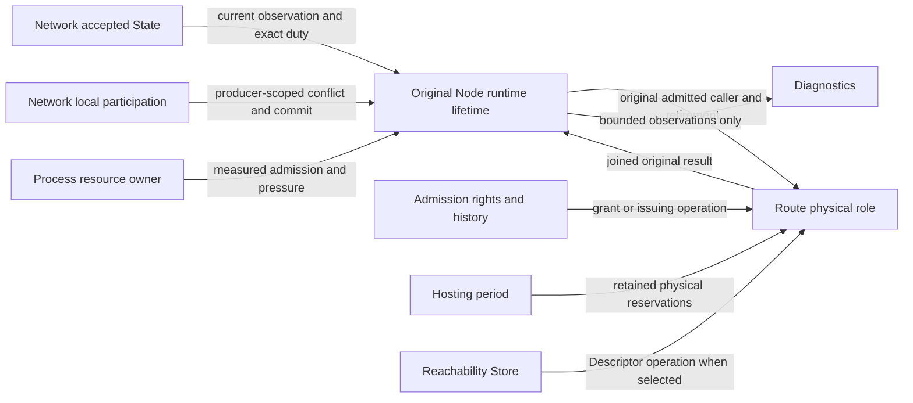

# Domain ownership map

This map owns semantic responsibilities, exclusions, collaborations and completion
boundaries. It does not select work, record delivery status or qualify a product.
Accepted ADRs and current product/security/technical contracts remain authoritative.
[CONTEXT.md](../../CONTEXT.md) owns product language; [package-map.md](package-map.md)
owns exact Go packages and imports. Detailed formats, native procedures and
scenario rules stay with the linked technical owners.

The nearest closed release uses TCP/TLS under
[ADR-0122](../adr/0122-select-tcp-only-closed-release.md), with explicit pre-effect
QUIC refusal and no fallback. The unresolved [QUIC finding](dependencies.md#existing-quic-finding-return-path-reply-budget)
remains separate. This changes no authority or old/new isolation boundary.
Component behavior, issue acceptance, repository integration and installed/privacy
qualification are distinct results; verify them in the selected GitHub ledger.

## Reading and planning route

Use this document to prepare a domain change:

1. Find the domain's question, rules and exclusions in
   [Domains and boundaries](#domains-and-boundaries).
2. Identify its state, physical borrowers and terminal owner in the
   [completion inventory](#consistency-resources-and-completion-inventory).
3. Select the permitted interaction from the
   [inter-domain contract](#inter-domain-interaction-contract) and
   [collaboration matrix](#collaborations-to-review).
4. Describe each affected operation using the
   [interface checklist](#interface-checklist-for-development-plans), then
   check its actual source and current technical owner.
5. Verify task selection and acceptance in GitHub before implementation.

| Planning question | One current owner |
|---|---|
| Product outcomes, non-goals and threat conditions | [Scope](../product/scope.md), [threat model](../security/threat-model.md) and their linked contracts |
| Domain boundaries, responsibility and inter-domain interaction | This map; the affected technical owner supplies exact rules and formats |
| Actual package/import direction and dependency admission | [Package map](package-map.md), [dependency register](dependencies.md) |
| Component prerequisites and whole-journey coverage | [Privacy integration map](privacy-anonymity-map.md), [Route integration](route-delivery-join-boundary.md) |
| Work selection, domain order, transition conditions and full issue acceptance | The selected parent and child issues in the [C0 milestone](https://github.com/dianabuilds/ardents-network/milestones), under [current selection](agent-execution.md#current-selection-takes-precedence) |
| Execution, handoff and verification method | [Agent execution](agent-execution.md), [testing](testing.md), [privacy qualification](privacy-qualification.md) |

An interaction described here is a contract to preserve, not evidence that its
complete consumer is implemented. The [realized boundaries](#realized-boundaries-and-their-limits)
identify concrete consumers and their limits. A draft, prepared interface or
successful narrower test cannot upgrade that result or select the next domain.

## How to preserve the map

Read this map before delegating a domain slice and after every orchestration
compaction/handoff. Compare it with the actual source and current owners before
updating it. A source path, successful import or directory rename cannot prove
that a responsibility moved to the correct domain.

Keep every identified domain in the inventory, including domains not yet
implemented. Do not delete a responsibility when its old source is removed.
Give each maintained rule one semantic owner and name its actual consumer and
evidence. If ownership changes, update both the receiving owner and the former
owner's exclusions, their collaboration, package registry and affected oracles
in the owning change. A shared technical mechanism does not merge authorities,
databases, principals or lifecycle owners.

Newly found responsibilities must be classified: existing domain rule,
application composition, technical adapter, or a proposed new boundary. Do not
silently put them in a generic shared package or invent a domain to hold a test.
Escalate consequential unresolved ownership with exact evidence and a concrete
proposal, while continuing unaffected authorized work.

The entries below describe DDD contexts and supporting owners. Network's numeric
Role Domains are a different protocol concept. Temporary `successor` paths,
delivery labels and issue numbers are not product domain identities.

## Domains and boundaries

These are ten semantic families, not ten packages, processes, databases or global
aggregates. A family may contain separate consistency owners at different
principals. Software acceptance retains separate Enrollment and Release owners.
[ADR-0125](../adr/0125-separate-software-delivery-and-infrastructure-deployment.md)
removes Installation as a standalone domain and separates user application
delivery from infrastructure deployment. Existing Installation code remains a
transitional implementation until responsibilities and evidence have transferred.
Local Application execution is the execution boundary, not all Application functionality.

| Domain / question | Owned rules and distinct owners | Explicitly outside | Current owner |
|---|---|---|---|
| **Network:** which authenticated facts may be used now? | Candidate eligibility/assignment; Epoch/profile, conflict and time floors; bound membership; coherent observations and same-observation retained duty; separate local participation | Route purpose/path choice, Admission rights/spend, Hosting budget, process monitoring, private signing, Job/Service authority | [Network State](../technical/successor-network-state.md); `internal/successor/network` and its State/authentication/Source/durable/duty owners |
| **Admission:** which finite rights can be obtained and spent? | Allocation, issuance quota, private material/results, holder permission/pending batch/stock, presentation, receiving verification/allowance and durable spend are separate owners; fresh-root creation is a storage fact | Network authenticity, transport scheduling, Introduction slots/floors, Hosting budget, Local Grants, Custody keys and file delivery | [Admission boundary](../technical/successor-admission-boundary.md), [implementation map](../../internal/successor/admission/README.md), [private admission](../technical/private-admission.md) |
| **Hosting:** which physical allowance can this owner reserve? | One provider-period Tx/Rx policy, measurements, durable budget, original initial-file ownership transfer, work/termination reservations and exact return | Token authority/debit, Node assignment, role envelope, transport join, CPU/RAM/cgroups or global monitoring | [Hosting](../technical/successor-hosting-budget.md); `internal/successor/hosting` |
| **Route:** which protected leg and role channel may this operation use? | Entry/Interior selection and retention, role-purpose rules, prefix/lanes/credit, forwarding/refill transport, receiving Introduction slots/delivery/floors, JOIN pairing and physical termination | State acceptance, Admission policy/spend, Hosting budget, Publication readiness, Descriptor authority/history, Instance authentication and logical recovery | [Protocol](../technical/protected-route-protocol.md), [prefix](../technical/successor-route-prefix.md), [Introduction](../technical/successor-route-introduction.md), [JOIN](../technical/successor-route-join.md), [migration](route-migration-contract.md) |
| **Local Application execution:** may this process invocation perform this operation? | Local Grant generation, session/current-last Job and one-use handoff, separate cleanup supervisor/capacity, qualified original launch and joined descendants. Job is an entity within the session | Tokens, Service authority, Target/path selection, private routing history, Publication, Connection recovery, software acceptance, process pressure, text semantics and qualification Run | [Execution](../technical/application-execution.md), [confinement](../technical/application-confinement.md); `internal/successor/execution`, `worker`, `runtime` |
| **Service Publication:** which authorized Instance is accepting work? | Publication generation/revision, current/pending/predecessor pair, private recipients, ACK/readiness, refresh/withdrawal; purpose-scoped Instance material | Credential-root signing, Route transport, Store conflict floors, Connection recovery, Job mutation and worker cleanup; retain the exact live Execution operation instead | [Service runtime](../technical/endpoint-service-runtime.md#publication-and-connection-lifecycle), [private reachability](../technical/private-reachability.md); `internal/successor/publication`, `durable`, `instance`, `runtime` |
| **Reachability:** what current proof is valid for this Target? | Receiving Descriptor Store/durable conflicts; separate local lookup verification/history at another principal | Publication readiness, token spend, path selection, Instance authentication and logical Connection | [Private reachability](../technical/private-reachability.md); `internal/successor/reachability` |
| **Service Connection:** how does one authenticated logical stream retain its identity? | Immutable destination/provenance, exact Instance TLS, ordered bytes, Attachment generation, continuity/recovery bound and retained Terminal outcome; exact Execution checks at effects/handoffs | New Target/operation/Grant, Job mutation/cleanup, Publication authority, Route policy and physical reservations | [Service runtime](../technical/endpoint-service-runtime.md#publication-and-connection-lifecycle), [Execution seam](../technical/application-execution.md#required-lifecycle-and-linearization); `internal/successor/connection` and its pure `wire` records/transcripts |
| **Software acceptance:** which exact generation may be installed or run? | Separate Enrollment pin/inventory and Release authorization/floors; `release/endpoint` owns the opaque application proof pair; `release/infrastructure` owns distinct infrastructure proof pairs. Application delivery and infrastructure transition/replacement/recovery and Startup owners remain transitional under ADR-0125 | Network membership, Admission rights, Service authority, generic signing and automatic rollback | [Enrollment](../technical/enrollment-verification.md), [Release](../technical/release-update-custody.md), [Installation](../../internal/successor/installation/README.md) |
| **Authority Custody** (supporting boundary): which purpose-bound authority operation may be performed? | Encrypted authority records, approved signing commitments, recovery and authority floors; separate authority kinds | Generic `Sign`, exported private authority, domain decisions owned elsewhere, runtime Instance/Node keys | [Custody](../technical/release-update-custody.md); `internal/successor/custody` with purpose-specific Admission/Publication consumers |

## Supporting mechanisms and composition

A shared mechanism never transfers another owner's admission, mutable root,
lease, private material or lifetime. Directory nesting grants no imports. The
[package map](package-map.md) registers concrete callers and exact dependencies;
this inventory records why their responsibilities stay separate.

| Owner | Responsibility | Boundary and detailed owner |
|---|---|---|
| Endpoint / Node composition | Construct genuine owners, order calls and supervise transfers/termination | Domain policy stays with the deciding owner. Only exact canonical files admitted by [R01](route-migration-contract.md#r01-isolate-both-directions) may cross the old-command/new-Route boundary; no wrapper, callback or process bridge |
| State/Hosting/Route adapters | Canonical byte verification, durable transactions, counters, sockets and Carrier mechanisms | No authority minting, floor reset or copied domain policy. Lower Route `transport` owns neither operation nor adapter selection; [Route integration](route-delivery-join-boundary.md) owns composed behavior |
| Endpoint delivery request/input | Closed declarations, original protected file/ancestor custody, byte/inode/access reobservation and joined secret erasure | No Release right, writer lease, journal, birth, selection or Startup; [Endpoint Installation](../../internal/successor/endpoint/delivery/README.md) and [infrastructure inventory](../technical/network-route-node.md#producer-proof-and-external-input-inventory) |
| Installation directory and fixed-file mechanisms | Exclusive original birth; same-inode writes/access promotion, rechecks, sync and physical Close | Installation retains allowed paths/bytes/account, original caller, Release, journal order and effect admission. A copied inode or birth grants no adoption, recovery or runtime right; [Installation implementation](../../internal/successor/installation/README.md) |
| Endpoint delivery generation files | Closed inventory, original creation/partial custody, independent read-only Snapshot, bounded same-inode Prefix continuation | Endpoint delivery admits fresh proofs, birth-before-bytes, phase access, selection and recovery; mechanisms grant no Release or startup. Original and recovery-owned births stay distinguishable; [generation provenance](../../internal/successor/endpoint/delivery/README.md#original-generation-file-provenance) |
| Application delivery journals | Endpoint preparation records and independently retained native transition custody through append/resync/Close | Transitional Endpoint delivery owns phase admission, effects, original lease, failure and barrier order; bytes alone grant no continuation. `endpoint/delivery/journal` owns only its record and physical mechanism; [Endpoint owner](../../internal/successor/endpoint/delivery/README.md) |
| Infrastructure artifact inventory | `release/infrastructure` compares fixed role-specific artifact commitments using Enrollment-validated public inventory bytes | Copied facts and hashes grant no Enrollment provenance, Release authorization, configuration or runtime permission; each role separately verifies its request, plan and rendered unit |
| Infrastructure invocation records | Bounded Node and Source invocation and retirement record grammars | Transitional infrastructure lifecycles retain native custody, admission and completion; detached records grant no runtime right; [infrastructure lifecycle](../technical/network-route-node.md#proposed-lifecycle-and-effect-admission) |
| Protected input files | Independent original read-only file and ancestor custody, bounded reads and joined close | No declaration, Release, mutation or runtime authority; `internal/successor/protectedfiles` |
| Infrastructure deployment declarations | Portable fixed Node paths, four role-specific runtime plan grammars, the fixed Source and Node service templates and shared public Network input/trust syntax consumed by the Node roles and Source preparation | Parsing grants no Release, Network authority, filesystem effect or runtime permission; `internal/successor/deployment` |
| Ubuntu host observation | Fixed Ubuntu release declaration and independently retained original file observation | No Release, process, deployment or startup authority; `internal/successor/ubuntu` |
| System-bus value validation | Bounded detached frame, native value and scalar decoding | Original manager transport retains connection and role-specific reply admission; validation grants no connection or runtime authority; `internal/successor/systemdbus` |
| Detached systemd properties | Bounded decoding and exact comparison of typed manager observations | Endpoint unit policy, Execution worker and transitional manager readers use detached data; no manager connection, process custody or startup authority; `internal/successor/systemdproperty` |
| Endpoint service manager | Fixed Endpoint and activation-socket systemd observations and finite original commands | Transitional Endpoint delivery owns admission and original completion; manager results supply no Release or joined runtime right; `internal/successor/endpoint/delivery/manager` |
| Endpoint fixed unit contract | Endpoint-specific service and activation-socket expectations, shared with its worker; detached typed observations only | No Release, manager mutation, process custody or startup authority; `internal/successor/endpoint/delivery/unit` |
| Installation systemd, process and cgroup | Fixed infrastructure unit expectations; actual manager and kernel observations; original proc/executable/argv/credentials/invocation custody; independently joined native effects | Detached facts grant no Release, mutation, original domain completion or Startup. Root controls, read-only inspectors and non-root self-observation remain separate lifetimes; [installed binding](../technical/network-route-node.md#proposed-exact-artifact-and-installation-binding) |
| Installation completion exchange | Original finite Unix connection, peer credentials, frame/reply, deadline and joined cancellation | Root owns synced archive-before-ACK; independent Startup retains its own generation/process/manager observations. The exchange grants no readiness or writer lease; [Endpoint startup](../technical/endpoint-service-runtime.md#selected-protected-installation-handoff) and each [infrastructure lifecycle](../technical/network-route-node.md#proposed-lifecycle-and-effect-admission) |
| Process resource owner | Original placement, finite measurements and pressure availability | Node reacts and owns its terminal outcome; Hosting counts provider bytes, Network owns accepted State. Unknown metrics are not zero; [native profiles](../technical/network-route-node.md#node-and-resource-lifecycle) |
| Offline provisioning and purpose-specific signing | Original protected inputs/keys, exact reviewed public bytes, finite output, secret erasure and joined custody | Network authenticates Records/Epoch/profile; Release authorizes exact targets; Enrollment owns independent pin/inventory. Shared I/O or key generation does not share a signing purpose. No universal Identity/PKI/Control signer; [producer inventory](../technical/network-route-node.md#producer-proof-and-external-input-inventory) |
| `admission/issuerprofile/signing` | Independently pinned imported Ed25519 material, original lease/failure/Close, exact issuer-profile signing | No Network membership, runtime duty or generic Node identity; [issuer profile](../technical/successor-issuer-profile.md) |
| Text Application | Bounded text/snapshot semantics, UTF-8/document rules, multiplexing/credit and safe presentation | Worker receives only selected snapshot and bounded bytes, no destination or Endpoint/Publication authority; `internal/application/textdocument` and [workload](../product/protected-service-workload.md) |
| Local Application IPC | AAI3 Connection and separately authorized Administration grammar/transport cleanup | IPC/READY does not attest a qualified Job; Administration supplies no stream/Service authority; [Execution](../technical/application-execution.md) and [Service](../technical/endpoint-service-runtime.md) |
| Disclosure and diagnostics | Public catalog verification, bounded process/timeline observations and command projection | No State/Release/runtime permission, global cross-role tracing or invented readiness; `alphacontrol`, `diagnostics` and [diagnostics owner](local-diagnostics.md) |
| Integration and qualification | Registered cross-domain test composition; selected Run, observers, measurements, barriers and retained reports | Neither production domain nor authority/Job substitute. Domain tests retain their own rules; an installed claim needs its exact environment and candidate under [testing](testing.md) and [privacy qualification](privacy-qualification.md) |

Offline Source contact/trust preparation supplies public declaration evidence,
not a second effective family, acquisition Plan or installed acceptance. State
retains its ordinary two-Source acquisition and fresh signed/time/floor rules.
Node certificate self-signature is not membership. Runtime TLS, offline State/
Node preparation, issuer-profile signing, Release signing and Custody authority
remain distinct purposes. Exact commands and input inventories belong to the
[command reference](../reference/commands.md) and technical producer owner.

Installation preflight observes existing inputs and absent future resources;
absence is not creation authority. Initial stopped installation leaves semantic
roots empty. Hosting alone initializes its known-born allowance; receiving
Admission and Route Registry initialize their own histories only through their
accepted fresh-root collaboration. Descriptor Store creation/inspection remains
Reachability's decision. Independent history readers retain their own custody;
historical account effects do not freeze host-owned account databases.

Stopped replacement and recovery consume fresh Release plus genuine existing-only
semantic inspections, not live foreign owners. Physical cut, native process exit,
archival, ACK, copied result and complete-looking journal are different evidence;
none substitutes for original domain completion. New installations follow
[ADR-0124](../adr/0124-start-new-installations-without-legacy-data-transfer.md);
their own keys, spend, conflict/replay/time/Release floors and original histories
survive retained restart, replacement and recovery. Detailed per-role journal
recipes belong only to the [installed infrastructure owner](../technical/network-route-node.md#proposed-lifecycle-and-effect-admission)
and [Endpoint Installation](../../internal/successor/endpoint/delivery/README.md).

## Node composition: original lifetime boundary

`internal/successor/node` composes one original Forwarding, Issuer, Descriptor,
Introduction or JOIN invocation. It is a supporting lifetime, not an eleventh
network authority. Node, process, signed identity and accepted duty generation
remain distinct. The [Node owner](../technical/network-route-node.md#node-and-resource-lifecycle)
owns exact behavior; GitHub owns selection and acceptance.

Canonical installed composition constructs new owners directly under R01's exact
file/import exceptions. Source has a separate State/Source command lifetime;
Endpoint installation cannot authorize Source or Node through a shared artifact,
unit or Startup. [ADR-0123](../adr/0123-bind-installed-infrastructure-generations.md)
retains independent inventory, exact target authorizations and separately
accepted bootstrap receipt requirements. Preparation or a narrower component
result grants no installed qualification.

| Installed lifetime | Current technical rule owner |
|---|---|
| Source initial/start/retirement/restart and forward transition | [Initial persistence](../technical/network-route-node.md#initial-stopped-source-persistence), [forward grammar](../technical/network-route-node.md#explicit-forward-source-transition-grammar), [retirement](../technical/network-route-node.md#explicit-source-retirement-and-subsequent-invocation) |
| Forwarding original invocation and generation transitions | [Initial/restart](../technical/network-route-node.md#forwarding-initial-lifetime-and-explicit-same-generation-restart), [replacement/recovery](../technical/network-route-node.md#explicit-forwarding-generation-transitions) |
| JOIN original invocation and generation transitions | [Initial](../technical/network-route-node.md#initial-stopped-join-persistence), [Startup](../technical/network-route-node.md#protected-first-join-start-and-independent-startup), [replacement](../technical/network-route-node.md#explicit-stopped-join-replacement), [recovery](../technical/network-route-node.md#join-stopped-original-prefix-recovery) |
| Descriptor original invocation and separate Store history | [Initial](../technical/network-route-node.md#initial-stopped-descriptor-installation), [Startup](../technical/network-route-node.md#protected-first-descriptor-start), [retirement/restart](../technical/network-route-node.md#descriptor-original-stop-and-retained-restart), [replacement](../technical/network-route-node.md#descriptor-explicit-stopped-replacement), [recovery](../technical/network-route-node.md#descriptor-complete-stopped-replacement-recovery) |
| Introduction original invocation and separate slot history | [Initial](../technical/network-route-node.md#initial-stopped-introduction-installation), [Hosting preparation](../technical/network-route-node.md#stopped-introduction-allowance-preparation), [Startup](../technical/network-route-node.md#introduction-original-first-start-and-independent-startup), [history](../technical/network-route-node.md#independent-introduction-first-start-history), [Stop](../technical/network-route-node.md#introduction-explicit-original-stop), [retained restart](../technical/network-route-node.md#introduction-retained-same-generation-restart) |
| Issuer runtime and its separately admitted installed scope | [Original Issuer](../technical/network-route-node.md#original-issuer-composition), [installed inventory and admission](../technical/network-route-node.md#proposed-installed-infrastructure) |

Introduction retained restart keeps each original invocation and retirement chain,
fresh Release and native admission, and independent existing-only State,
participation, Receiving, Hosting and Route history checks. It transfers no live
owner or right between roles; replacement and recovery remain separate.

A listed contract does not imply every lifecycle or interruption boundary is
implemented or accepted. In particular, a real Issuer runtime does not provide
Issuer installation, and Introduction first-retirement does not establish
retained-restart, replacement or recovery acceptance. Preserve the limits of the
current technical owner and selected issue.

### Assessment and responsibility inventory

Node is a supporting composition over substantive Network and Route rules.
Light DDD is appropriate for this lifetime: model original identity,
admission, retirement and completion precisely. Do not create a universal Node
aggregate, repository, event bus or microservice around the old directory.
Network and Route retain their own substantive domain models.

| Responsibility | Semantic owner | Current seam / remaining boundary |
|---|---|---|
| Membership, duty/profile and purpose checks | Network authenticates and binds membership; Route admits its exact purpose; composition matches local credentials | `state.CurrentRuntime`, `RuntimeView.RetainDuty/MatchDuty`, `route/role.Authority`; copied diagnostics cannot replace them |
| Producer-owned local conflict retention | Network's separate local-participation policy and native `network/duty` owner; Node lifetime owns its producer's physical completion | Source uses `duty.OpenOperation/Replace/Remove`; the Node lifetime consumes `duty.OpenNodeProducer/Check/Live/Close` with private producer and original-caller fencing |
| Startup, retirement and process result | Original Node runtime lifetime, orchestrated by command composition | No new general Node supervisor is inferred from `route receive`; transport already has its own currentness watcher and joined Close |
| Queues, channels, slots, pairing and physical work | Route | New `receiver`, `channel`, `introduction`, `join` and concrete Carriers own these mechanisms; Node must not copy them |
| Issuance and reserve-before-spend composition | Admission owns issuance/spend; Hosting owns the period; Route owns the physical exchange | New `admission/issuer`, `receiving`, `hosting`, `route/issuer` and the real `route receive` composition already collaborate |
| Receiving Descriptor rules and physical listener | Reachability owns proof/conflict/history; Route owns receiving transport | New `reachability.Store` and `receiver` have a real command consumer; Node grants no Store ACK or publication readiness |
| OS observations, pressure classification and reaction | Separate process-resource owner measures/classifies; Node lifetime reacts; Hosting retains provider-period accounting | New `processresource` owns actual original Linux placement, counters and pressure, plus detached process start-clock parsing shared with installed observation; `node` composes its synchronous work checks. No old-runtime import or historical profile revival |
| Source serving and background termination | Network State and Source, with their own command composition | New State owns Source exposure, Wait and Close; `ardents-next source serve` composes that original owner with its distinct processresource Source guard. State joins transport/handlers before guard release, retains its own root lease through producer cleanup, and composition releases process pins last. A Source is not another Route role selected by Node dispatch |
| Purpose-specific credential loading and signing preparation | Purpose-specific credential mechanisms and provisioning; accepted Node identity stays with Network facts | Admission `issuerprofile/signing` grants only imported offline issuer-profile signing, not generic TLS/Node authority or State signing |
| Lifecycle/resource event output and qualification fixtures | Bounded diagnostic projection and independent test composition | Neither output success nor a measured/unknown field grants readiness; historical tests cannot replace the new independent oracle |

### Original lifetime and state

The consistency boundary is one original runtime invocation and one
retained role generation. It owns its admission/terminal latch, original caller,
startup work, cancellation callbacks, physical borrow inventory and immutable
first failure. It references external owners through their narrow contracts;
it does not own their journals, budgets, private roots or policies.

Its retained binding comes from one coherent authenticated observation: Network,
Epoch/profile, Node/key/family, record generation, assignment, endpoint, Carrier
and finite bounds. A retained binding is copied evidence, not an independent
live permit. Network rechecks it; the runtime additionally checks its original
invocation and process admission. Node may not pick the first locally available
role or silently rebind that lifetime to a successor.

| Local transition / observation | Owner and required ordering |
|---|---|
| Prepare original invocation | Validate declared roots/credentials/resource profile; obtain genuine current Network binding and producer-scoped participation admission before accepting role work |
| Acquire role | Retain the original startup caller; open genuine collaborating owners; recheck after native I/O and before publishing the accepting lifetime; creator joins rejected partial acquisitions |
| Serve | Route rechecks authority at its effects. Process protection controls new work through the original runtime; measurements require declared scope, freshness and availability |
| Protect or retire | Local denial is synchronous. A pressure observation, diagnostic event or polling tick cannot substitute for denial; interrupt original dependents before waiting |
| Join and finish | Route joins physical users first; then composition closes purpose roots/Hosting borrows, updates only its own participation producer and releases remaining owners. Preserve first failure and all cleanup causes |

For the selected Forwarding, Issuer, Descriptor, Introduction and JOIN compositions, Network retains `node-duty/live`
identity/family conflicts until the original producer releases them after join.
The earlier Epoch/Record bound still denies work; it does not prove physical
completion. Prepared/quarantined Node facts remain time-held. An unresolved
live producer, including after lost cleanup, cannot be pruned or adopted as a
restart shortcut. This refines local restriction retention, not membership,
Source exposure, another Node role or a persisted-format migration.

An early failed outcome and known physical completion are different results.
If a bounded attempt cannot prove join, it must preserve the failed result and
retain still-needed resources/conflicts; it cannot publish successful withdrawal
or invent free capacity. A new lifetime cannot inherit the old one's failure,
authority or borrowers, nor begin as an automatic recovery/restart policy.
Exact compatibility of outward states remains with their current owning formats.

### Narrow collaborations and effect checks

These arrows describe owner calls, facts and physical borrows, not cyclic Go
imports. A runtime supervisor must not import its command composer; Route,
Admission, Hosting, Network and process-resource mechanisms do not import the
supervisor. Exact future package admission must establish an acyclic graph.
No foreign I/O/join or policy callback occurs under a runtime state lock.

Network retains accepted-state and local-participation consistency separately.
Shared local participation history has one policy/storage owner and short
producer-scoped operations; it is not a shared live State/Node root, lease or
mutex. Node release follows actual role join. Source exposure cannot be removed
by Node or expired merely because a caller is stopping.

Process placement/CPU/RAM/availability are separate from Hosting bytes. The new
Receiver exposes `Listen`, `Done` and retained `Close`, not the predecessor's
`Protect/Usage` surface. Before accepting a complete new Node runtime, specify
genuine protection/measurement seams and the applicable current native profile.
Unknown timers/queue/admission values are not zero. Missing required protection
does not authorize an unprotected accepting path or an optional stronger mode.
Profile changes need their current owner's admission; historical stage labels
do not become new domain or runtime identities.

Runtime TLS credentials must match the accepted member at the owned effect;
offline issuer-profile signing is a different purpose. Credential loading is a
physical mechanism, not a universal Identity/Custody domain. Enrollment, Release
and installed-process validation retain their own authority; a development role
consumer cannot establish a supported Node installation or qualified host.

### Realized prerequisites and design limits

`cmd/ardents-next/route_linux.go` composes genuine State/duty, Receiving, Hosting
and Receiver, with an Issuer or Descriptor owner only for its exact duty. The
five `node_*_linux.go` command consumers compose original Node lifetimes.
Receiver uses TCP/TLS, refuses deferred QUIC before listening and joins physical
work; it is not by itself a complete Node/installed-runtime acceptance.

Node retains only its invocation's role-specific lifetime: JOIN pairing remains
Route policy; Introduction Registry/floors remain Route; Descriptor Store remains
Reachability; issuer quota/key/results remain Admission; Hosting keeps separate
Control/Bootstrap reservations. Node neither receives private RSA/signing rights
nor invents refill, Service authority, replacement or a foreign cleanup failure.
The [original role contracts](../technical/network-route-node.md#original-forwarding-composition)
record exact acquisitions, effect ordering and completion.

Forwarding has separate Node Guard/participation, Route authority and installed
Startup supervisors. Each effect still requires fresh original observations.
Shared Startup rounds admit only requests present before physical reads begin;
later requests wait for another full round. The [Startup observation contract](../technical/network-route-node.md#proposed-lifecycle-and-effect-admission)
keeps fresh before/after brackets, bounded observer/waiter custody and joined
Close; no timer or cached result grants authority.

Source, provisioning, installed/operator acceptance and privacy qualification
remain separate. Historical old-runtime failures retain their exact source scope;
they neither select repairs nor prove failure of new owners. Required checks of
the selected change remain mandatory.

## Consistency, resources and completion inventory

The semantic owner below decides transitions. Storage, crypto and operating
system adapters enforce its declared mechanism; they cannot acquire the rule.
Separate roots are separate histories, not arbitrary new root names that may
erase installed floors. Every live operation retains its original identity,
bounds and terminal result; no late completion can act on a replacement.

| Family | Distinct state/authority owners | Resources and completion responsibility |
|---|---|---|
| Network | Authenticated State/history/conflict/time floors; retained runtime duty; separate local participation | State owns its root/lease and intake work; participation stops its own effects. Observations grant no indefinite right to callers and cannot replace their final currentness checks |
| Admission | Allocation; issuer quota/debit; private key/results; holder stock/pending/presentation; receiving verification/spend | Each principal owns its own private durable history. Issuer stores debit before response; holder stores presentation before sending; receiver reserves before spending. Receiving serializes original observations/spends outside its state mutex; Close seals admission before joining original callbacks and refusal release, then returns the spend lease. Work owns transferred physical reservation until join; no later failure refunds a token |
| Hosting | Provider-period counters, durable budget, current measurements and finite work/termination reservations | Hosting owns budget and actual once-only return. Physical borrowers keep the reservation until joined; close of another domain cannot invent capacity or reset usage |
| Route | Entry selection/floors retained for the Endpoint installation; local retained Interior/Rendezvous; role channel/parent/children; Introduction registry and slot history; JOIN pair and queues | Route owns Carrier/TLS/readers/writers/timers, wire accounting and physical stop/join. Its channel-local identifiers and private selection stay local; no full-path object or shared private history at a Node |
| Local Application execution | Volatile authority generation; execution session with current/last Job and one-use handoff; supervisor capacity and first terminal failure | Exact verified invocation/attachment/pinned original descendants. Revoke synchronously denies new effects, interrupts all dependents, joins the original worker tree, then returns cleanup capacity. Job is an entity within the session, not an independent network context |
| Service Publication | Purpose-scoped Instance generation/material; publication lifecycle with current/pending/predecessor pair, revision, recipient/replay and readiness | Publication stops new acquisitions before joining registrations and retiring/erasing private recipients. Descriptor Store ACK and REGISTER ACK remain different prerequisites; a late ACK cannot renew a retired generation |
| Reachability | Receiving Descriptor Store/conflict floors; local exact-Target lookup/history at another principal | Receiving Store owns original native root/records/marker/lock/record custody, permanent operational denial, serialized durable effects and ACK; joins original operations before retained physical release. Foreign observations run outside its state mutex. Lookup owns its bounded attempt/history. Refusal cannot expose an older proof or substitute another destination; proof validity is neither readiness nor Instance authentication |
| Service Connection | Immutable destination/provenance, authenticated Instance, logical ordered bytes, Attachment generation, original recovery bound and terminal result | Connection stops/joins its current Attachments and retains the logical outcome. Route joins each physical stream; Execution joins its worker. Recovery changes an Attachment, never Target, Job, Grant or original recovery time |
| Software acceptance | Enrollment first-pin/inventory; Release authentication and monotonic floors; installation/replacement journal and generation ownership | Enrollment cannot sign or install; Release authorizes exact bytes but cannot download/activate. Installation authenticates fixed resources, joins its predecessor and completes its own transaction before runtime admission; ordinary Job cleanup does not own replacement |
| Authority Custody | Purpose-specific encrypted vault/recovery record, approved signing commitment and retained authority floors; separate authority kinds | Custody owns unlock, secret erasure and durable successor-before-response. Service Credential issuance retains its own purpose-specific approval/generation policy; Admission supplies allocation rules. No generic Sign or shared right across Service, Admission, State, Name and Release. Runtime Instance/Node keys stay outside the vault authority owner |

### Endpoint application composition

`internal/successor/endpoint/funding` coordinates original Source Stock
preparation/issuance/presentation and retains shared Entry/Hosting parents.
`endpoint/reader` owns the qualified request's Source, lookup history, selected
roles, stream handoff and joined local result. Its one qualified Operation
is consumed by both installed IPC and the console Reader; root construction
retains its original ordering around that operation. `endpoint/publisher` owns snapshot
launch, pending/active handoff, Source/Introduction/Responder composition,
Instance/history borrows, serving and joined withdrawal. These are application
scenario boundaries, not new semantic domains. Their sole command consumer
remains `cmd/ardents-next`, including its installed participant invocation.

Admission retains finite allocation and irreversible presentation/debit; Network
retains live authority; Route retains selection and physical join; Execution
retains worker admission/results; Publication retains readiness/refresh/replay;
Connection retains logical bytes and recovery. The original participant joins
all requests/publications before closing shared parents, Stock and authority.
`endpoint` owns the original participant Startup, State, local Execution,
permission file exchange and shared parents. Its bound Installation declarations
are also consumed by offline Source preparation, without runtime authority.
CLI selectors, diagnostic rendering and exit projection stay in the command. Splitting these lifetimes
changes neither accepted persisted/wire bytes nor installed qualification.

`endpoint/session` retains one serial holder conversation: original issuance
attempt and intent, Prefix/JOIN context, registration, Publication, stream and
lookup history. Its separate local, preparation and live-operation constructors
borrow genuine authority and transfer Stock only on success. Every typed method
checks the sealed Execution permission independently of CLI dispatch; joined
preparation still admits only permission/bootstrap operations. Explicit Finish
joins children and Stock before its final permission check, while deferred Close
retains the same terminal result. Network and Execution remain outer owners.
Native Prefix/Bootstrap/JOIN construction lives with this application scenario;
Route retains selection, role and physical transport policy. The command keeps
input DTOs and result/error-stage rendering. Test adapters lend real new handles
only and do not reintroduce production command callbacks.

## Responsibilities outside the selected transition

**Naming is an explicit future separate model:** Service Name to authenticated
Target binding. The current maintained journey uses Target Links; Namespace and
Name signing routes are retired. Keeping this future boundary visible does not
restore their code, wire, signing rights or select implementation. Person,
Device, Persona, transport identity, Service Target, Credential and Capability
also remain distinct glossary concepts; this map does not create an Identity
domain or a universal authorization model by conflating them.

Public storage, consensus, blockchain, governance and long-term public transport
are unselected product/technology decisions. They are not silently inferred
domains or tasks for this DDD transition. Current accepted bounded transport and
software compatibility obligations remain with their named owners. A new
boundary needs a concrete domain question, rules, state/termination owner and
real consumer before package or implementation admission.

## Realized boundaries and their limits

| Owner | Maintained new behavior | Separate remaining boundary |
|---|---|---|
| Network, Admission, Hosting | Authenticated State/current observations, separately owned rights/history and durable physical budgets; genuine new command and Route consumers | Complete old-runtime cutover and installed/public qualification are not inferred |
| Route | Retained prefix/channel and TCP/TLS; explicit deferred-QUIC refusal; REGISTER/WITHDRAW and durable floors; opaque relay delivery and paired JOIN; parent refill, issuer and Descriptor Control; genuine qualified Reader/Publisher Service consumers and five original native Node compositions | [Future QUIC admission](dependencies.md#existing-quic-finding-return-path-reply-budget) remains blocked by its unresolved finding; supported operator cutover, old-runtime retirement, installed Node, whole-host and privacy qualification stay separate |
| Execution | Volatile local authority/session/Job, fixed native worker, original operation and joined cleanup; permission, holder and installed bootstrap consumers | Logical Service recovery and complete installed journey remain separate |
| Publication and Reachability | Public proof, consumed private Instance, live qualified Publisher, accepting registration/Store-ACK pairs, refresh/withdrawal, private recipient/replay; independent Store and local lookup history | Full Service TLS, logical Connection and installed product qualification are not implied by accepting Link or capsule transport |
| Connection | Immutable original binding, exact-Instance TLS/Continuity, bounded ordered stream and Terminal controls; genuine Reader/Publisher Text transfer, finite recovery and Route-backed Attachments retain original Execution/Publication; independently admitted installed participants consume these same owners | Service authentication and recovery grant no new Target, Job, Grant, publication authority or physical Route allowance; complete operator and privacy qualification remain separate |
| Enrollment, Release, Installation | Pinned immutable inventory; offline exact-byte authorization/floors; separate generation authentication and native initial/replacement/recovery/startup consumers | Full interruption matrix, private Service journey and installed acceptance remain separate |
| Custody | Encrypted Vault/Bundle, purpose-specific Admission through new Allocation and Service through the pure public request/response contract, original exclusive lifetime, authenticated successor/floors and separate quarantine; genuine terminal command consumer | Full operator/installed integration and platform/crash qualification remain separate |

Real consumers are recorded above and in the [implementation entry point](../../internal/successor/README.md).
An accepting Link/capsule, successful authentication or a physical cleanup receipt
proves only its own boundary. The [Service lifecycle](../technical/endpoint-service-runtime.md#publication-and-connection-lifecycle),
[Execution lifecycle](../technical/application-execution.md#required-lifecycle-and-linearization)
and [Route integration](route-delivery-join-boundary.md) own the complete rules:

- One original Execution operation and immutable Instance lease survive transport
  gaps; recovery replaces an Attachment, never Target, Job, Grant or its bound.
- Connection retains logical byte/Terminal outcomes; Route retains each physical
  generation and joined cleanup. Application completion can precede the joined
  Terminal-control tail. Recoverable loss or cancellation cannot erase a physical
  failure or be reclassified as one merely to end the Job.
- Final handoff checks precede caller-visible bytes and clean outcome; failed
  fences expose neither staged plaintext nor a positive read count. Setup expiry
  and original refusal remain failures despite buffered input or later cancellation.
- Instance, recipient and Stock native observations run outside their state locks;
  original use borrows join before private material, journals or reservations return.
- Reader/Publisher Route scopes retain selected legs and original logical bounds.
  Each acquisition binds one physical generation; old handles never follow a
  successor. An ended generation joins before fresh resources open. Issuer use
  cannot recursively replace Source during dependent presentation; Descriptor
  Store ACK commits under its exact retained acquisition.
- Installed listeners and pending/active Publications join before shared Entry,
  Hosting, Stock and State close. Startup/ACK and diagnostics supply no worker or
  Service permission; live Execution admission remains separate.

Source hashes, attempts, receipt provenance and acceptance remain in the selected
GitHub ledger and existing evidence, not this map. Documentation consolidation
cannot upgrade an inspected result to reproduced or qualified evidence.

## Collaborations to review

Apply the interaction contract below to these collaborations. The matrix names
semantic dependencies; the package map separately permits each implemented
import. The technical owner defines the exact callable or wire Interface.

| Collaboration | Mechanism and evidence or right passed | Consumer check / prohibited expansion |
|---|---|---|
| Network State to Direct-Origin Source command | Original State configuration, PermitWork, Current/Wait/Close; command's original fixed-input Check/Close and processresource's Source Check/Close | Composition supplies synchronous original input/process/caller admission outside State locks and background supervision. Input loss is latched without reload/rebinding; caller cancellation starts the same State.Close even during a held native Check. State owns serving decisions, live clock/time, guards and original transport join. State Close/Wait and command observations join before input Close releases its observers/files/bytes; loaded command key and process pins release last. A bounded completion-unavailable notice retains failure and continues waiting through input Close too, never substitutes timeout for join. Source is neither Node receiving duty nor Route Source/Responder; development custody supplies no installed binding |
| Network to Admission/Route application | `CurrentRuntime` with coherent authenticated profile/member/time; `RetainDuty` from that same observation and `MatchDuty` against a fresh one | Reobserve at effect/commit points; no diagnostic Snapshot/receipt authority, successor rebinding, cached approval or callback into an already locked owner; exact role/Purpose and actual peer authentication remain consumer rules |
| Admission to Route | Purpose/receiver-bound finite accepted allowance and exactly transferred reservation lifetime | Admission owns the Control, Forward and Registration class bounds in the [private admission contract](../technical/private-admission.md); this map does not maintain another numeric register. No token refund, new deadline, second claim or transport authorization based only on Node identity. Receiving Admission may request reservation rollback; Route's `Channel.HoldReservation` retains its physical return until joined retirement, including refusal without a Grant |
| Admission root creation to Route slot-history initialization | `receiving.Owner.TakeFreshRoot` passes an opaque one-use fact of genuinely durable fresh receiving-root creation for an exact public duty binding, before admission attempts; Route consumes it through its own history initialization | This is storage lifecycle evidence, not token/Network/Service authority. Retained reopen or pruned-empty spends cannot recreate a missing Route floor; attempts, Close, stale binding and late completion invalidate the fact. No shared lease/mutex or private spend parsing. The [implemented owner](../technical/successor-route-introduction.md) retains the failure/adoption boundary |
| Route Introduction lifetime to receiving composition | `OpenReceivingRegistry` prepares one original Registry/native History before listener; `ReceiverConfig.Introduction` borrows it and `Registry.Check` supplies exact-binding native/short-state reobservation without a foreign observer | Composition denies, interrupts and joins Receiver before Registry physical Close, then Receiving/Hosting. Route retains slot/floor policy, original root/lease/snapshot pins and first native failure; short Stop cannot wait behind physical history I/O. Request refusal grants no original failure or refund |
| Hosting to actual work owner | Finite work and termination reservation | Work owner joins physical borrowers before release; no duplicated budget or hidden cleanup reserve. Hosting still owns the budget and actual return; Route delays the composed return callback until physical join rather than changing Hosting or Admission policy |
| Execution to operation composition / Publication / Connection / Route | Exact live Job/operation permit and local generation; joined result checked against exact last Job | Revoke is synchronous; neighbors check before effects and final handoff, stop/join their own resources and never mutate Job state. Late completion cannot enter replacement generation; no eventually delivered event substitute |
| Execution to permission preparation composition | Private retained provenance of a successfully joined verified preparation launch under its still-live local session | It is not a live worker permit or network authority; Network/Admission still verify current facts and permission. Do not retain a dead worker's rights through this proof |
| Software acceptance to Execution launch | Exact authorized installed artifact/binding; distinct runtime byte/invocation checks | Execution cannot mint Release authorization, reset floors, choose arbitrary executables or install privilege; worker compatibility is not product platform qualification |
| Publication through Route and Reachability | Authorized registration/revision and signed bounded Descriptor | Receiving slot transport, publication readiness and Store ACK remain different facts |
| Publication/Instance to Connection | Owner methods lend purpose-specific non-exporting Instance TLS/proof use under the original accepting generation and exact live Execution operation | Connection verifies Service authentication and owns continuity; Publication retains readiness/replay/withdrawal and Instance erasure. Join all key users before returning the borrow; no raw private key, generic signer or supplied established flag. Full authenticated consumers remain a separate acceptance boundary |
| Reachability to Connection | Verified exact-Target proof with its bounds and provenance | Descriptor verification is not Instance authentication, readiness or an accepting stream |
| Connection to Route | Already authorized fresh Attachment attempt within original logical bounds | Route cannot change destination, restart an Application operation or own the recovery decision |
| Allocation to Custody | Custody invokes `allocation.Prepare` and original `Request.Decide` over authenticated retained journal and exact independently approved holder request; no caller-supplied Decision | Allocation owns finite rights/hour/retry; Custody owns private signing, encrypted successor/readback/floor before response. Domains receive no private root. Service approval and generation policy remain purpose-specific Custody rules; the pure Publication codec grants no issuance authority |
| Enrollment to Release/Installation composition | Independently pinned, verified immutable inventory and retained initial-pin provenance passed through the owning public contract | Pin/inventory verification cannot sign, authorize a successor Release or install. Consumers use the same verified bytes; copied identifiers cannot recreate initial-pin provenance |
| Release to Installation | Fresh exact-artifact authorizations through the retained verifier; `release/infrastructure` binds each coherent infrastructure program/generation pair and immutable inventory | Release retains trust/floors and the infrastructure-specific opaque pairs; transitional installation retains transition admission and native effects. Files alone grant no authorization, and recovery cannot introduce rollback |
| Installation startup to installed runtime composition | `endpoint.OpenStartup`, retained `Startup.Check` and detached `Plans` after original generation/process/manager observations and root completion | Recheck the same startup before participant effects. Plans/ACK do not grant a Job, token, Publication readiness or Service permission; each Service operation additionally retains its genuine live Execution permit. Preparation provenance remains limited to its separately admitted purpose |
| Text Application and local IPC to Execution/Connection composition | Closed AAI3/Administration requests and bounded worker/stream handoffs through their registered Interfaces | Text owns document semantics; Execution owns local admission/worker cleanup; Connection owns authenticated logical bytes. No destination, Service key or Route authority crosses into the worker. IPC/READY alone cannot attest a qualified Job |

## Inter-domain interaction contract

The project uses narrow owner Interfaces inside one modular Go codebase.
Command/runtime composition constructs genuine owners, orders their calls and
supervises transfers; the receiving owner still decides its own policy. Remote
roles use the accepted protected wire contracts, and local Applications use
the accepted IPC/worker contracts. A domain collaboration selects no new
service, message bus, generic repository or protocol.

### Forms of interaction

| Form | What crosses the boundary | Required behavior |
|---|---|---|
| Detached data or verified observation | Canonical bytes, copied facts, public proof or declarations; examples include Network observations and Installation plans | State what was verified and when. Reverify original signed bytes where mutable projections could be substituted; reobserve current authority at required effects. A copied value is neither a live permit nor resource ownership |
| Owner-specific right or borrow | An opaque handle tied to the original owner, purpose, caller/generation and finite bounds; examples include an Execution operation or Hosting reservation | Check it through its owner; preserve revocation and original identity. It grants only its stated purpose. Borrowing another domain's resource does not transfer that domain's policy, mutable state or private key |
| Request to perform an owned effect | A typed owner operation over admitted inputs; examples include Admission presentation/spend, Reachability Store publication and Installation transition | The owner validates, orders and records its own effect. The caller cannot write its journal, mutate its aggregate or replace validation with an accepting boolean/callback |
| Physical ownership transfer | The exact original stream/acquisition, reservation or launch lifetime and its completion obligation | Define the handoff point and who owns a partial result. After transfer the recipient joins it; before transfer the creator joins rejected work. An error after a real transfer does not silently return ownership or permit double release |
| Result or notification | A bounded outcome, original completion or notification after an owned transition | Preserve the result's scope and original failure. A notification, ACK, cancellation or timeout cannot substitute for synchronous revoke, current authority or physical join |

These forms may be combined in one use case, but their meanings stay distinct.
No universal authority token or common mutable context combines Network,
Admission, Execution, Publication and Installation rights.

### Checks, handoff and termination

Every affected operation preserves this ordering at its owning boundaries:

1. Bind the exact caller, principal, purpose, destination where applicable,
   original generation and bounds. Obtain genuine authority and reservations
   before the admitted effect, in the order required by the technical owner.
2. Recheck the relevant live owners before effects, after asynchronous I/O and
   at the final commit/handoff. An observation or earlier successful check is
   not indefinite permission. A late result cannot bind to a replacement owner.
3. Publish a successful handoff only under the original owner's admission
   barrier. Disarm and join a setup-only cancellation callback that could close
   the transferred resource; retain the admitted operation's own cancellation
   and authority checks. Join rejected/partial resources through their original
   owner and retain their actual cleanup failures.
4. On revoke or close, deny new dependent effects synchronously and interrupt
   affected work before waiting. Each domain joins its own borrowers; composition
   orders the dependencies. Wait for actual readers, writers, callbacks and
   descendants before returning their reservations or erasing needed material.
5. Return the original retained terminal result. A later success cannot erase
   a definite failure; timeout or path absence is not joined completion. Spent
   rights and durable conflict/replay/time floors keep their owning semantics.

Application completion and physical resource retirement may differ where the
accepted owner explicitly requires it, including a Connection Terminal-control
tail. Such a result retains every still-needed authority/resource borrow until
the tail joins; it cannot release Execution cleanup or Instance material early.
Exact ordering remains with [Execution](../technical/application-execution.md#required-lifecycle-and-linearization),
[Service](../technical/endpoint-service-runtime.md#publication-and-connection-lifecycle)
and the [Route migration contract](route-migration-contract.md#r05-preserve-authority-bytes-and-failure-ordering).

Across an owner boundary, do not hold a state lock while waiting for another
owner's physical I/O/join or call back into an already locked owner. A narrow
synchronous commit check may compare original local state only under its
documented lock ordering; it cannot perform foreign network/filesystem work or
become a foreign policy callback. Each owner still serializes its own durable
effects as its technical contract requires. Asynchronous notifications may
follow a synchronous transition, never implement its revoke.

The retained Connection Source/Responder consumes Network State's opaque
`RuntimeWitness` as a synchronous local refusal projection. Its exact original
owner/profile and invalidation generation remain fixed across physical Route
replacement. Full signed/durable/time observations remain mandatory outside
consumer locks; the local witness supplies no accepting authority or root
borrow. Network invalidates it on its own retirement or authority transition;
Route and Connection retain their own stop, join and outcome responsibilities.

### Dependency and information boundaries

Keep production and test imports acyclic and exactly registered. A shared
codec/transcript/typed-observation leaf grants no permission for its live parent
owner and must retain its own declared imports. For example, fixed-unit/systemd
facts used by Execution do not grant Installation transaction/startup authority.
Route's Entry selection retained per installation is Route state, not software
installation/replacement policy.

Use only the fields and identities permitted to that role by the current
product/threat/wire owner. Do not pass raw private authority, a whole private
Context/path, shared cross-role history or a new tracing identity through a
convenient request structure. Diagnostics never supply authority. New Route
remains isolated from old runtime in both directions, including tests, wrappers,
callbacks, process bridges and mutable roots.

## Interface checklist for development plans

For each changed cross-domain operation, record these fields in its selected
issue/brief and link the current owners. Do not create a parallel contract file
or export a speculative API merely to fill the checklist.

| Field | What the plan must make reviewable |
|---|---|
| Rule and owners | One semantic decision owner; separate authority, state, physical resource and terminal owners; explicit exclusions |
| Producer and consumer | Genuine non-test caller, exact incoming/outgoing Interface and composition responsibility |
| Input and proof | What is copied, verified, borrowed or transferred; original provenance, principal/purpose/generation/bounds; fields hidden from the recipient |
| Effects and linearization | Checks before/after I/O, durable effect/commit order and the exact successful ownership handoff |
| Failure and completion | Refusal, cancellation, expiry, late/foreign result, partial transfer, stop/interrupt/join/release and retained error behavior |
| Dependencies | Specific ready component and source/Interface/evidence identity; distinguish component readiness, full domain acceptance, integration and installed qualification |
| Verification | Positive and causal refusal cases for both neighbors, applicable race/reopen/Carrier/native profiles, actual candidate identity and honest limits |
| Owning updates | Changes to both neighbors' exclusions/collaboration, technical owner, exact package/import registration and affected oracles |

Missing authority or a missing real producer is a named prerequisite, never a
successful fixture. Required rules stay with their owner when implementation is
incomplete. The selected issue owns unresolved evidence and acceptance; preparing
this contract does not select another implementation or alter current WIP.

## Updating after a completed slice

The orchestrator checks and updates this map with the owning result:

1. Reconcile every affected responsibility against final implementation, real
   caller and accepted contract. Record excluded/retired old ownership rather
   than dropping the responsibility from the inventory.
2. Update inbound/outbound collaboration and state/resource/termination owner.
   Verify both the receiving domain and the neighbor losing that responsibility.
3. Link the realized architectural result to its precise source and evidence,
   distinguishing inspected, reported and independently reproduced results.
4. Record unresolved consequential boundaries as proposals with named owner;
   do not convert a recommendation into an accepted product rule.
5. Update current technical documentation and factual imports with the owning
   implementation. Delivery status and acceptance remain in the selected issue.
6. Preserve all future domains and the map/contract paths in the orchestrator's
   external handoff. After compaction reread the actual map, then verify source.

Do not start new work merely because this inventory contains a future owner.
Within a selected project transition, design and verify dependency-ready work,
record its selection and WIP admission in GitHub, and assign a real acceptance
boundary only under the [execution workflow](agent-execution.md#delegated-project-wide-domain-transition).
Completion of one slice does not complete a domain; completion of one domain
continues the program until every maintained scenario has transferred.
