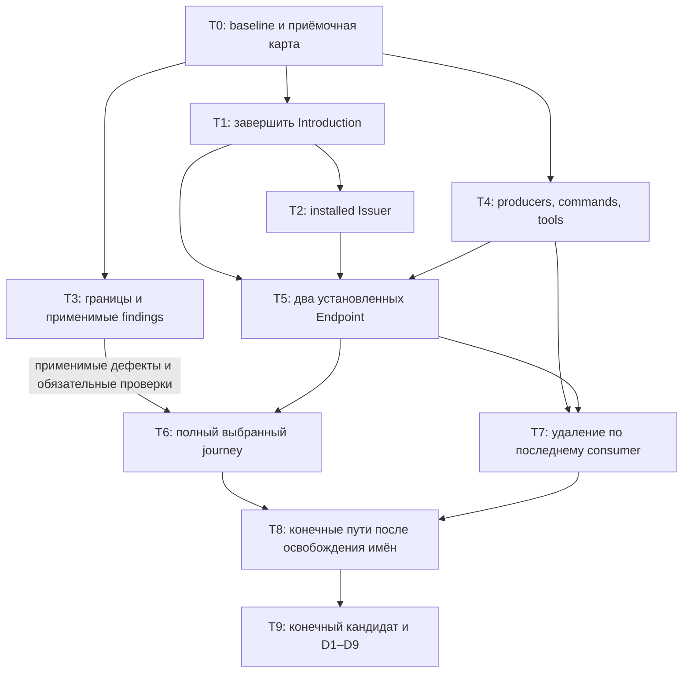

# План готовности successor и удаления legacy

Подготовлен **2026-11-15** по запросу Product Owner. Это конкретизация
[стратегии](completion-strategy.md), а не второй журнал исполнения. Номера T0–T9
обозначают части плана, не домены или будущие пакеты. Выбор работ, исполнитель,
статус и приёмка остаются в существующих GitHub issues. Подготовка этого документа
не запускает реализацию, обновление зависимостей, стенд или удаление файлов.

## Что считаем готовым

Конечный результат — выбранный закрытый Ubuntu text-Service на TCP/TLS:
поддерживаемая подготовка и установка инфраструктуры и двух Endpoint,
publish → Target Link → lookup → delivery → JOIN → Instance authentication →
текст Application → withdraw/stop; предусмотренные restart, forward replacement
и recovery сохраняют собственные ключи, расходы, результаты retry и floors
новой установки. Все сохраняемые операции используют новых владельцев или
явно сохранённые независимые механизмы. Заменённые реализации и их потребители
удалены; кандидат имеет проверяемые source/artifact/environment/evidence.

Обязательные границы:

- [ADR-0122](../adr/0122-select-tcp-only-closed-release.md): TCP/TLS positive,
  QUIC pre-effect refusal без fallback. Исследование QUIC не блокирует этот план
  и не считается решённым удалением старого Carrier.
- [ADR-0124](../adr/0124-start-new-installations-without-legacy-data-transfer.md):
  новые установки независимы; перенос predecessor history/keys/rights не нужен.
  Retained opening и recovery **новой** установки не могут перейти к initialization.
  Удаление кода не разрешает удалять пользовательские данные или remote `old`.
- [R01–R08](route-migration-contract.md): никаких old/new runtime bridges,
  callback/process adapters или общих live roots. Новые canonical consumers
  требуют своего точного разрешения; план не расширяет исключения R01.
- `ardents-next` сохраняется. Перенос пакетов не требует переименования бинарника
  или автоматического переноса всех команд в другие executable.

## Проверенная исходная точка

Проверены рабочее дерево на `codex/559-introduction-installed`, HEAD
`df625e7b562fe1f3a4a7629234a0a5acc85610e3`, текущие owners, исходники,
Makefile/профили и GitHub. Это снимок для планирования: в общей рабочей копии
продолжается #559. Native и полные gates здесь не воспроизводились; сообщения
о прогонах ниже — прочитанные receipts, не наши новые результаты.

Порядок опирается на [актуальное уточнение #497](https://github.com/dianabuilds/ardents-network/issues/497#issuecomment-6893892285),
а не его историческую формулировку удаления Next. Перед началом каждого среза
заново проверить source, последние комментарии, selection/WIP и нужный компонент.

| Основание | Что следует делать дальше |
|---|---|
| Source, Forwarding, JOIN и Descriptor приняты в ограниченных installed scopes; ссылки на receipts в [#497](https://github.com/dianabuilds/ardents-network/issues/497) | Не реализовывать роли заново; проверять применимость их evidence к изменяемому кандидату |
| [#559](https://github.com/dianabuilds/ardents-network/issues/559#issuecomment-6897727390): Stop доставлен; same-generation restart имеет native receipt, но на момент обзора ещё проходит завершение доставки. Текущий исполнитель готовит независимый slot-history inspector | Продолжить эту же задачу и существующего владельца. Наличие dirty/staged кода не означает принятие всей Introduction |
| [#561 E4](https://github.com/dianabuilds/ardents-network/issues/561#issuecomment-6891442373): funding/reader/publisher/participant/session уже выделены и интегрированы в dev | Остаток — установленная двух-Endpoint приёмка вместе с #391, не повторное выделение композиции |
| Issuer runtime и genuine Admission есть; installed Issuer остаётся [#560](https://github.com/dianabuilds/ardents-network/issues/560) | Довести доставку ресурсов, Startup и retained lifecycle, не писать Issuer заново |
| `execution-installed-pair-check` и `execution-installed-timing-check` уже существуют | Развить их недостающее покрытие. Контролируемые Route/Issuer/Store/Source fixtures не являются всей установленной инфраструктурой |
| Старые production/tool/test consumers ещё существуют | Удаление требует полной closure; расположение вне `successor` само по себе не признак legacy |

## Порядок и зависимости

Основная последовательность: **T0 → остаток T1 → T2 → T5 → T6 → T8 → T9**.
T3 и T4 поставляют необходимые компоненты до соответствующего installed positive;
T7 выполняется по готовым группам после их последнего потребителя, а не одним
массовым удалением в конце. T6 повторяется для затронутых сценариев на окончательном
артефакте после T7/T8. Это не цикл разработки: ранний прогон доказывает сценарий,
финальный — тот же сценарий на доставляемых байтах.

T1 → T2 — согласованный порядок одного исполнителя, а не источник полномочий
Issuer. Его технические prerequisites — готовые State/Forwarding/Node/Admission/
Hosting. Частичный producer/Interface из T4 передаётся с commit и evidence;
не требуется закрыть весь #563, чтобы начать зависимую роль. У T7 зависимость
от T5/T6 применима к группе, участвующей в этом сценарии; независимая группа
может уйти раньше при выполненном admission удаления ниже.

Не более двух явно выбранных implementation issues по проекту; одна research
question. Это предел, не требование загрузить оба слота. Зависимая цепочка #559
остаётся у текущего исполнителя в существующем checkout. Параллельно полезны
read-only inventory/review и подготовка требований; второй implementer допустим
только для отдельно выбранной независимой границы с отдельным владением.

## Задачи и условия приёмки

### T0. Зафиксировать вход и одну карту покрытия

**Владелец исполнения:** [#497](https://github.com/dianabuilds/ardents-network/issues/497),
со ссылками на действующие дочерние задачи. **Зависимость:** нет.

1. Сверить текущую ветку, индекс, чужую работу, активные jobs и принятые commits.
   Отделить component-ready, awaiting integration и полную приёмку.
2. Для сохраняемых команд и сценариев собрать одну карту в выбранной issue:
   `operation → producer → semantic owner → consumer → evidence/profile → gap`.
   Не заводить ещё один package/profile registry.
3. Разобрать противоречия старых issue bodies: TCP-only по ADR-0122, no old-data
   transfer по ADR-0124, Next сохраняется, #561 extraction уже выполнен.
4. Для каждого известного finding указать применимость к конечному пути:
   causal repair; доказанная неприменимость; закрытие вместе с последним consumer.
   Исходный FAIL сохраняется даже при последующем полном PASS.

**Выход:** у каждого обязательного сценария и оставшегося consumer есть конкретная
задача/владелец и oracle; нет задач «переписать весь домен» или «разобраться позже».
Подготовленный план не присваивает текущему чату реализацию #559.

### T1. Закончить установленную Introduction

**Ledger:** [#559](https://github.com/dianabuilds/ardents-network/issues/559).
**Prerequisites:** существующие принятые роли, genuine State/Admission/Hosting,
действующее точное R01-разрешение и отдельный применимый bootstrap receipt.

| Последовательная граница | Проверяемый результат |
|---|---|
| T1.1 Завершение текущего restart | Проверенный scoped commit/evidence; следующий Startup имеет новую invocation, но прежние root identities/keys/spend/slot floors. Нет принятия по одним нулевым manager fields или без predecessor retirement |
| T1.2 Настоящий Publisher/Source | REGISTER/refresh/SUBMIT/delivery/WITHDRAW через genuine retained owners; registration ACK, Store ACK и accepting Publication различены; replay/stale revision/full capacity/late delivery дают причинный отказ |
| T1.3 Stopped inspection и forward replacement | Независимый read-only slot-history owner с original lease и joined Close; отдельно доказанные program/resource transitions на завершённом predecessor. Не открывать рабочий Registry вместо инспектора и не считать exit достаточным domain join |
| T1.4 Safe-prefix recovery | Для каждого изменяемого write/sync/close/select/reload/start/stop/join — safe stopped continuation либо retained repair-required. Unknown completion, missing history и foreign inode не дают reset/adoption/replay ACK |
| T1.5 Приёмка роли | Полная конечная матрица #559, применимые native/race и полный gate на точном source; проверенная dev integration. Узкий adjacent-peer exchange не заменяет T1.2 |

Текущий исполнитель уже готовит T1.1/T1.3; это не поручение второму агенту.
Матрица должна следовать эффектам Introduction. Копирование всех Forwarding
сценариев без их применимости увеличит стоимость и не докажет эту роль.

### T2. Довести установленный Issuer

**Ledger:** [#560](https://github.com/dianabuilds/ardents-network/issues/560).
**Порядок:** после T1; техническая зависимость от принятых State/Forwarding/Node/
Admission/Hosting. До нового canonical consumer требуется точный R01/package
admission; существующие исключения других ролей его не предоставляют.

1. Public artifact/request/inventory и независимая проверка signed issuer-profile;
   purpose-specific key/result/quota custody без generic signer в Control.
2. Initial stopped generation, независимый history reader и preparation через
   владельца Admission. Разделить genuine fresh roots и retained inputs.
3. Protected root Start и independent non-root Startup до accepting listener;
   actual manager/executable/account/invocation/cgroup и joined completion.
4. Реальные bootstrap/paid issuance через Forwarding: finite allocation,
   exact retry после reconnect, exhaustion/conflict, wrong key/profile/epoch,
   expiry и отмена после irreversible effect.
5. Joined Stop, existing-only restart, forward program/resource replacement,
   независимый recovery разрешённых prefixes. Quota/results/keys не сбрасываются;
   поздний ответ не создаёт вторую выдачу или refund.

**Выход:** установленный binary с настоящими подписанными входами проходит positive,
causal refusal и persisted-effect matrix; normal/full/native/race gates и verified
dev. Существующий `node-issuer-check` — prerequisite runtime, не installed acceptance.
Недостающий installed Issuer profile зарегистрировать с реальным runner, discovery,
конечной матрицей и prerequisites в том же выбранном изменении.

### T3. Закрыть архитектурные риски без новой перестройки доменов

**Ledger:** применимые существующие quality issues и #497; не новый общий epic.
**Зависимость:** T0; изменения активной роли — после её стабильного результата
или внутри её текущего владельца. Для каждого пункта сначала проверить, не доставлен
ли он соседним quality-исполнителем.

| Работа | Основание и критерий завершения |
|---|---|
| Проверить междоменные эффекты | Для каждого изменяемого seam использовать [interface checklist](domain-map.md#interface-checklist-for-development-plans): exact authority до/после I/O, irreversible spend, original generation, handoff, partial failure, deny/interrupt/join/release. Нужны реальные consumers и causal controls обеих сторон; одних import gates недостаточно |
| Разобрать копии Installation | Подтверждены одинаковые кроме package `account_linux.go`, `principal_linux.go`, `initial_readback_linux.go` у Forwarding/JOIN/Descriptor/Introduction. Сначала один общий физический механизм либо обоснованная независимость и точный drift coverage; не объединять live owners/leases/journals/authority. Сверить [#567](https://github.com/dianabuilds/ardents-network/issues/567) и [#599](https://github.com/dianabuilds/ardents-network/issues/599), не дублировать их |
| Проверить session/funding seam | `endpoint/session.OpenPrefix` и `funding.PrepareSelectedPrefix` похожи, но владение selection/budget и Network witness различается. Это гипотеза для проверки эквивалентности, не доказанный дефект и не обязательное объединение |
| Закрыть root/fuzz coverage | Проверить actual privileged discovery foreign-owner case в `route/selection/root_hardening_linux_test.go` и mutation targets successor. Связать [#571](https://github.com/dianabuilds/ardents-network/issues/571) с реальной проверкой; seed execution не заменяет mutation campaign. Если покрытие отсутствует, добавить в подходящий существующий профиль без passing skip |
| Разобрать применимые findings | Например [#601](https://github.com/dianabuilds/ardents-network/issues/601) хранит подтверждённый прежний legacy Endpoint cleanup FAIL, хотя поздний #561 full gate прошёл. Нужна causal disposition, а не вывод о текущем падении всех gates. Для successor quality findings проверять actual source и принятые contracts |
| Согласовать factual maps | Убрать оставшиеся ссылки package-map на удалённые command-файлы и прежних consumers после #561; регистры должны описывать фактические imports/owners. Это документационный drift, не основание повторять runtime extraction |

**Выход:** нет непринятых consequential defects на выбранном пути; для намеренной
повторяемости ясна причина и контроль расхождений. Performance cleanup имеет
измеренную стоимость и причинный oracle. Семантические предложения из
[#588](https://github.com/dianabuilds/ardents-network/issues/588) не превращаются
в незаметное изменение проверок, времени, форматов или защиты.
Обязательны исправления применимых дефектов и конкретная disposition findings;
каждая возможность ускорения или сокращения кода не становится блокером выпуска.
Гипотеза дублирования и необязательная оптимизация выбираются отдельно и не
блокируют T6 без доказанного нарушения принятого контракта.

### T4. Замкнуть command/tool consumers и подготовку входов

**Ledger:** [#562](https://github.com/dianabuilds/ardents-network/issues/562),
[#563](https://github.com/dianabuilds/ardents-network/issues/563), применимые
[#558](https://github.com/dianabuilds/ardents-network/issues/558) и #391.
**Зависимость:** конкретный готовый Interface, не полное закрытие всех соседних issues.

| Порядок | Работа и приёмка |
|---|---|
| T4.1 Inventory | Перечислить dispatch/aliases/flags, процессы, artifacts, config/recovery callers, игнорируемые build-tag Go tools и shell/PowerShell. Каждая сохраняемая операция имеет новый owner/реальные inputs; каждая снимаемая — принятое retirement и effect boundary |
| T4.2 Producers до dependent positive | Build/inventory/enrollment/Release/permission/State inputs создаются поддерживаемыми командами. Реальные emitted bytes проходят независимый verifier; unknown/partial/substituted inputs отказываются до эффектов. Нет fixture keys или ручного редактирования внутренних JSON в operator journey |
| T4.3 Node/Control cutover | Сохранить уже готовые role-specific installed paths. Разобрать old `node --config`, issuer/hosting и Control inspection/profile operations по одной; прямые новые owner calls только при точном admission. Не вводить общий signer/runtime bridge |
| T4.4 Tool closure | Qualification, build/package/signing, process runners и diagnostics измеряют тот же новый candidate. Producer/verifier schema и required journals проверяются на реальном выводе; loss/staleness/unmeasured не становятся нулём или PASS |

Не переносить все работающие Next-команды в canonical binaries. Для старой
поддерживаемой операции сначала решить replacement или явное retirement;
сохранение имени бинарника не оправдывает скрытый старый backend. Если chosen
Endpoint adapter в `cmd/ardents` начнёт потреблять новый Route, сначала необходимо
его точное R01-разрешение. Уже работающий `ardents-next` этого не требует.

Существующие tooling findings #474/#475/#446/#445/#442/#383 оценить на конечных
producer/consumer и закрыть в их исходных задачах. Новый monitoring stack не
prerequisite. Финальное закрытие #563 следует за всеми сохраняемыми consumers;
частичные producers нужны раньше, внутри T1/T2/T5.

### T5. Закрыть установленный Endpoint journey

**Ledger:** [#391](https://github.com/dianabuilds/ardents-network/issues/391) и
оставшаяся приёмка [#561](https://github.com/dianabuilds/ardents-network/issues/561).
**Prerequisites:** готовые endpoint/funding/reader/publisher/session и
Installation/Execution/Publication/Connection; нужные subsets T4. Для полного
all-installed результата дополнительно T1/T2 и остальные принятые роли.

1. Одна текущая матрица требований обеих issues; общий exact-source receipt может
   закрывать совпадающие строки, но не разные условия среды/авторитетности.
2. Genuine distribution + independent initial pin + Release, отдельные roots/
   principals и два admitted system managers. Разрешённые профили — Ubuntu 22.04/
   systemd249 и Ubuntu 24.04/systemd255 amd64/cgroup-v2. #391 допускает Endpoint A
   на 22.04/249 и Endpoint B на 24.04/255; смешивать OS и несовместимую версию
   manager внутри одного host нельзя. Текущие pair/timing runners зарегистрированы
   для 24.04/255: при выборе второй разрешённой комбинации сначала согласовать
   её factual runner/registry. Допуск комбинации не доказывает её квалификацию.
   Приватные manager fixtures не превращаются в два установленных host.
3. Поддерживаемые provision/start/update/recover, permission и Service Instance;
   отдельный Reader без Publisher материалов; реальный text AAI3 и worker.
4. Publish/Link/read/refresh/withdraw, stable actionable refusals, cancellation,
   bounded open/recovery, оригинальные Job/Target/Instance и terminal outcome.
5. Restart и forward transition не создают новую authority или новый Service
   credential молча. Остаток [#369](https://github.com/dianabuilds/ardents-network/issues/369)
   получает поддерживаемый operator path либо честный принятый typed refusal.
6. Прерывания write/sync/fixed-copy/select/reload/start/stop/join проверяются по
   actual owner; original process/worker trees joined, unsafe/uncertain prefixes
   остаются repair-required. Один post-ACK cut не закрывает всю матрицу.

**Выход:** обе issue имеют покрытие всех применимых строк на final artifacts,
включая public commands, honest recovery/refusal и confinement. Наличие harness
или passing component test не закрывает установку и полный Service.

Конечная матрица T5/T6 — девять классов сценариев. Для каждого выбрать actual
selector/discovery, source-matched oracle и среду в существующем profile owner.
Не требуется декартово произведение всех parser faults и native ролей.

| Класс | Положительный результат и причинная проверка |
|---|---|
| Два Endpoint | Независимые provision/root/principal, Publisher Snapshot → Link → точный текст Reader → Withdraw → отказ Link; original процессы joined. Полный installed claim требует реальной установленной инфраструктуры |
| Публичные входы | Empty/reference/maximum workload из [контракта](../product/protected-service-workload.md); wrong Target, Name, invalid UTF-8, changing/special file, extra request и terminal escapes. Полную parser matrix оставить дешёвому owner test; installed boundary проверяет публичный результат и запрещённые эффекты |
| Authority и расход | Genuine permission/current State; exhaustion, duplicate spend, revoke/expiry/conflict отказывают без новой quota, Stock или ослабления защиты |
| Stop и restart | Штатное завершение; разрешённый retained restart сохраняет floors, неподдержанный даёт установленный отказ. Worker crash не повторяет remote Application request; отказ без нового Root completion не доказывает positive restart |
| Прерывание установки | Каждая actual durable/volatile transition имеет safe recovery либо repair-required, late result не получает новую generation. Существующий post-ACK Root cut проверяет лишь одну границу |
| Замена generation | Настоящие program/resource Release transitions, stale/rollback/cross-installation refusal; новые owners сохраняют собственные histories и допускают только выбранное продолжение |
| Refresh | Автоматическая новая revision/slot/key и второй read без смены исходной Publication; время/overlap/ACK-delay из owning contracts, без перестановки часов или ручной Refresh-команды |
| Worker и физический lifetime | Exact shipped worker, escape/FD/network/files/child-tree controls, cancellation/EOF/loss и joined cleanup. Использовать применимые `execution-tree-check`, `execution-escape-check`, `execution-recovery-check` |
| Результат и стоимость | Stable public outcomes, cold/warm, idle/failed refresh, overload и обязательные network conditions. Functional pair PASS не доказывает p95, cost или privacy |

Полная автоматизация P1–P11 одним target сейчас не установлена: `make qualification`
исполняет существующие portable Endpoint targets и не является агрегатом этой
матрицы. Для latency использовать уже принятые
[numeric parameters](privacy-qualification.md#numeric-design-parameters), включая
число cold/warm попыток, три seeds, nearest-rank метод и учёт non-success.
Для остальных экспериментов до выполнения фиксировать требуемые owner-методом
seed/schedule, наблюдения и stopping rule; лимиты не подменять более удобной выборкой.

### T6. Принять целый выбранный сценарий

**Ledger:** #391/#497 и владельцы protection/qualification; **вход:** T1/T2/T5,
необходимые T3/T4. Один кандидат объединяет все роли и конечные operator inputs.

Заполнить [P1–P11](privacy-qualification.md#acceptance-matrix) фактическими evidence:
content/Target/Instance; wire/flow; role observations; crypto/admission;
confinement/descendants; durable/volatile recovery; cost/latency; диагностическая
корреляция; new-installation refusal/transition; supply chain. Численные лимиты
и методы остаются у owning contracts, здесь не создаётся второй набор порогов.

Топология, Role Domains и effective Operator Families должны соответствовать
scope. Машины и ключи под одним controller не доказывают независимость. Если
нужные условия недоступны, сохранить полезное component/system evidence, но
полную приёмку оставить незавершённой; не проектировать вымышленную команду
операторов. P9 фиксирует признанное ограничение, не обещает количественную
анонимность. Все дополнительные public/load/platform claims остаются вне плана.

**Выход:** воспроизводимый результат выбранного journey, отрицательные контроли
и условия квалификации на exact candidate. Product Owner walkthrough подтверждает
понятный operator route; он не заменяет независимый security/usability review.

### T7. Удалять legacy группами после последнего consumer

**Ledger:** [#564](https://github.com/dianabuilds/ardents-network/issues/564),
[#558](https://github.com/dianabuilds/ardents-network/issues/558); Network closure
дополнительно [#493](https://github.com/dianabuilds/ardents-network/issues/493).
Пути ниже — кандидаты для проверки, не список разрешённого `rm`.

| Группа и относительный порядок | Что удерживает сейчас / условие удаления |
|---|---|
| Endpoint и старые Service lifetimes | `cmd/ardents`, `cmd/ardents-qualification` → `internal/endpoint/**`, затем старые `service/connection`, `service/instance` и endpoint-only helpers. Требуются T5 и соответствующий tool cutover; `cmd/ardents-custody/main_test.go` всё ещё использует старый Instance |
| Старые Node receiving/issuer owners | Сохраняемые old accepting paths в `cmd/ardents-node` → `internal/node/**`. Удалять после replacement/retirement всех их операций, T1/T2 и точного T4.3; готовые canonical installed files остаются |
| Control/Release/Enrollment provenance tools | `cmd/ardents-control`, `scripts/{sign-qualification-*,prepare-qualification-alpha-*,enrollment-artifact-name,protected-generation-check}.go` удерживают старые `internal/{network,enrollment,release,alphacontrol}`. Каждую retained ACA1/inspection обязанность перевести или явно снять; не восстанавливать уже retired Naming/ACA2 |
| Нижние общие старые owners | `internal/entry/**`, `internal/route/**`, `internal/admission/**`, `internal/hosting/**`, `internal/network/**` и оставшиеся старые Service dependencies — после последнего фактического consumer конкретного owner во всех применимых ветвях, включая тесты и квалификацию. В `stream-network-two-host/fixturecommand/qualification-network` есть old Entry consumer |
| Осиротевшие инструменты и регистрации | Удалить только exclusive old runners/fixtures/allowlist entries/dependencies; перенести уникальные byte/behavior oracles с новым владельцем. Exact registries, packaging и commands остаются согласованными |

`internal/application/{administration,connection,textdocument}`, `cmd/ardents-text`,
`internal/diagnostics`, stream/qualification tooling и public grammars не являются
legacy по расположению. `cmd/ardents-custody` уже использует новый Custody в
production. Сначала классифицировать каждый supporting mechanism по фактическому
назначению; старый `application/broker` имеет отдельную проверку потребителей.
То же относится к `internal/resource` и `internal/qualification`: их resource/
measurement обязанности сначала получают действующего владельца или принятое
retirement, затем удаляется оставшийся exclusive old код.
Canonical `tests/epochfixture/network` и действующие artifact lanes
`packaging/{alpha-bundle,ubuntu-deb,text-worker}` также нельзя убрать по имени.
Зависимость из `go.mod` удаляется только после последнего runtime/test/build/tool
consumer; quic-go в текущем модуле уже отсутствует, остальные библиотеки нельзя
считать legacy по их происхождению.

**Admission одного удаления:**

1. Каждая retained обязанность имеет проверенного нового consumer либо принятое
   retirement. Нужные positive/refusal/lifecycle/format oracles сохранены.
2. Нет оставшихся production/test/build-tag/platform/script/process/config/
   package/qualification/recovery callers. Проверены transitive closures и
   динамическое построение команд, не только прямой `rg`.
3. Доказаны применимые fresh-root/trust/refusal условия ADR-0124. Данные не
   удаляются; новые истории не reset. Findings получают causal correction
   либо source-matched removal/non-applicability, а не закрытие по имени файла.
4. Вместе с кодом обновлены exact package/ownership/profile/deadcode/build/docs
   регистрации. Запрет возврата старого backend остаётся проверяемым.
5. После удаления проходят required gates и затронутые реальные scenarios на
   новом source; scoped delivery проверена. Нельзя пропустить падающий old suite,
   объявив его legacy до выполнения пунктов 1–4.

#493 закрывается по своему inventory Network rules/callers и сценариям
current/pending/conflict/time/reopen/join, с genuine Admission/Hosting consumers.
Закрытие не ждёт косметического переезда пути и не следует автоматически из T7.

### T8. Завершить структуру пакетов

**Ledger:** [#565](https://github.com/dianabuilds/ardents-network/issues/565).
**Вход:** освобождены соответствующие старые paths; обязанности и consumers приняты.

После отдельного выбора задачи переносить cohesive owners из `internal/successor`
в окончательные `internal/<domain>` небольшими проверяемыми группами. Сохранить
Go import direction, wire/storage bytes, command behavior, error/lifetime semantics.
Не восстанавливать общий `service`-контейнер политик и не создавать будущие домены.
Migration guards заменить равносильными final-owner guards; обновить actual imports,
tags, maps, ownership и профильные селекторы одновременно. `ardents-next` остаётся.

**Выход:** одинаковые independent vectors и поведение, реальные retained consumers,
полные gates и новое artifact/evidence identity. Переезд не разрешает data rename
или использование receipt от другого бинарника без проверки применимости.

### T9. Зафиксировать конечную приёмку и доставку

**Ledger:** #497 и незакрытые критерии исходных issues. **Вход:** применимые T1–T8.

На окончательном source выполнить обязательные gates и затронутые installed/
combined проверки; собрать одну связь `requirement → owner → consumer → profile →
source/artifact → receipt → limitation`. Сверить все
[D1–D9](https://github.com/dianabuilds/ardents-network/issues/497#issuecomment-6293669361)
с последующими accepted amendments: полный inventory, один accepting path,
правильные boundaries, genuine producers, data disposition, доказанное поведение,
findings/gates, согласованные code/docs и verified delivery.

**Выход:** scoped commits, normal hooks, verified remote dev и точный final receipt;
нет незавершённой интеграции, потерянной чужой работы или скрытого legacy consumer.
Закрытие #497 не закрывает автоматически отдельные product/security claims.

## Проверки: минимальный достаточный слой и обязательные gates

Команды ниже уже существуют; точные selectors, окружение и актуальная inventory —
в [testing](testing.md), [profiles.json](../../tests/profiles/profiles.json), Makefile
и профильных README. Новая строка плана не создаёт passing profile.

| Когда | Проверки | Что они принимают |
|---|---|---|
| Каждая bounded code change | Focused owner + genuine consumer tests; causal refusal/fault, applicable race/reopen; `make quick-check` во время работы; `make route-check` при затронутой Route composition | Изменённая семантика и regressions соседей |
| Граница/consumer/удаление/переезд | `go test ./internal/architecture -count=1`; реальные Linux/Windows production/test/tagged closures; scan ignored tools/process invocations; `make deadcode` | Exact imports, ownership, profile membership, отсутствие stale exemptions; не доказательство отсутствия behavioral bridge |
| Принятые Source/Forwarding/JOIN/Descriptor | Затронутые `source-{preflight,stopped,startup,restart,replacement}-check`, `forwarding-installed-check`, `join-installed-check`, `descriptor-{initial-stopped,startup,publish,restart,store-inspection,forward-release,replacement,recovery-physical,recovery}-check` | Это группы отдельных Make targets, не одна команда. Выполнять нужные exact case selectors из registry; default одного запуска не закрывает весь recovery catalog. Source recovery входит в `source-replacement-check` |
| Introduction | `make introduction-initial-stopped-check`, `make introduction-hosting-check`, `make introduction-startup-check`, `make introduction-exchange-preparation-check`, `make introduction-exchange-check`, `make introduction-slot-inspection-check`; final #559 matrix | Только заявленные native effects/role boundaries. Slot-inspection target появился в активной работе #559; наличие не доказывает прохождения или installed authority. Отдельные restart/replacement/recovery targets пока не установлены |
| Issuer | `make node-issuer-check`, `make issuer-profile-check`, соответствующие Admission profiles; затем зарегистрированный installed lifecycle из T2 | Runtime/authority prerequisite отдельно от установленной роли |
| Endpoint integration | `make execution-installed-check`, `make execution-installed-pair-check`, `make execution-installed-timing-check` и полный accepted installed сценарий T5/T6 | Существующие harnesses и их limits; controller fixtures не подтверждают всю установленную систему |
| Каждый integration candidate | `make check`, normal hooks и applicable selected native/race/durable/installed profiles на точном source | Полный обязательный gate; PR affected selector не заменяет его |
| Конечный release candidate | `make headless-check`, exact artifact/package/signature/inventory checks, applicable installed/combined P1–P11 и source-matched supply-chain review | Доставляемые байты, выбранная среда и честно заявленный scope |

Обычные Linux gates запускаются non-root; root/native profiles — в отдельно
объявленной среде. Infrastructure installed profiles требуют свой Ubuntu24.04/
systemd255/x86-64/cgroup-v2/native-ext4 stand; допуск Endpoint22.04 не расширяет
допуск каждой инфраструктурной роли. Pair/timing имеют собственный original-manager,
namespace и pinned-artifact контракт в [README](../../tests/qualification/execution-installed/README.md).
Профиль требует свои реальные privilege, binaries, manager, platform и bootstrap
acceptance; отсутствие — invalid environment. Не запускать
дорогие проверки на ноутбуке параллельно активной работе; выбранный стенд и его
exclusive ownership проверяются перед каждым native job.

Чтобы стоимость оставалась управляемой: сначала дешёвый causal oracle, затем
затронутый consumer/race/native и полный gate перед интеграцией. Не повторять
неизменившийся узкий прогон без причины; изменение source, ошибка или новый риск
требуют повторной проверки затронутой evidence. Снимать cold/warm duration,
fixture/build/race cost и исходные failures. Оптимизировать измеренный hotspot,
не deadline, защиту, сериализацию общих ресурсов или обязательность full gate.

## Ближайшие действия без расширения scope

1. Текущему исполнителю #559 завершить доставку restart и продолжить genuine
   Publisher/Source, stopped inspector, replacement/recovery и final role acceptance.
2. Подготовить T0/T4 operation inventory и применимость quality findings чтением
   текущих owners и последних receipts; не вмешиваться в его runtime-файлы.
3. После принятой #559 и выбора следующей границы вести #560; затем T5/T4 и
   удаления T7 по закрытым consumers. Сроки оценивать по фактическим оставшимся
   acceptance rows и длительности gates, не по количеству пакетов или строк.

Этот документ не назначает новые задачи агентам и не изменяет GitHub. Код,
тестовые раннеры, профили, зависимости и существующая работа #559 здесь не меняются.
